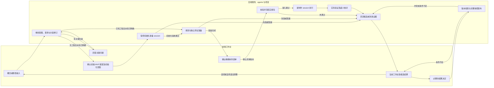

# 前后分离与澄清—制作—工作台回流评估

评估日期：2026-10-09。依据：当前重组仓库 `8269227`、原合并计划、实际 bridge/提交契约/语义适配器，以及已安装 Ptah 的规划与 BW 工作台说明。

方案修订：r4，纳入最终方案自检。以下新增状态、字段与接口均为待实现契约，不表示当前 bridge 已支持。

本文件是候选方向评估，不表示用户已经批准架构迁移或制作游戏。本轮不创建制作 session，不改原计划或执行状态。附件中的开发指令和技能说明作为参考材料。构建与后续审阅遵循用户规则：采用 Git 版本、原生身份和 diff，不恢复独立 SHA/MD5 校验。

部署假设：第一版采用独立 Web 前端和本机后端。职责分离可以先完成，远程部署单独评估。

## 判断

方向合理，适合成为下一阶段的产品主线。它把工作台从“对已有、已审工程提出精确修改”扩展为“从概念形成可运行 Demo，再持续修改工程”的入口。

前端表达意图、后端维护工程和执行证据，符合原计划的薄适配层原则。需求澄清也有现成的 GM 苏格拉底式访谈可借鉴。新增的主要工程范围是：无工程时的启动流程、澄清状态、版本化提案、多 session 调度、自动结果关联，以及源码到工作台的持续语义映射。

可行性应分开承诺：在一种受控 Godot 模板及明确可编辑能力范围内，可以建立完整闭环；目前没有证据支持“任意概念生成任意工程后，都能自动完整拆解并无损编辑”。回流能力决定了这个产品的实际适用范围。

## 两部分应怎样划分

| 部分 | 应承担的职责 | 持久状态与边界 |
|---|---|---|
| 前端工作台 | 概念与图片输入；澄清问题；提案比较与确认；对象、规则、资源编辑；草稿、diff、运行结果与预览 | 本机首版将未提交草稿持久保存到 IndexedDB，按 workspace、project、原快照版本及客户端草稿修订隔离；提交后的方案与作业从服务恢复。只使用项目 ID、对象 ID 和能力声明，不持有执行权限或主机路径控制权 |
| 后端服务 | 澄清协调；方案版本与决定；项目登记；制作 session 调度；工程访问；Git；Godot；验证；语义投影与结果回流 | 持久保存方案、作业、附件和结果关联。工程使用项目自己的 Git 基线。实际任务、角色和验收继续以所选框架的正式项目文档为准 |

后端内部可以区分规划、制作和验证角色；用户始终操作同一个工作台。每个项目有稳定身份，session ID 是一次执行的关联信息。工作台生命周期不应跟随制作 session 的结束而结束。

建议前端和服务具有独立构建入口、配置及版本化 API；工程放在后端管理的数据目录并各自使用 Git。可以先在同一仓库实施边界，是否拆成两个仓库属于维护选择，不影响职责分离。本轮不移动现有目录。

第一版前端独立打包，由本机服务加载配置好的静态资源目录，页面与 API 使用同一个 loopback origin。这样可以保留当前精确 Host/Origin 检查；前端的构建和源码仍与服务分离。若另加代理或采用不同端口，需要显式配置允许的 origin、代理来源和会话传递，并测试拒绝非法来源。改成跨域或远程部署还要处理身份、图片和工程传输、作业恢复及预览交付，不能只将 loopback 服务公开。

## 建议工作流

1. **概念输入。** 文字确定初始意图；图片要区分风格、布局、角色参考和准备直接用于运行时的素材。不能从参考图自动推定游戏规则，也不能把上传图片当作生成其他资产的授权。
2. **澄清与提案。** 后端维护结构化决定，生成一份可审阅的 MVP 提案。提案要写明核心玩法闭环、范围、占位素材、假设、排除项和验收方式。重大分歧提供有限选项及后果；普通实现细节使用可见默认值。
3. **准备、冻结与制作。** 新项目先由用户确认初始 MVP 提案及初始化范围，受控准备 session 仅创建最小 Godot 工程、Git 基线和约定的准备产物；初始化验收通过才进入项目内规划。已有工程直接进入准备阶段。规划及独立测试准备角色随后产出本轮规格、任务和必要测试基线候选，用户在同一工作台确认精确制作表单后，后端冻结实施任务包并创建制作 session。初始化或准备失败时返回证据并阻塞后续制作。准备阶段使用独立许可；实施包不得顺带修改规格或验证基线。制作 session 从任务包和工程状态恢复上下文。
4. **运行与验证。** 验证实际 Godot 工程，并把要求与断言、运行和报告对应起来。分别展示制作状态、运行验证状态和用户体验决定。失败或缺能力也应返回可理解的结果；不能据此更新为“已完成”。
5. **返回工作台。** 将源码版本、语义清单、可编辑能力、来源映射和当前运行证据作为一份关联结果返回。用户留在原工作台，查看变化并继续编辑。
6. **增量迭代。** 固定选项和自然语言都先形成候选变更。只对影响本轮范围、行为或验收的疑点追问；明确的小参数调整可以直接形成表单。确认后的修订再次进入制作流程。

初始 MVP 提案、初始化包和实施表单共享意图与版本关联，使用阶段各自的必填条件。初始提案描述最小可玩流程及准备范围；初始化包绑定模板、创建位置及精确输出；实施表单绑定实际工程、已准备规格和测试基线。后续表单描述相对已验证版本的增量。无需每次修改都重复整套初始访谈。

## “类 grill me”需要的机制

访谈方法与原 GM 相容，但单靠聊天记录不够。后端需要保存已确认需求、冲突、假设、默认值、延期决定和每次修订的影响。

建议停止澄清的条件是：本轮核心玩法或变更目标明确；影响 MVP 的关键冲突已解决；资源和技术限制有处理方案；可观察的验收条件已经写出。与本轮无关的问题进入后续清单。提问数量不能成为完成标准。

对修改做影响分类：参数和布局调整使用精确 diff；新增机制或设计变化先更新方案与规格；实现缺陷进入修复路线；测试问题交验证角色；缺能力显式阻塞。不要把每句自然语言都当成同等写入授权。

现有 `gm-gdd` 的前置条件包含 `project.godot`，所以概念阶段使用工程外的规划入口。用户确认初始提案后，才允许按独立初始化包建立工程并进入项目内 GM 规划。初始化批准只覆盖明确的准备产物，不包含后续玩法实现；精确规格和测试基线准备好后再确认实施表单。两次决定都在同一工作台完成，界面分别解释批准范围。

## 最大风险：如何拆解并返回

当前中立语义模型和视图可以复用，已经区分对象定义、场景实例、生成规则、来源、实现状态、可编辑性和验证状态。但 `extract-velvet.py` 明确是 Velvet 专用的已审规则提取器，包含源锚点及项目知识。

建议把语义映射变成制作契约的一部分：制作时同步维护稳定对象 ID、行为和参数定义、资源引用、源码位置、影响关系和测试关联；完成后独立检查这些声明是否与实际代码及运行行为一致。已有工程仍需要受控适配器。制作过程生成的清单本身不能证明准确。

工作台优先承诺模板支持的能力，例如特定规则参数、关卡数据和资源绑定。未映射功能保持只读，新增机制以提案进入规划。固定选项由后端返回的能力及参数范围驱动，避免界面允许工程尚不支持的操作。

一次有效回流至少包含：

- 项目、方案修订、任务包、作业、session、Git 源版本和正式 run 的对应关系；
- 语义清单版本、稳定 ID、来源映射、影响关系和编辑能力；
- 实际启动方式、截图或其他预览，以及逐要求验证证据；
- 已实现、失败、未验证和不支持部分；
- 相对工作台旧基线的变化及 ID 迁移信息。

回流时应比较“提交时基线、制作结果、当前草稿”。先保存原草稿并生成重关联预览，只有一对一且无语义变化的 ID 重关联可以自动建议；新值、删除、冲突和孤儿说明须显式展示。用户确认预览后才将草稿移到新基线，撤销可恢复原草稿。引用无法证明、客户端草稿版本变化或迁移不支持时保留旧草稿，进入人工处理。旧 session、取消作业及迟到结果不得覆盖新的修订。

对象 ID 在创建时登记，重命名、移动文件和无语义变化的重构保留 ID；删除、合并或拆分通过版本化迁移表表达，不能重新提取时随意重新编号。定义与实例使用不同身份空间。未编辑内容要通过无操作往返等价、未知字段保留和引用检查，映射覆盖写明纳入范围及未覆盖项。

IndexedDB 保障同一浏览器、同一 origin 的刷新和正常重启恢复。首版不承诺浏览器数据被清除后的恢复或跨设备未提交草稿同步。缓存不可用时显示持久化失败，并在离开或应用回流前提供草稿保存方式；不能显示为已经保存。

前后分离不会自动提供浏览器内可玩预览。本机首版可以由后端运行原生 Godot 并返回证据，提供明确的 Demo 启动入口；若要求直接在页面玩，还需单独定义 Web 导出或运行流传输的能力与验收。

## 制作表单与 session 交接

表单应是人能审阅的正式变更契约。用户可见部分建议包括：本轮目标、核心流程或变更项、影响对象、固定参数与自然语言的解释、必须保留的行为、资源选择、默认与延期决定、验收条件，以及需要确认的取舍。

后端执行层另绑定：方案修订、项目 ID、Git 基线、语义模型与适配器版本、精确目标、任务与角色、逐文件许可、报告要求及停止条件。这些执行边界由后端解析、验证并展示；不让前端任意设置 cwd、命令、权限或角色。

一份实施包至少使用以下字段组。初始化包另行绑定已批准提案、模板 Git 版本、后端分配的工程位置、初始化输出清单及准备验收要求；它不得以空 `baseCommit` 或缺失测试引用冒充合格实施包。任务包按阶段 schema 版本验证，冻结后内容不变；变更任何有执行意义的字段都生成新版本并重新审阅。

| 字段组 | 内容与冻结条件 |
|---|---|
| 身份 | `schemaVersion`、`packetId`、`projectId`、`proposalId`、`proposalRevision`、`operationKind`（初始 MVP 或增量） |
| 输入版本 | `baseCommit`、`specRef`、`testBaselineRef`、`catalogVersion`、`adapterVersion`、`resolverVersion`；新项目另带模板及初始化版本 |
| 修改意图 | 要求 ID、目标 ID、类型化 diff、自然语言的结构化解释、保留约束、资源引用、默认与延期决定 |
| 实施边界 | 新变更 task/tag、角色、精确文件及字段范围、执行能力、停止条件；已完成任务的旧备注不能充当本轮授权或通过证据 |
| 验收 | 要求→目标→任务→断言映射、正式 run/report 要求、预览方式、所需用户决定及确认记录引用 |

UI、语义投影和制作包使用后端同一个版本化 target resolver。缺目标、类型不合、规范漂移、角色不符、测试基线未准备或确认不匹配时，不允许冻结实施包。已有参数可以复用确实覆盖新请求的已审测试；新机制的测试由独立验证角色在准备阶段建立，不借用 `test_error` 扩权。

新 session 必须接收这份冻结任务包，不能只转发最终一句话或全部访谈记录。一个持久作业 ID 对应一份冻结包；断线后能恢复状态，投递不确定时先对账。保留原实现的幂等、互斥和冻结内容一致性。

建议每个制作作业使用绑定 Git 基线的隔离 worktree，同一项目只有一个活动工程写入者。生产代码、规划准备和测试准备的共享写入分别串行进行。工作台显示与制作隔离；当前用户 checkout 不因候选结果生成而被覆盖。创建新 session、模型完成回合和工程通过验证分别记录。

协调服务可以拥有概念、候选方案、决定和作业记录；批准的实现要求进入版本化规格及 PLAN/GAP。不要在数据库中再维护一套与正式 PLAN 竞争的任务通过状态。

## 身份、版本与最小服务契约

| 身份或版本 | 归属与语义 |
|---|---|
| `workspaceId` / `projectId` | 后端登记的长期身份；重新创建制作 session 不改变它们 |
| `proposalId` + `proposalRevision` | 后端保存的候选意图；回答澄清或改动候选产生新整数修订 |
| `draftRevision` | 前端草稿变更计数，只在对应浏览器草稿内有意义，不能与提案或工程版本比较大小 |
| `publicationRevision` | 服务当前完整快照的整数修订；用于竞争提交与发布时的版本比较 |
| `baseCommit` / `candidateCommit` | Git 的输入和候选源码身份，与前述整数修订分别绑定 |
| `packetId` / `jobId` / `attemptId` | 冻结包、持久作业及执行尝试；失败后的新尝试有独立执行、run 和报告关联 |
| `sessionId` / `runId` | 实际执行会话和正式验证身份，不能替代项目、作业或确认身份 |

服务侧 API 最少提供以下能力；它们属于拟议接口，不是当前 `/api/submit` 已有功能：

| 能力组 | 输入、输出和校验 |
|---|---|
| 概念与附件 | 接收文字及媒体；附件返回服务管理的 ID、类型、用途和版本引用。验证大小、可解码类型及缺失引用；文档/图中文字作为需求材料，不改变执行政策 |
| 澄清 | 读取问题、决定和候选；提交答案时带预期提案修订。过期答案返回冲突，不覆盖新决定 |
| 提案与冻结 | 展示后端解析后的完整提案/表单；保存精确版本确认并冻结任务包。实际内容或基线变化使旧预览失效 |
| 作业 | 创建、读取、取消及人工对账；后端分配执行 session 与工程。相同幂等键和内容返回原作业，键相同而内容不同返回冲突；投递不确定时不创建替代作业 |
| 工作台与产物 | 读取指定 PublishedSnapshot 或候选、能力清单、证据和重关联预览。产物通过受控 ID 读取，前端不能传入任意主机路径 |
| 结果决定 | 接收精确候选的接受/拒绝及合法反馈；校验修订、阶段、实际操作者会话和引用，返回可恢复的决定记录 |

首版可用状态轮询完成回流；断线后按持久 ID 查询。流式事件属于体验扩展，不作为闭环成立的前置要求。由单一契约源产生前后端类型与校验；遇到不支持的 schema、adapter 或 resolver 版本，保持只读并报告升级需求。

同一工作台可以在制作期间继续编辑草稿，但同一项目只允许一个活动或投递不确定的实施作业。已知失败的人工重试必须重新检查输入版本、确认及执行能力；原有效证据不得移植到新尝试。停止状态尚不确定时不能释放互斥。

## 执行、确认与发布规则

新工作流的目标确认入口是前端。正式启用前，需要实现并审阅新的 `interactive_frontend` 确认契约：服务侧关联操作者会话、阶段、展示内容及精确修订，记录明确操作并校验来源。客户端不能自行写入 `actor=human`，也不能将前端事件伪装成旧 `local_interactive` TTY 事件。规格批准、运行体验验收和反馈解决独立绑定各自版本；有效的同版本决定可复用。

原 GM 消费端必须能验证这种新来源，之后新工作流才可以在前端完成全部必要决定。迁移未完成时，新路线显示阻塞原因；现有 TTY 路线按原契约继续工作。该迁移属于第一阶段的前置能力。

| 作业状态 | 转移条件与结果 |
|---|---|
| `QUEUED` | 已保存冻结任务包、有效确认和幂等键，等待工程写入租约 |
| `DISPATCHING` | 取得租约并登记执行尝试，再请求新制作 session；仅登记 thread ID 不代表已执行 |
| `RUNNING` | 有实际执行关联及技能、角色证据，按冻结包制作 |
| `VERIFYING` / `PROJECTING` | 冻结候选 Git 版本，执行正式验证，再核对语义映射；映射不合格不能发布新工作台版本 |
| `READY_FOR_REVIEW` | 验证与映射证据齐全，候选供工作台审阅，尚未替换当前有效版本 |
| `PUBLISHED` | 满足当轮必要决定，通过版本比较后发布完整结果引用 |
| `REJECTED` | 用户拒绝该候选，保留证据与原有效版本；后续修改形成新提案，不自动发布或重做 |
| `FAILED` / `BLOCKED` | 返回失败或缺能力证据，保留上一个有效版本及用户草稿；不能显示为通过 |
| `UNCERTAIN` | 无法证明投递、执行或退出状态，保留互斥并对账，不自动重发或新建替代 session |
| `CANCEL_REQUESTED` / `CANCELLING` / `CANCELLED` | 请求取消后等待 agent、Godot 及子进程确认停止，才释放写入租约；迟到结果保留为过期候选 |

每个阶段设置可配置超时及退出清理；超时不能直接算作安全停止。租约带单调递增的执行代次，旧代次无权发布。工作台刷新通过持久作业记录恢复状态，浏览器连接断开不等同于作业取消。

发布单位为不可变 `PublishedSnapshot`，关联候选 Git commit、catalog、adapter/resolver、能力清单、正式运行证据和确认记录。验证期间候选内容变化时证据失效。发布前检查预期旧版本、外部源漂移、任务包、执行代次及必要确认，用服务事务一次切换整个快照引用。数据库指针只是 Git 内容和正式报告的导航入口，不重新定义任务验收真相。

Git 与文件产物在切换前准备完毕，不宣称文件系统和数据库有共同事务。进程在切换前崩溃时保留旧引用；切换后重启可从新引用恢复。生成结果、运行通过、用户接受和当前版本发布分别记录。回流只读预览可以先显示候选，但不能把部分更新的源码、旧 catalog 和新 PASS 报告拼成当前版本。用户接受后若版本检查失败，保留决定但阻塞发布；变更后的候选需要重新验收。

## 与源计划的出入

| 维度 | 原计划和当前实现 | 拟议方向 | 评价 |
|---|---|---|---|
| 产品入口 | 已有真实工程及已审语义快照 | 无工程时输入文字或图片，形成 MVP | 显著扩展范围，需要外层规划与工程初始化 |
| 前后边界 | 实际 GM 工程内的薄 workbench 适配层；loopback bridge | 独立前端，后端管理 agents 与工程 | 职责相容，打包和部署约束需要更新 |
| 澄清 | GM 已有初始和当前 tag 的苏格拉底式访谈；前端主要编辑/提交 | 访谈成为工作台内的常规交互 | 复用方法，新增接口、结构化决定和停止条件 |
| session | 绑定已有、同 cwd、空闲 thread；SQLite store 绑定一个 thread | 从方案调度新的制作 session，并持续回流 | 明确改变原约束；需项目登记、作业状态、session 交接和恢复机制 |
| 提交 | 已实现类型化 diff、精确目标和不可变提交预览 | 初始 MVP 提案和每轮正式制作表单 | 可以复用冻结机制，扩展契约；保留精确范围 |
| 工程权威 | PLAN/GAP、规格、角色和原验证流程权威；SQLite 只记传递 | 增加候选方案和协调状态 | 可相容，需按领域划定权威并将批准意图落实到项目文档 |
| 回流 | Velvet 专用提取器；停 bridge 后人工导入结果；逐目标验证仍 BLOCKED | 自动验证、拆解并返回当前工作台 | 主要新增工作；需生成时映射、正式证据关联和草稿冲突处理 |
| 人工决定 | 按阶段要求真实本地 TTY 确认 | 用户集中在前端作决定 | 新路线以确认来源契约迁移为前置；现有按钮不能替代 TTY 证明 |
| 首轮验证 | 先一个已有小参数真实闭环，再做 transition | 先初始 MVP，再进入编辑迭代 | 可保留小参数闭环作为调度/回流技术探针，之后进入概念创建路线 |
| 项目通用性 | 只覆盖已审 Velvet；不承诺任意项目 | 可能支持多种概念和工程 | 先限定模板和能力，再逐个扩展适配器及验收 |

前端集中确认与源计划存在明确契约差异，需要按上述规则迁移；本次自检没有直接修改旧 GM 的确认工具或角色许可。

## 可复用程度与当前缺口

| 能力 | 当前证据 | 后续工作量判断 |
|---|---|---|
| 前端语义编辑与冻结 diff | 已有模型、视图和提交契约 | 中；主要新增概念、访谈和方案页 |
| 苏格拉底式规划 | 源 GM 已有流程 | 中；需要面向前端的决定状态和问题协议 |
| 独立前端与本机服务 | 已有 loopback HTTP bridge | 中；拆静态托管/服务边界并版本化接口 |
| 自动制作 session 调度 | 当前仅 `thread/resume` + `turn/start`，没有创建或多 session 作业管理 | 中到高；具体执行通道还需真实闭环验证 |
| 正式验证与结果关联 | 引擎已安装、Git 迁移完成；尚未建立真实模型→GM→Godot 提交链 | 高；首先补映射、正式运行及逐目标断言关联 |
| 自动语义回流 | 模型可复用，提取器项目专用，结果导入人工执行 | 高；这是优先验证的架构风险 |
| 任意工程自动完整拆解 | 没有实现或验收证据 | 首版不承诺，按支持范围扩展 |

已安装 Ptah 的 BW 工作台说明也提供了候选设计、整数 revision、CAS 冲突保留、MVP job 和结果查询的相近范式，可作为设计参考。但其文档仍要求用户回 Codex 请求执行作业；登记 queued 作业不等于自动建新 session 或运行 Godot。它的设计数据库权威与原 GM 交接的 PLAN/GAP 权威也不同，不能直接将两套状态混合后声称闭环已经存在。

当前环境记录已经解决 Godot 安装和 Git 基线迁移。仍需审阅 HUD/title 两处源差异、补真实 target mapping、准备测试依赖，并建立正式执行与浏览器验收。旧 `DEVELOPMENT-ASSESSMENT.zh-CN.md` 中关于未安装 Godot、无 Git 以及待替换 SHA 的判断是迁移前历史；当前状态以 `LOCAL-SETUP-GIT.zh-CN.md` 为准。

## 建议实施顺序和证明条件

0. **执行与确认通道验证。** 明确当前支持的新 session 创建及执行通道，证明显式技能和真实角色执行，并完成前端确认契约迁移。准备 target resolver、独立测试准备流程与发布版本规则。能力尚不支持时明确阻塞，不以 queued 作业、可见 toolOutput 或模型声称成功替代。
1. **现有工程的完整迭代闭环。** 对一个已有参数，建立“工作台选择或文字修改→必要澄清→冻结表单→独立制作 session→真实运行与断言→回流”。完成现有基线差异审阅和映射，建立新的变更任务。证明断线、取消与迟到结果可处理，没有扩权，运行能关联本轮要求，以及制作期间产生的新草稿没有丢失。
2. **一种模板的概念到 MVP。** 加入文字/图片输入和初始提案。限定一种 Godot 模板及可编辑参数，制作时维护语义映射。证明一条完整可玩流程、失败/重试路径，并能在原工作台完成第二轮修改和再次验证。
3. **提高覆盖与部署能力。** 在前两步有真实证据后，扩充模板、资源类型、语义对象和远程部署。每次新增能力都声明映射分母、支持范围及实际验收。

第一阶段保留源计划最有价值的验证次序，同时直接验证新产品的多 session 和回流链路。无需先完成 transition 等玩法功能，也不建议在尚未证明回流时全面重写框架。

| 阶段 | 正向通过条件 | 必测拒绝或恢复条件 |
|---|---|---|
| 0：执行与确认能力 | 新 session 从冻结包恢复正确项目与权限；有实际技能/角色/源变更证据；合法前端决定由 GM 消费端验证 | 错项目、旧规格、伪造确认、缺执行能力被拒绝；模型回合完成或仅有 toolOutput 不得算通过 |
| 1：已有参数闭环 | 一个新变更任务有当前要求→目标→断言→正式 run 证据，生成一致快照并返回原工作台；完成真实浏览器操作验收 | 双击/重复请求只有一个作业；外部源漂移阻塞；断线恢复；取消无第二写入者；迟到结果不覆盖；制作期间新草稿可恢复并审阅重关联 |
| 2：概念到 MVP | 初始提案→受控初始化→精确制作表单的版本关系明确；一种模板完成开始、核心操作、成功/失败和重试；支持范围内的对象可编辑；第二轮修改有新运行证据 | 无工程时不调用项目内 GM 阶段；初始化批准不授予玩法实现；图片缺失、含糊规则、不支持能力如实处理；占位素材明确展示；验证或映射失败保留上个有效版本；用户拒绝候选不触发发布 |
| 3：扩展能力 | 每个新增模板/部署目标有独立能力、映射覆盖和端到端证据 | 不复用不匹配模板、资源、运行或确认版本的证据，不把本机成功当远程通过 |

上述均为后续验收要求，本轮只做方案层面的反例走查，没有实际执行这些场景。

本次没有实施、运行游戏或重新执行测试；因此上述可行性是架构与代码评估，没有将未运行能力记为 PASS。作为评估请求，未创建或更新 `ptah_log.json`，未修改项目执行状态。

## 主要依据

- [原合并计划：边界、同线程路线与源码回流](/Users/typ/Desktop/godot_project/ptah-gm/local-codex-handoff-20261008-compact/docs/MERGE-PLAN.zh-CN.md:5)
- [原剩余工作：真实映射、最小闭环及人工门](/Users/typ/Desktop/godot_project/ptah-gm/local-codex-handoff-20261008-compact/docs/REMAINING-WORK.zh-CN.md:5)
- [bridge：单 thread store、恢复与投递](/Users/typ/Desktop/godot_project/ptah-gm/local-codex-handoff-20261008-compact/frontend/bridge/server.py:14)
- [bridge：API、Velvet 固定标识及人工结果导入](/Users/typ/Desktop/godot_project/ptah-gm/local-codex-handoff-20261008-compact/frontend/bridge/server.py:156)
- [提交契约：精确目标、净 diff 与冻结载荷](/Users/typ/Desktop/godot_project/ptah-gm/local-codex-handoff-20261008-compact/frontend/src/submission-contract.js:22)
- [执行契约：角色、验证与人类确认](/Users/typ/Desktop/godot_project/ptah-gm/local-codex-handoff-20261008-compact/frontend/bridge/gm_contract.py:436)
- [中立语义模型：层次、来源、无损与适配器边界](/Users/typ/Desktop/godot_project/ptah-gm/local-codex-handoff-20261008-compact/frontend/docs/SEMANTIC-OBJECT-METHOD.md:6)
- [Velvet 专用提取器](/Users/typ/Desktop/godot_project/ptah-gm/local-codex-handoff-20261008-compact/frontend/tools/extract-velvet.py:1)
- [源 GM 的初始/增量访谈及工程前置条件](/Users/typ/Desktop/godot_project/ptah-gm/local-codex-handoff-20261008-compact/sources/GodotMaker-non-pk/skills/core/gm-gdd/SKILL.md:31)
- [当前环境与 Git 迁移记录](/Users/typ/Desktop/godot_project/ptah-gm/local-codex-handoff-20261008-compact/LOCAL-SETUP-GIT.zh-CN.md)
- [Ptah BW 参考：设计、CAS、MVP 作业及人工执行边界](/Users/typ/.codex/plugins/cache/personal/ptah-plugin/0.1.0+codex.20260907151319/skills/ptah/references/bw-workbench.md)
