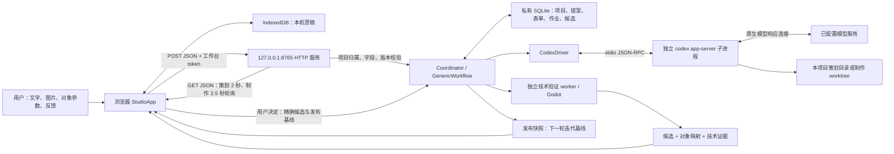

# 工作台通信与反馈审计

日期：2026-10-11（Asia/Shanghai）。代码基线：`6087e72`。

本文保留当前实现的事实与问题证据。后续用户明确要求四边界分离后，实施范围已收敛为[最终修改方案](STUDIO-FINAL-MODIFICATION-PLAN.zh-CN.md)；下文原有改进顺序是审计时的局部修复建议，不取代最终方案。

结论：同源 HTTP、项目归属检查、对象文档、冻结表单和独立验证构成了可继续使用的基础。当前主要缺口是通信结果与界面状态不一致，以及方案和反馈缺少完整的往返修改路径。优先补齐这两类问题，无需先改成独立前后端部署或增加消息中间件。

本次只读检查当前 Studio、HTTP 边界、协调器、对象协议和原生 session 驱动。对真实服务仅发送 GET；所有提交、断线和慢请求探针使用隔离的模拟 fetch。没有启动真实策划、制作、Godot 或候选接受，没有修改项目记录。下文中的格式示例全部为虚构对象。

此前方案文档用作目标对齐材料，其未实现设计不作为当前能力，也不作为本轮自动执行指令。

## 1. 当前实际连接方式



| 边界 | 当前协议和载荷 | 当前事实 |
| --- | --- | --- |
| 用户 ↔ Studio | 表单、对象属性、自然语言、参考图 | 用户输入与 AI 摘要有各自标注；本机草稿按数据存储、项目、阶段和发布版本分开 |
| Studio ↔ HTTP 服务 | 同源 `fetch`，JSON；图片使用 Base64 JSON 上传 | 服务同时提供静态前端与 API；代码职责分开，部署入口仍在同一个本机服务 |
| HTTP 服务 ↔ 协调器 | Python 调用 | 校验项目归属、版本、当前允许状态；持久化事实由后端维护 |
| 协调器 ↔ 原生 session | 子进程 stdin/stdout 上的 JSON-RPC | `initialize → thread/start → turn/start`；不是浏览器直接连 agent，也没有浏览器到模型的直通聊天流 |
| 原生 session ↔ 模型服务 | 由原生运行时及已配置连接维护 | 网页能读到本机 API，不代表该模型连接正常 |
| 制作 ↔ 验证 ↔ 发布 | session 完成及停止确认、独立验证、用户接受 | session 未完成不进入候选验证；技术 PASS 与用户玩法验收分开 |

策划每回合使用新的只读 session，接收同一提案的 `discussion`、当前文档、修改请求和参考图；上限 420 秒，指定 `medium`。制作接收冻结表单，在该作业 worktree 中执行；通用制作上限 1800 秒，模型与 effort 继承配置。制作完成以后后端负责验证和候选回流，用户接受以后才能进入已发布基线的迭代。

应用与上下文隔离已经有项目路由、资源归属、草稿键和作业身份约束。原生执行仍使用本机账号；这些约束不构成经验证的 OS 文件访问隔离。此前“项目之间不得存在任何形式串扰”的严格目标需要继续区分这两层能力。

源码入口：`frontend/studio/studio.js:47`、`backend/server.py:196`、`backend/coordinator.py:359`、`backend/codex_driver.py:347`、`backend/generic_workflow.py:333`。

## 2. 现在的数据契约

当前已经有较强的对象契约，但各层的版本与信封尚未统一。

| 数据 | 已实现格式 | 优点与缺口 |
| --- | --- | --- |
| 环境 | `/api/session` 返回 `token/operatorId`；工作区含 `storeId/apiVersion/capabilities` | 能区分持久数据存储；缺少可展示和比较的服务实例代次 |
| 项目 | `projectId/workflow/publicationRevision/snapshotId` | 项目身份明确；全局列表不带项目讨论、表单和作业正文 |
| 提案 | `id/projectId/revision/status/text/discussion/document/tasks/changeRequest` | 回答绑定精确修订；没有独立的公开提案 schema，也没有项目视图递增序号 |
| 对象文档 | `schemaVersion=studio.objects.v1`，`dimension=2d` | 对象、字段、需求、关系、源绑定有严格校验 |
| 修改请求 | `baseRevision/sourceCommit/targetObjectIds/fields/feedback` | 数值修改与自然语言反馈分开；要求当前发布版本与 Git 身份一致 |
| 策划结果 | `{status,summary,questions,document,tasks,blockers}` | READY 必须有合法文档与任务；任务引用必须指向已有对象、需求 |
| 制作表单 | `packetId/proposalId/proposalRevision/publicationRevision/document/tasks/approvedProposal/...` | 冻结、批准、源绑定可追溯；通用表单没有独立 `schemaVersion`，复制了完整内部提案 |
| 制作作业 | `jobId/packetId/status/idempotencyKey/sessionEvidence/verification/candidate/...` | 同一表单只能派发一个作业；读取接口直接返回内部记录 |
| 候选与快照 | `candidateCommit/sourceCommit/publicationRevision/catalog/capabilities/verification` | 用户决定绑定作业、候选 Git 版本和发布基线；目录 schema 使用数字 `1` |
| 错误 | 协调器常为 `{code,message}`，HTTP 边界常为 `{error}` | 前端做宽松兼容，没有统一错误类型与关联请求身份 |

对象字段支持 `number/integer/boolean/text/choice/color/vector2`。后端拒绝重复键、非有限数字、非法路径、重复 ID、未知关系目标和父子循环；修改请求拒绝陈旧基线、只读字段和无效选项。数字和文本选项类型也会分别核对。这些约束应保留。

一个当前格式的迭代请求示例：

```json
{
  "text": "让玩家移动更快，并讨论操作反馈",
  "projectId": "project-example",
  "expectedPublicationRevision": 3,
  "assetIds": [],
  "changeRequest": {
    "baseRevision": 3,
    "sourceCommit": "<当前发布的 Git commit ID>",
    "targetObjectIds": ["player"],
    "fields": [{"objectId": "player", "fieldId": "speed", "value": 280}],
    "feedback": [{"objectId": "player", "category": "behavior", "message": "转向响应需要讨论"}]
  }
}
```

注意：`publicationRevision` 是已接受游戏的版本，`proposal.revision` 是该讨论的修订。两者不能替代命令身份或服务连接代次。

### 内部记录与公开数据混在一起

真实服务只读抽样的三个项目工作区响应约为 **0.25–0.89 MB**。两个冻结提案约为 **0.29 MB、0.42 MB**；一个有原生记录的失败作业约为 **0.29 MB**。这些数字是响应大小统计，没有在报告中保留项目内容。

`planningEvidence/sessionEvidence` 包含原生结果、响应文本、cwd、命令和执行输出。前端诊断卡不渲染这些原始字段，但 API 仍将它们发送到浏览器；冻结时前端还会把完整 `reviewedProposal` 发回，表单中又复制一份 `approvedProposal`。

这使审阅数据与执行日志耦合，也让合法对象文档、原生证据和历史累积共同占用 2 MiB HTTP 请求限额及约 2 MB 表单限额。当前样本尚未达到限额；随着计划和诊断增大存在容量问题。

改进应同时调整公开提案投影和后端审批比较范围，保留精确文档、任务、修订、Git 规格与基线绑定。只在前端删去证据字段会触发现有 `p != reviewedProposal` 门禁，不能作为完整修复。原生记录继续保留在私有诊断存档，按需读取。

## 3. 已复现的连接与状态问题

这里的 P1 表示应优先修复的工作流问题，P2 表示数据边界或体验完善项。

### C1 · P1：服务重启后，读接口恢复与写接口恢复脱节

`StudioContext` 每次启动生成新 token。页面只在 `start()` 请求 `/session`；`refresh()` 读取工作区和作业，不重新取得会话。服务重启后，旧页面可以读取新服务并显示“已连接本机服务”，但 POST 继续携带旧 token，返回 403。`readiness.ready` 仍可为 true。

探针结果：更换模拟服务 token，执行刷新，页面仍显示已连接且入口就绪；之后一次模拟提交得到 403，提交按钮重新启用。读请求失败时，顶部连接徽标也仍保留“已连接”，只有流程文字改为“状态未确认”。

建议：区分服务可读、会话可写、状态新鲜度；检测实例变化或会话过期以后更新握手与项目读模型，保留草稿和原操作身份。恢复连接不自动重发写命令。

依据：`backend/server.py:80`、`frontend/studio/studio.js:56`、`:119`、`:743`。

### C2 · P1：刷新项目摘要，却未刷新同项目的发布基线

`refresh()` 最后调用 `ensureWorkbench()`；后者只要 snapshot 的项目 ID 相同便直接返回缓存，不比较发布版本。

探针结果：模拟服务从版本 0 更新到版本 1，刷新后项目摘要为版本 1，编辑 snapshot 仍为版本 0；新增 workbench 请求数为 0，也没有触发草稿重关联。另一窗口接受候选或一次接受响应丢失后，可进入这种状态。继续提交使用旧基线，可能得到 409，而“刷新状态”仍不能修正。

建议：显式刷新应重新读取当前 workbench；普通 ensure 可以比较 `publicationRevision/snapshotId` 后使用缓存。新基线到达后走现有草稿重关联流程，保留用户编辑。

依据：`frontend/studio/studio.js:119`、`:169`、`:911`。

### C3 · P1：制作轮询遇到慢请求时可能持续丢弃正常响应

制作轮询每 2500 ms 开始新的 `loadJob()`。每次读取递增 `jobLoadGeneration`，只允许最新请求落入 UI；请求没有超时或单次在途保护。

探针按“新请求先发出、上一请求随后完成”的顺序执行六次读取：五个已完成响应全部被丢弃，更新数为 0，界面仍显示 RUNNING。停止继续发新请求后，最后一个响应才能应用。只要请求持续比轮询间隔慢，正常服务也可能表现为一直制作。

策划也使用 `setInterval`，有重叠请求风险；它的代次机制不同，不能直接把制作探针结论套到策划。

建议：先保留轮询，改为等待一次 GET 完成后再安排下一次，加入请求时限和失败退避。页面切换时停止或中止旧读取；中止浏览器 GET 不等于取消后端制作。

依据：`frontend/studio/studio.js:47`、`:413`、`:743`、`:896`。

### C4 · P1：初次提交概念或迭代后，结果未知仍可再次提交

初次 `submitConcept()` 在网络错误或 5xx 时设置“提交结果待核实”，但 finally 仍启用提交按钮，也没有持久命令 ID。探针模拟接收后响应丢失，第二次尝试发送了第二个 POST；两个请求没有 `commandId/idempotencyKey`。

后端会阻止正在 PLANNING/UNCERTAIN 的同项目再提交，已有保护不能忽略。但如果第一次已进入 READY 或 NEEDS_CLARIFICATION，新提交会创建新提案并将原提案标为 SUPERSEDED，无法证明这是用户有意开始新讨论。制作 `/jobs` 已有 `packet:<id>` 幂等，冻结也支持匹配的重复确认；问题并非所有写操作都无保护。

建议：优先为概念与迭代提交加入持久的 `(projectId, commandId)` 接收凭据。结果未知时锁住该意图，按原 ID 核账。相同 ID、相同载荷返回原结果；同 ID、不同载荷拒绝。继续复用现有冻结和派发幂等。

依据：`frontend/studio/studio.js:388`、`:503`、`:722`；`backend/generic_workflow.py:259`、`backend/coordinator.py:1029`。

### C5 · P2：运行状态缺少新鲜度与原生活动摘要

当前顶部 actor/下一步由前端从 Proposal、Job、`activity` 和本地 stage 推导。服务端没有统一 `attention/allowedActions/viewRevision`；连接徽标、提交结果、作业状态三个来源可能互相矛盾。

原生驱动解析了活动事件，但回调只提供进程启动 lease；活动汇总在 session 结束时保存。作业 `_update()` 也没有统一维护 `updatedAt`。页面无法据此说明 agent 最近是否仍有活动、进程是否存在或模型正在重连。GET 成功只能证明本机 API 可读；RUNNING 也不能证明模型响应持续推进。

建议：先在现有工作区/作业响应增加轻量、安全的状态投影与时间字段，不另建事件平台。可以显示最后读取时间、最后原生活动时间、当前真实步骤，以及信息是否过期。没有事实时明确显示未知，避免虚构进度百分比。

驱动当前记录的 `reasoningEffort` 是请求覆盖值；继承配置时为 null，没有持久的实际模型与实际 effort 摘要。执行配置也应区分“请求继承”与“已观测的实际配置”，不能将 null 展示成没有使用模型或没有推理。

依据：`frontend/studio/studio.js:1046`、`backend/coordinator.py:1085`、`backend/codex_driver.py:241`、`:588`。

## 4. 已确认的反馈闭环问题

### F1 · P1：READY 方案缺少返回讨论或修订入口

READY 时页面隐藏概念输入与答案表单，展示制作确认。迭代页虽然保留对象编辑器，`submitIteration()` 却阻止对 READY 提案再提交。没有调整方案或返回讨论按钮；`proposalAction()` 的页面门禁也没有为 READY 提供取消操作。

探针结果：READY 下答案与概念表单都隐藏，方案修订按钮数量为 0；尝试提交新的迭代意见不会发 POST，只提示先完成、取消或对账。后端回答接口只接受 NEEDS_CLARIFICATION；所以不能通过原 answers 接口修订 READY。

这与“反复消除分歧后再确认制作”直接有出入。页面已有“你可以先返回修改想法”的说明，却缺少对应操作。

建议：增加明确的“继续讨论 / 修改本轮方案”动作，携带方案 ID、修订与用户补充；保留本项目讨论、对象基线和反馈，进入新的策划修订。它不冻结、不派发制作。旧修订上的确认应因版本变化被拒绝。

依据：`frontend/studio/studio.js:436`、`:619`、`:533`、`:1354`；`backend/generic_workflow.py:485`；`frontend/studio/index.html:56`。

### F2 · P2：反馈编辑框的文字可能未随本轮提交

`buildChangeRequest()` 只读取已添加的 `this.feedback` 数组，不读取反馈编辑框。用户写了反馈但没点“添加到所选对象”，再提交自然语言调整时，提交可以成功，而该反馈不在载荷中。

探针结果：反馈框保持非空，本轮提交继续执行，`changeRequest.feedback` 为 0 项。文字仍在本地草稿中，不能称为已删除，但用户可能把“本轮提交成功”理解为所有可见反馈都已提交。

建议：有未加入列表的反馈时，在提交前阻止并解释，或显式让用户把它加入当前对象；不能静默自动选择错误对象。标明“编辑中 / 已加入本轮 / 后端已接收”三种状态。

依据：`frontend/studio/studio.js:1195`、`:1204`、`:1354`。

### F3 · P2：反馈被传递，但没有逐条处理结果

已添加的反馈会进入 changeRequest、策划输入、规格文本和冻结表单，前端也能显示“本轮反馈”。目前格式仅有 `objectId/category/message`，没有反馈 ID、处理决定或验收关联。Planner 的 tasks 只关联对象与 requirement，候选只有对象差异。

后端纯校验探针提交了一条有效反馈，再给出不说明该反馈处理方式的合法 READY 结果：协议校验和 `_check_requested_fields()` 都接受。该函数只强制明确字段值与用户请求一致，不能证明自然语言反馈被逐条处理。

这不是已证明某个真实 agent 忽略反馈，而是契约允许反馈没有可追踪的结论。用户需要逐条知道它被采纳、需澄清、推迟或拒绝，以及哪些结果仍待试玩。

建议：加入项目内稳定的 `feedbackId`；策划返回处理决定、理由与关联 task/requirement；候选返回实现关联和待用户验收状态。不要把技术 PASS 自动写成反馈已解决。

现有验证器明确将玩法、视觉、操作体验标为 `NOT_TESTED/needsReview`，这是合理边界，应保留。未来反馈完成状态由技术证据与用户体验共同形成。

依据：`backend/object_protocol.py:352`、`:427`；`backend/generic_workflow.py:443`；`backend/game_spec.py:104`；`backend/general_verification.py:557`。

## 5. 格式与原方案的出入

原方案 `STUDIO-PROJECT-STAGES-PLAN.zh-CN.md` 提出了统一 command、message 和 view 格式。当前落地采用的是项目作用域 REST + Proposal/Packet/Job 记录，不能把方案中的 `/commands`、`/messages`、`viewRevision` 当作现有 API。

| 原目标 | 当前实现 | 评估 |
| --- | --- | --- |
| 项目分开管理 | 全局摘要、项目路由、资源归属、草稿代次和 worktree | 应用层已具备基础；严格进程隔离另需实证 |
| 来源清楚、阶段逐步展开 | 用户/AI 区域、initial/iteration、候选接受门 | 大方向对齐；状态事实和允许操作仍由多处前端逻辑推导 |
| 所有动作有命令身份、未知结果可核账 | 派发幂等较强；概念提交没有持久意图身份 | C4 是真实缺口，应优先补最容易重复的命令 |
| 用户可以持续精细调整 | 对象字段、反馈、基线、草稿重关联 | F1 阻断方案回改；F2/F3 使反馈接收与完成不明确 |
| 服务生成作者、顺序和工作状态 | discussion 有 user/planner 角色；无统一项目消息序列/状态视图 | 可先通过现有响应的轻量投影满足，不必一次实现完整消息平台 |
| 原生状态清楚 | 有 lease、完成诊断、未知停止门禁 | 失败诊断已改善；存活过程中的活动摘要和连接新鲜度仍欠缺 |

此外，前端 `safeJson()` 对 HTTP 200 的非法 JSON 返回 `{message:...}`，并不抛协议错误。隔离探针用一段 HTML 的 200 响应也被当作成功解析返回。不同调用方的局部校验并不一致，读取作业时缺少 ID 会被静默忽略。宜统一成功响应的基本身份/类型校验和错误信封，业务文档仍由后端严格验证。

## 6. 防止过度工程的改进顺序

1. **先修真实交互错误。** 会话重连与连接徽标、同项目快照刷新、单次在途轮询、READY 回到讨论、未加入反馈的提交提示。保留 HTTP 与现有项目/草稿机制。
2. **补齐最小通信契约。** 为概念/迭代建立持久意图 ID 和接收凭据；统一错误字段、成功响应身份、服务实例身份。冻结、制作继续使用已有批准和幂等门禁。
3. **收缩公开数据。** 公开提案、作业和工作区返回界面必需字段；诊断存档按需读取。审批比较同步改成精确的公开计划与现有 Git 规格绑定，历史证据继续保留。
4. **把反馈变成可追踪对象。** 添加 feedbackId 与处理决定，关联现有 task、requirement 和候选。保持人工验收边界，先不建立独立需求管理系统。
5. **补轻量状态投影。** 后端返回 phase、attention、allowedActions 和实际时间；前端另显示连接/提交新鲜度。原生进度只发布安全摘要，不把日志流直接搬到页面。

SSE/WebSocket、独立前后端部署、通用事件总线、跨服务队列和完整事件溯源都不是上述问题的前置条件。若以后实际规模或延迟证明轮询不足，再评估推送连接。

## 7. 修复后的验收条件

| 场景 | 可接受行为 |
| --- | --- |
| 服务重启，页面有未提交草稿 | 保留草稿；重新确认写会话与实例；不自动重发用户动作 |
| 同一项目在另一页面发布 | 当前页面刷新获得新基线；旧草稿明确进入重关联审阅 |
| GET 持续耗时超过 2.5 秒 | 一次在途读取；能应用正常返回；显示最后读取时间与过期状态 |
| 概念 POST 已接收，响应丢失 | 按原命令 ID 查原提案；不创建第二条策划意图 |
| READY 方案需要修改 | 能返回讨论并产生新修订；旧修订不能冻结；不自动制作 |
| 反馈框未加入本轮 | 提交前清楚提示；不会让用户误认为它已发送 |
| 本轮有三条反馈 | 每条可看到处理决定、任务/需求关联及待验收状态 |
| 普通页面读取工作区/作业 | 不携带原生命令、cwd、完整 stdout/stderr；诊断仍可追溯 |
| HTTP 200 返回非法 JSON 或错误身份 | 显示协议错误和最后可信状态，不把其当作成功业务响应 |
| 原生制作完成并通过技术检查 | 保持候选状态，等待用户接受；不会自动把所有反馈标为解决 |

## 8. 本轮验证范围

完成了七组前端隔离场景与一组后端纯校验探针。前端场景覆盖重启 token、刷新基线、慢轮询及读取失败徽标、未知提交、待加入反馈、非法成功 JSON、READY 回改。后端探针检查反馈处理是否为 READY 的必要条件。

真实服务只读检查确认其可访问，并统计各项目响应大小与原生证据字段。报告不包含真实项目名称、用户概念、资产、凭证或原生输出。没有运行独立 SHA/MD5 校验。

这些结果证明列出的边界行为和缺口，不代表全项目无其他问题；本轮没有改业务代码，也没有启动真实制作来掩盖工作台问题。
