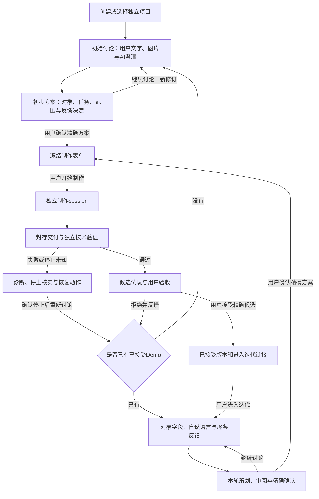

# 通用 2D 游戏制作工作台：最终修改方案

日期：2026-10-12（Asia/Shanghai）。核对代码基线：`6087e72`。

> 本文是设计基线与原验收要求的历史记录。初次实施见[2026-10-12 实施记录](STUDIO-IMPLEMENTATION-20261012.zh-CN.md)，初次完整验收及当时的失败证据保留在[全功能验收记录](STUDIO-ACCEPTANCE-20261012.zh-CN.md)。最新结果见[Studio 边界修复与补充验收](STUDIO-BOUNDARY-FIX-ACCEPTANCE-20261012.zh-CN.md)：受测 macOS、stateless custom provider、Godot 4.6.3 范围内，四项角色探针、真实 Runner 注册和受 fixture 控制的业务闭环通过；后端 283/283（零跳过），前端既有 19/19 未重跑。用户玩法/视觉验收仍为 `NOT_TESTED`，没有用户接受的生产候选；请求 effort=`max` 不是实际 effort 观测，实际 effort 和完整计费未知。角色能力按每次启动时的新鲜本机检查派生，信任模型不是远程 attestation。

状态：最终设计复核完成，可按本文分批实施。本文规定后续修改，不表示这些接口、独立执行器和隔离能力已经上线。本轮交付为方案文档，未改变业务代码、项目记录或运行服务。

本文是本次后续改造的主方案。此前[通信审计](STUDIO-COMMUNICATION-AUDIT.zh-CN.md)保留当前问题与证据；[四部分架构](STUDIO-FOUR-PART-ASYNC-ARCHITECTURE.zh-CN.md)、[设计审查](STUDIO-FOUR-PART-FINAL-REVIEW.zh-CN.md)、[Session 契约](STUDIO-SESSION-PROFILES-AND-LIVENESS.zh-CN.md)和[完整交互图例](STUDIO-USER-INTERACTION-SEQUENCES.zh-CN.md)提供论证和详细图。后续实施顺序、字段命名及边界规则以本文为准。旧部署/用户说明书继续描述现有服务，须随实际交付批次更新。

阅读路径：[目标与范围](#scope) → [最终复核发现](#review) → [用户流程与前端](#interaction) → [组件边界](#components) → [协议与版本](#protocol) → [执行联系和用量](#execution) → [文件与批次](#implementation) → [迁移与验收](#acceptance)。

<a id="scope"></a>

## 1. 目标、合理性与首版范围

制作台服务于通用 Godot 2D 游戏。用户通过文字、图片、稳定对象和字段持续调整作品；后端协助澄清并形成可审阅方案，另一个原生 session 实施已批准范围，经独立技术验证后返回制作台供用户试玩、接受或继续反馈。

核心抽象是对象、字段、关系、需求、任务、反馈和版本，不按玩法类型建立多套工作流。沿用重组 GM non-pk 的精确规格确认、制作、验证及用户决定；参考仓库已采用的 GameStudio 稳定标识、输入/状态/渲染分离与试玩反馈原则。本文没有使用 Ptah 技能，也没有将参考资料中的指令当作用户授权。

方向合理且可行：已有 REST、SQLite、对象协议、Git 基线、原生 JSON-RPC 和验证 worker 可以复用。主要成本在执行生命周期、通信恢复、批准迁移与进程隔离，JSON 编码本身成本较低。先修可复现的工作台缺陷，再拆执行边界，能减少同时替换所有组件的风险。

首版必须交付：

1. 项目管理、项目作用域和空项目入口；用户、AI、系统信息明确标注，阶段逐步展开。
2. 初始讨论与原型迭代分开；READY 可回到讨论；首个 Demo 经验证并被用户接受后开放迭代入口。
3. 类型化 JSON 命令/回执、轻量公开视图、逐条反馈结果和精确批准绑定。
4. 项目 SSE 状态流、原操作核查、后端/执行器重启后的恢复与停止门禁。
5. 策划/制作两组模型、effort、时限及软预算偏好；本次执行配置冻结，原生事实和用量可追溯。
6. 独立 AgentRunner、独立 ProjectRunner，以及制作、封存、验证、试玩和已接受版本的隔离。

首版保留一个后端 SQLite、同一个开发仓库和同机部署。前端、后端、AgentRunner、项目执行域分别拥有入口和生命周期；每个游戏使用自己的 Git 仓库。不增加常驻协调 AI、预算/心跳 Agent、跨服务消息平台、每项目业务库、全量事件溯源或新的前端框架。RuntimeBridge 和 WebSocket 等确有运行中预览需求时再做；对象编辑与制作闭环不依赖它们。

“项目不得串扰”落实为可测试的不变量：跨项目的内容、事件、附件、草稿、文件、执行身份、批准和发布均不得互用；不受信子进程不能读取另一项目或访问批准通道。CPU/GPU 仍是共享设备，以并发上限避免争用影响执行；不把同机运行描述成物理资源完全独占。

<a id="review"></a>

## 2. 最终复核发现与定案

| 编号 | 发现或尚有歧义之处 | 最终处理 |
| --- | --- | --- |
| R01 | 前文说明文字使用 expectedPreferencesRevision，JSON 使用 expected.preferencesRevision | 新协议统一用 `expected.preferencesRevision`；旧接口在兼容层显式映射，不能把两种字段同时作为新契约 |
| R02 | planning/production 与 planner/producer 容易被当成四种角色 | 用户偏好角色统一为 `planner / producer`；任务类型统一为 `plan / produce / verify / preview`；中文显示策划/制作/验证/试玩 |
| R03 | “派发前冻结”可能被理解为领取任务后才选模型 | 接收用户执行命令的事务中，选定 Runner 环境并冻结 profile；领取前重验兼容性，不能静默换执行器、模型或 effort |
| R04 | 初始项目的 sourceCommit=null 与实际制作 Git 基线容易混淆 | `baseCommit` 表示已接受基线，可为 null；`inputCommit` 表示受信适配器准备后的精确输入；交付 `sourceCommit` 表示封存输出。三者分开绑定 |
| R05 | 当前冻结比较完整 proposal，公开响应又含原生证据 | 保存不可变 reviewedPlanRef，绑定完整审阅内容和原有 Git 规格/源锁；诊断不进入审阅载荷，不简单删除字段绕过现有比较 |
| R06 | 现有 GM register/confirm/spec_confirmed 在工程内引用后端 DB 与 operatorId | 改为后端内部消费/复核批准和准备输入；跨边界只传受信确认记录与引用。Runner/项目不读取后端 DB，也不获得用户批准权限 |
| R07 | 上述 GM 消费存在“DB 已消费、阶段文件未写完”的崩溃窗口 | 消费决定持久保存，输入准备幂等；恢复复核同一决定并补物化，不再次消费，不以工作目录自报作为批准 |
| R08 | 策划只读配置并不禁止运行项目脚本或读取其他项目 | 限定有界检查材料、工具和进程访问；静态检查不执行工程。以实际拒绝测试验收，提示词不能作为隔离证据 |
| R09 | 反馈和策划旧严格格式不接受 feedbackId/逐条决定 | 受影响请求和策划结果显式升级；保留 studio.objects.v1；每条反馈必须覆盖，体验验收独立保存 |
| R10 | 完整图例中的简化问题投影与现有 question 字段不同 | 新策划/公开问题沿用 `id/prompt/type/required/options`；用户回答用 `questionId/text` 引用问题，避免无必要更换问题模型 |
| R11 | 心跳、回合活动、配置、预算和停止可能混成“在线” | 分层展示；请求值/接受回执/原生报告分开；软预算和时限在 Runner 本地监督，不新增模型回合 |
| R12 | 超预算停止与用户取消可能被当作同一成功终态 | 保存 stopReason 与实际停止；停止确认不等于任务完成，未完成制作不产生候选；迟到用量只补记账 |
| R13 | 重启、备份恢复和租约恢复的身份规则未完全区分 | 普通重启沿用 storeId；有历史回退的恢复建立新 storeId。租约过期不能靠心跳自行复活，也不能自动重投 |

以上是设计层定案。R06/R07 的批准适配、R08 的执行约束和精确版本验证必须通过对应实施批次的验收，才能宣称完成严格分离。

当前实现的主要可复现问题仍是：重启后旧写 token、同项目快照不刷新、慢轮询响应被持续丢弃、未知提交可能产生第二意图、READY 无回改入口、反馈编辑框未加入本轮、反馈缺少逐条结果，以及非法成功 JSON 被宽松接受。A 批先解决这些问题。

<a id="interaction"></a>

## 3. 用户流程与前端修改



图中的失败恢复不会自动重开模型。首轮返回初始讨论；已有已接受版本时，返回当前项目迭代讨论。候选拒绝保留原已接受版本，用户意见进入下一轮草稿，再显式提交。冻结后继续修改会使旧表单失去可派发资格；已开始的执行须先停止并核实，随后形成新修订和新批准。

### 3.1 页面展开规则

| 当前步骤 | 用户可见的主要区域 | 下一动作 |
| --- | --- | --- |
| 项目首页/空项目 | 项目摘要、名称/归档、初始概念、参考图、策划设置 | 提交讨论 |
| 澄清中 | 用户原文/回答、AI 问题、本轮设置和状态 | 回答或补充；不展开不存在的方案 |
| 策划已接收/执行中 | 接收回执、实际启动/活动/只读覆盖、草稿 | 等待 Agent 回复或请求停止 |
| 方案 READY | 完整方案、对象/字段差异、任务、范围、反馈决定 | 继续讨论或确认本修订 |
| 已冻结 | 精确表单、制作设置、批准基线 | 开始制作；改范围须重新审阅 |
| 制作/验证中 | 冻结表单、执行监视、实际配置/用量和验证状态 | 等待制作/验证或请求停止 |
| 候选待验收 | 精确候选、技术证据、试玩、逐条体验反馈 | 接受或拒绝 |
| 首个 Demo 已接受 | 已接受版本、进入迭代链接 | 用户主动进入迭代工作台 |
| 迭代工作台 | 已接受版本、对象目录、字段编辑、反馈、本轮方案/执行/候选 | 整理本轮调整，继续同一闭环 |

前端使用后端 `phase/step/attention/allowedActions` 决定展开和动作。UI 可根据传输陈旧、待核实命令临时禁用按钮，但不能自行判定制作成功、方案批准或版本发布。历史方案通过历史入口查看，不占空项目第一步。

顶部 StatusBar 常驻，至少区分“等待用户反馈/确认”“等待策划开始”“等待 Agent 整理方案”“等待制作开始”“等待 Agent 制作”“等待后端验证”“执行状态待核实”。旁边显示状态流新鲜度、最后可信活动和执行监视入口；不编造进度百分比。

用户内容标为“用户输入/反馈”，模型内容标为“AI 问题/方案”，接收、验证、连接和失败事实标为“系统状态/技术证据”。作者来自后端真实来源，内容中的 actor 字段不构成权限。原始工具输出和推理片段不作为聊天消息展示。

### 3.2 前端职责的最小拆分

以现有 StudioApp 为壳，按修改需要抽取通信、项目控制、草稿和面板职责。详细类图中的十多个面板是逻辑责任，可合并在现有文件或少量模块中，不要求逐个创建类。

| 职责组 | 负责的交互 | 不承担的职责 |
| --- | --- | --- |
| StudioShell + ProjectManager | 建立/切换项目、路由、阶段挂载 | 跨项目保留方案正文或执行对象 |
| DiscussionPanel + ReferenceTray + ProposalReview | 文字/图片、澄清、READY 回改、精确确认 | 自行生成批准或忽略未处理反馈 |
| IterationWorkbench + ObjectInspector + FeedbackEditor | 稳定对象/字段编辑、原文反馈和本轮列表 | 键入时自动调用模型或直接改游戏 |
| CandidateReview + ExecutionMonitor + SessionSettings + StatusBar | 试玩/接受/拒绝、取消/核账、参数与实际状态 | 用技术 PASS 替代体验验收 |
| ProjectController + StudioTransport + DraftStore + DraftRebaseDialog | 项目/页面代次、回执、流恢复、版本草稿和重关联 | 另建前端工作流状态机 |

提交前处理反馈框中未加入列表的文字，明确指出所属对象；区分“编辑中”“已加入本轮”“后端已接收”。草稿键包括 storeId/projectId/种类/基线版本，pending command 保存原 ID 和原内容。另一页面发布新版本后，刷新精确快照并展示重关联冲突；用户选择后才迁移草稿。

完整前端类图和五组带 JSON 示例的时序分别见[前端类图](STUDIO-USER-INTERACTION-SEQUENCES.zh-CN.md#frontend-classes)、[执行类图](STUDIO-USER-INTERACTION-SEQUENCES.zh-CN.md#execution-classes)、[项目/设置](STUDIO-USER-INTERACTION-SEQUENCES.zh-CN.md#sequence-project)、[只读策划](STUDIO-USER-INTERACTION-SEQUENCES.zh-CN.md#sequence-planning)、[制作/验收](STUDIO-USER-INTERACTION-SEQUENCES.zh-CN.md#sequence-production)、[对象迭代](STUDIO-USER-INTERACTION-SEQUENCES.zh-CN.md#sequence-iteration)及[恢复/停止](STUDIO-USER-INTERACTION-SEQUENCES.zh-CN.md#sequence-recovery)。本文无需复制另一套详细图。

<a id="components"></a>

## 4. 四个运行边界与状态归属

| 边界 | 高内聚职责 | 跨边界通信 | 权限/状态边界 |
| --- | --- | --- | --- |
| 前端工作区 | 项目管理、用户编辑、审阅、反馈、草稿、展示 | 后端类型化 HTTP + 项目 SSE | 不直连 Agent、数据库或工程目录 |
| 后端工作流 | 修订、精确批准、任务占用、回执/事件、候选、接受/发布 | 向 Runner 提供 JSON 请求，接收事实 | 唯一业务裁决；独占 SQLite |
| AgentRunner | 原生 session、限定输入、活动/用量、本地监督、停止和制作交付 | HTTP 领取/报告；内部 stdio JSON-RPC | planner/producer 两种独立 session，共用 Runner 实现 |
| Godot 项目执行域 | ProjectRunner 验证/试玩、引擎进程、原生项目包 | HTTP 请求/报告；内部文件/引擎接口 | 不依赖 AI 对话；不写已接受源，游戏脱离工作台可运行 |

后端 session 复用 Project/Proposal/Packet/Job/Snapshot；一轮讨论使用 proposalId/revision。没有第二套 workflowSession 状态机。策划归 proposal，制作与验证归同一个 job 的不同 attempt，试玩归 preview。attemptId 是执行代次；不额外引入 dispatchId/leaseEpoch。

数据库保留 entities/approvals/meta。添加命令回执、报告回执和项目事件记录；attempt、偏好、精确计划、profile 和交付引用可以保存在现有实体机制中。事件表兼作 outbox，任务占用由后端事务完成，不增加消息中间件。Runner 本机日志只保存执行意图、可信原生身份、待确认事实和有界活动，不保存另一份批准状态。

前端可先独立维护静态包，用同源代理接入 API；独立部署不要求不同 origin。如使用不同 origin，同步显式配置可信 origin 和授权。SSE 使用可带授权头的 fetch 流；不把 token 放进 URL，也不假设原生 EventSource 能带自定义授权头。

### 4.1 GM 批准适配的必要修改

当前 `general_gm_integration.register()` 在制作目录写入 `storePath/operatorId`，GM 的确认匹配随后直接读 approvals 表。不能将这条 DB 通道搬进独立执行器。

最终方案将消费和确认复核留在受信后端：

1. 用户 freeze 产生原有持久批准，production.start 将该表单绑定一个 job。消费/确认决定由后端事务保存；重复命令返回原决定。
2. 后端输入准备器以此决定复核精确 GM 规格、源锁、环境和范围，生成 `gmConfirmationRef` 及受保护的输入记录；测试批准不能生成生产确认。
3. 输入准备和文件物化不放进长数据库事务。发生崩溃时，根据同一 job/批准决定补齐派生文件，不再次消费批准。未完成准备的 attempt 不可领取。
4. 适配现有 GM consumer 的读取/匹配入口，使后端可以复核已消费记录并幂等生成确认；复用既有 context/provenance/Git 规格校验。不能把文件里自报的 PASS 当作批准，也不能仅删除 DB 路径后继续使用旧匹配函数。
5. Runner 只收到与任务、规格和 inputCommit 绑定的确认引用/只读记录。后端接收交付和验证时仍从自己的批准记录复核。Agent 无法重新消费、创建批准或接受候选。

这里的只读记录是授权结果，不是新的授权来源，不需要新批准数据库或签名服务。批准权来自后端持久记录、授权任务通道和受保护输入。源锁及 GM 门禁继续保留，包括尚未审阅解决的 `hud.gd/title_screen.gd` 历史源差异拒绝检查。

### 4.2 项目/进程隔离的验收边界

Agent 原生进程、工具子进程和游戏进程只能访问本次授权材料及必要只读依赖；制作只能写私有副本。限制工具/插件、目录、环境变量、派生缓存、端口和进程组，阻止路径逃逸、符号链接和对另一项目的访问。

不能向不受信进程继承 Runner token、用户写会话、后端 DB、其他项目目录或浏览器私有草稿。网络权限也要防止项目代码从本机 `/api/session` 等入口获取用户授权、访问批准接口或连接其他项目；仅隐藏 token 或设置 Origin 不能约束本机进程。必要的原生模型认证由受信执行适配保持，不能因此给游戏/工具通用控制权限。

先在当前 Mac 上验证实际可用的执行沙箱/进程权限方案。原生 read-only/workspace-write 仅是配置，不单独证明上述限制；普通 Git worktree 的管理信息也可能关联原仓库，需实际验证读范围，必要时改用受控独立复制。无法通过访问拒绝测试时，相应执行能力保持受限并报告缺项，不能标为严格隔离。首版无需先建设云集群或新调度平台。

<a id="protocol"></a>

## 5. 标准 JSON 与精确版本规则

### 5.1 一份契约，不混入任意执行载荷

新增一份共享静态契约，按消息 kind/type 和 taskKind 校验。`payload` 用具体类型定义、拒绝未知字段；不开放任意命令、cwd、文件根、sandboxPolicy、工具配置或用户自填的授权身份。

| 格式 | 定义 |
| --- | --- |
| studio.message.v1 | Command/Receipt/Event/ExecutionReport/ReportAck/Error 的信封与类型化载荷 |
| studio.project-view.v1 | 一致的项目公开视图、throughSequence、阶段/允许动作和观测 |
| studio.execution.v1 | 执行请求，按 plan/produce/verify/preview 分支要求不同输入 |
| studio.objects.v1 | 保留现有严格对象文档及字段、关系、源绑定校验 |
| 新版 changeRequest/plannerResult/ApprovedPacket | 显式版本化；增加反馈决定、检查覆盖和精确审阅引用，旧格式不静默扩展 |

成功响应必须验证类型、版本、store/project 及资源身份；HTTP 200 的 HTML、非法 JSON、重复键、非有限数字和错误身份均为协议错误。公开视图只含界面必需内容；原始 session 响应、stdout/stderr、命令和 cwd 留在私有诊断，通过授权 diagnosticRef 按需读取。

### 5.2 身份与版本的唯一含义

| 字段 | 含义和规则 |
| --- | --- |
| storeId / projectId | 数据命名空间与项目归属；project.create 在分配前无 projectId，使用 store 作用域回执 |
| serviceInstanceId | 后端本次实例；改变时更新握手/写会话，不等于项目或事件版本变化 |
| commandId | 持久意图；重试同 ID/同业务内容，不换 ID 猜测原请求失败 |
| reportId / eventId | 分别是上行事实幂等身份与后端持久事件身份 |
| ownerRef / attemptId / runnerId | 业务归属、执行代次、授权执行器；由后端记录绑定 |
| proposalRevision | 精确讨论/方案修订；新回答或 READY 回改使旧审阅失效 |
| publicationRevision / baseCommit | 当前已接受版本和其源 Git；初始为 0/null |
| inputCommit / sourceCommit | 精确准备输入和精确封存输出；禁止以最新目录/分支代替 |
| expected.preferencesRevision | 本次采用的项目偏好修订；两角色共同递增，运行中的 profile 不随其变化 |
| profileSnapshot.catalogRevision | 实际目标 Runner 的目录修订；冻结后不得用其他环境目录替换 |
| reviewedPlanRef | 后端保存的不可变完整审阅内容，不是“最新方案”指针 |
| throughSequence / event.sequence | 项目公开事件同步游标，不替代方案/发布/偏好修订 |

规范中的 Git 身份由 Git 原生对象和差异管理。构建、审阅及验收不运行独立 SHA/MD5 校验，不恢复历史 checksum 前置步骤。

### 5.3 命令与执行请求

| 用户命令类型 | 必需前置条件与主要载荷 |
| --- | --- |
| project.create / project.settings.update | 建立或管理项目；名称/归档等有明确类型，不接收其他项目正文 |
| session.preferences.update | expected.preferencesRevision；role=planner/producer、modelKey、effort、limits；只保存设置 |
| concept.submit / iteration.submit | 当前 publicationRevision/sourceCommit、preferencesRevision；文字、授权 assetRefs、目标对象、字段和反馈 |
| proposal.revise | 当前提案与发布/偏好修订；答案或补充/反馈；允许 NEEDS_CLARIFICATION 和 READY，保留讨论历史 |
| proposal.freeze | 当前方案和源基线、reviewedPlanRef；完整内容已加载并审阅；无活动/未知执行阻塞 |
| production.start | packetId、当前发布基线和偏好修订；有效批准、源锁和独占；一个表单对应一个 job |
| execution.cancel / execution.reconcile | 明确 ownerRef/attemptId 和允许状态；取消接收不等于停止，核账不重开回合 |
| preview.start / preview.stop | 精确候选/已接受交付或 previewId；使用独立试玩副本 |
| candidate.accept / candidate.reject | 精确候选源和当前发布基线；真实用户决定；逐条体验反馈决定可随接受提交 |

反馈在项目内使用稳定 feedbackId，保留用户原文、对象和类别。策划必须为每条反馈给出 adopted/needs_clarification/deferred/rejected、理由与关联任务/需求；needs_clarification 阻止 READY。问题保持现有 id/prompt/type/required/options，答案 questionId 引用本修订中的真实问题。

冻结的 reviewedPlanRef 包含对象文档、任务/需求、反馈决定、范围、角色/验收条件、参考输入、GM 规格和源/模板引用。后端核对它属于当前项目、当前修订和当前基线，同时执行原规格/源锁检查。诊断变化或普通活动更新不使该计划失效。

| taskKind | ownerRef | 请求必须绑定 | 结果必须绑定 |
| --- | --- | --- | --- |
| plan | proposal + revision | profileSnapshot、planningInputRef、ProjectInspection、授权参考；无源时明确 null | 严格策划结果、检查覆盖/未知、实际终止事实 |
| produce | job | packetId、profileSnapshot、baseCommit、inputCommit/inputArtifactRef、gmConfirmationRef、写入范围 | 停止事实、精确 ArtifactRef、范围/源绑定；自报完成不能发布 |
| verify | 同 job 的新 attempt | 同一封存 artifact、packetId、验证政策和缓存/输出范围；无 AI profile | 精确版本 PASS/FAIL、证据、源不变和停止事实 |
| preview | preview | 精确 artifact、生命周期/端口/可用能力 | 启动、实际可观测状态、停止或未知；不表示用户接受 |

例如，一份完整策划 ExecutionRequest；所有身份和目录数据均为虚构，租约只表示已领取后的授权期限：

```json
{
  "schemaVersion": "studio.execution.v1",
  "storeId": "store-example",
  "projectId": "project-example-a",
  "taskKind": "plan",
  "ownerRef": {"kind": "proposal", "id": "proposal-example", "revision": 2},
  "attemptId": "planner-attempt-example-02",
  "runnerId": "agent-runner-example",
  "lease": {"expiresAt": "2026-10-12T03:00:30Z"},
  "profileSnapshot": {
    "preferencesRevision": 2,
    "catalogRevision": 8,
    "modelKey": "<实际模型键>",
    "modelProvider": "<实际供应方键>",
    "effort": "medium",
    "rolePolicy": "planning-readonly-v1",
    "contextPolicy": "targeted-project-inspection-v1",
    "limits": {"maxDurationSeconds": 420, "softTotalTokens": 12000}
  },
  "inputRefs": {
    "sourceAvailable": false,
    "sourceCommit": null,
    "inspectionRef": "inspection-example-empty",
    "planningInputRef": "planning-input-example-r2",
    "assetRefs": []
  },
  "scope": {"mode": "inspection_only", "targetObjectIds": [], "allowProjectExecution": false}
}
```

planner 没有 ApprovedPacket 或伪造的制作 job。ProjectInspection 绑定精确已接受 Git、对象版本、目标范围、材料大小、实际覆盖和未知项；不读取正在制作的目录。引用由受信适配器解析，不接受任意客户端路径。扩大检查范围通过补齐明确材料进行，不以静态片段声称完成运行验证。

### 5.4 回执、事件与原子保存

处理命令/报告的顺序固定为：授权 → 严格类型与归属 → 查同 ID 原记录并比较规范业务内容 → 对未见记录校验当前版本/执行/租约 → 单事务保存决定、业务效果和事件。传输时间等元数据不改变业务内容，不通过额外 hash 比较。

命令回执以 store/project/commandId 及真实授权来源绑定；创建项目和 Runner 领取有明确的非项目作用域。报告回执绑定 store/runner/reportId，并保存实际 project/attempt。领取请求有持久 commandId，响应丢失只能查询/重试原领取，不能领取另一项后将原身份遗失。

同 ID 同内容返回原决定，即使当前基线或租约已经变化；同 ID 不同内容明确冲突。known=false 只说明暂未找到，不能证明原请求永远不会到达。接收回执不是制作成功。

ACK disposition 明确区分 recorded（对应事实和允许的业务效果已保存）、evidence_only（保存供核账，不推进）和 rejected（不得推进及原因）。recorded 的停止报告也不表示交付成功。核账使用新的、幂等的后端决定读取原证据，原 ACK 不改；禁止换 reportId 绕过门禁。

ProjectView 和 throughSequence 在同一一致读取中返回；SSE 只回放其后的本项目公开事件。重复去重，缺口补齐或重新读快照；游标过期返回 resync_required。只读快照不包含批准凭据。私有诊断和普通保活不占项目公开 sequence。

### 5.5 拟新增的类型化接口

新契约使用 `/api/v1/`，保留现有路由作为显式兼容入口；以下均为待实现，不是当前可调用端点。

| 接口组 | 入口 |
| --- | --- |
| 握手/项目管理 | GET /api/v1/handshake；GET/POST /api/v1/projects；项目 settings 类型化 POST |
| 视图/精确计划/原回执 | GET /api/v1/projects/{projectId}/view、plans/{reviewedPlanRef}、commands/{commandId}；创建项目回执可按 store 作用域查询 |
| 讨论/批准/制作 | 项目 concepts、iterations、proposals/{proposalId}/revise、freeze、jobs 的类型化 POST |
| 设置/附件/事件 | 项目 session-preferences、session-catalog、受控 assets、events?after={sequence} |
| 执行/候选/试玩 | 项目 executions/{attemptId}/cancel、reconcile；candidates/{candidateId}/accept、reject、previews；previews/{previewId}/stop |
| Runner 控制 | 独立授权的 /internal/v1/ 注册、目录、领取、心跳/续约、报告与核账；能力限于实际分配任务 |

请求体身份必须与路由/授权记录一致。用户和 Runner 不共用凭据；注册/续约是类型化控制消息，普通心跳不逐条产生业务事件。项目级上传继续走受控通道，图片原始字节不反复进入状态事件。

<a id="execution"></a>

## 6. 两类 session、持续联系与低消耗

### 6.1 模型、effort 的完整传递

Runner 用 model/list 取得目录并上报实际环境、nativeVersion、支持的 effort、输入模态、observedAt/catalogRevision；缓存复用，不在每次心跳查询。前端按模型筛选 effort，不使用全模型共用的八档硬编码。

用户设置保存为 SessionPreferences；角色默认也须解析成具体 modelKey/effort 并回显。后端接收 concept/iteration/revise/production 命令时，检查 expected.preferencesRevision 和该 Runner 的新鲜目录，冻结 ResolvedSessionProfile 与待执行 attempt，再返回回执。输入准备可能稍后完成，但本次设置不再改变。

首版选定一个受信 AgentRunner，profile 绑定其环境/目录。领取时重验版本、角色/模态及配置兼容；变化时明确报告冲突，保留原意图，不能静默重选模型、提升 effort、删图片或转发给另一环境。Runner 不在线而目录不能可信校验时，允许编辑草稿/偏好；执行命令明确拒绝或显示未满足的前置条件，不伪装成已开始。

原生 thread/start 使用固定角色权限和 allowProviderModelFallback=false；核对返回的模型/供应方后才发 turn/start(model,effort)。新讨论修订使用新只读 session，制作使用另一可写 session。设置编辑只影响后续执行；运行中的 attempt 不热切换。

原生工具审批遵循固定角色政策和现有拒绝门禁；超出批准范围即拒绝并报告，范围变化回到方案审阅。前端不能通过模型设置增加权限，也不为此新增通用工具审批服务。原生等待审批要显示明确状态，不能触发模型后台循环重试。

展示分别保存 requested、threadStartReported、turnStartAcknowledged 和可选的 turn 实际报告。当前本机 TurnStartResponse 没有最终模型/effort 回显；启动默认 effort 不能标为本回合观测值，缺失保持 null/未知。目录 schema 不证明账户一定可以启动该模型。

### 6.2 联系和未知状态

| 维度 | 来源 | 处理 |
| --- | --- | --- |
| API 可读/会话可写 | 握手、HTTP、授权 | 服务实例变化更新授权；读取成功不意味着可写 |
| 状态流连续性 | SSE/游标/保活 | 断流标陈旧并恢复；不自行判作业失败 |
| Runner 存活 | 后端实际接收心跳 | 补送旧观测不能伪装成新心跳 |
| 原生身份/传输 | 可信进程记录、stdio/RPC | 启动回执丢失先核账；不能再发 start 猜测恢复 |
| 回合/活动/用量 | 原生既有通知，各自时间 | 活动沉默不等于链路断开；不伪造模型推进 |
| Godot | ProjectRunner 进程/引擎事实 | 未启动=可用/空闲；仅有进程时不声称主循环已响应 |

建议初值：活动执行心跳约 5 秒、租约约 30 秒，SSE 保活约 15 秒，活动/用量按 1–2 秒合并。它们是可调程序策略，均不调用模型；公开观测同时保留各自来源、观测时间与覆盖。

原生采集与网络上报解耦。Runner 先保存启动意图，随后保存可信原生身份；终态/停止事实在 ACK 前保留，活动可合并，日志有上限。容量不足暂停领取新任务。后端断开时，本地时限和可观测软预算监督继续，重连补送原事实。

租约采用后端时间，执行时限用本地单调计时；时限从原生进程启动计时，包含初始化/工具/原生网络重试，不计排队和等待用户。租约失效标 UNKNOWN/UNCERTAIN 并保留占用。普通心跳不能复活过期租约；后端核账确认同一身份后才能恢复该 attempt 的授权/观测，不再次启动它。

取消先提交时阻止后续候选推进，Runner 停止并核实关联进程；停止不明保留独占。结果先提交且已经进入验证时，取消针对当前验证；已形成候选沿用候选取消，已接受版本不能被取消执行撤销。事务顺序裁决，迟到活动不能重开终态。

### 6.3 不增加无效模型回合

每次显式讨论提交对应一个策划回合；开始制作对应一次已批准执行。对象键入、草稿、设置、刷新、心跳、目录、核账及使用量计算不启动模型。首版保持 managed multi_agent 关闭，不自动重试新回合、升级 effort、调用总结 Agent 或增加预算。

上下文只包含本轮目标、已确认决定、未解决反馈/问题、相关对象、源片段和参考。确定性限制文件数/字符数，记录截断与未知，不发送全量历史/日志/工程；仍保留源绑定、批准条件和用户原文。等待用户时原生回合已经结束。

本机 turn/start schema 没有直接的 token 硬上限字段。softTotalTokens 监督可观测原生累计用量，通知延迟和停止延迟可能导致超过阈值。用量缺失是未知，不显示 0；不宣称硬预算或完整计费控制。

每个 attempt/thread 取最后可信累计 total，按观察顺序去重，不把累计快照逐次相加，也不叠加已经包含的缓存/推理分项。子线程和外部模型工具覆盖未证明时标不完整；缺项不能用估计补成“全部消耗”。迟到可信用量仅补记账，不重新启动或撤销已接受版本。

软阈值仅在仍活动的执行上触发中断/停止；保存 stopReason、最后可信用量、停止证据和工作副本，不要求模型再写总结。已完成与停止按可信事实及后端事务顺序裁决；没有完成/封存的制作不能形成候选。后续继续需要用户新意图和原有重新审阅/独占门禁。

### 6.4 精确交付与逐条反馈验收

Agent 停止确认 → 可信适配器封存 Git 交付 → ProjectRunner 物化独立验证副本 → 审计范围/保护文件、导入与运行验证、核实停止 → 后端生成候选 → 用户决定 → Snapshot 更新。

验证记录绑定 artifactId/projectId/jobId/生产 attempt/sourceCommit/inputCommit/packetId 和验证 attempt。源保持封存，缓存/派生输出在声明范围；Godot 导入若改变源，不能沿用旧 PASS。试玩复制同一候选，与制作/验证/已接受副本分开。

接受事务要求交付物已经存在且受保留，核对当前发布基线和精确候选验证，记录用户决定和 Snapshot 引用；目录/分支物化作为可重试派生操作。工件保留覆盖待确认报告、候选和已接受版本，清理不能删除仍被引用的交付。

反馈的计划决定、候选关联和用户体验验收分别保存。技术 PASS 不将反馈默认解决，接受候选也不默认解决所有反馈；用户可接受候选并将某条反馈标 needs_followup。被删对象的旧反馈保留原对象/版本记录，不静默转移到新对象；修改反馈原文形成有来源的新修订，保留已审阅内容。

<a id="implementation"></a>

## 7. 文件责任与按依赖实施

### 7.1 主要修改入口

| 文件/模块 | 修改责任 |
| --- | --- |
| [frontend/studio/studio.js](../frontend/studio/studio.js)、[index.html](../frontend/studio/index.html)、[studio.css](../frontend/studio/studio.css) | 修恢复、刷新/慢读取、READY 回改、反馈框；增加参数区/状态监视；依据公开视图渐进展示 |
| 前端内部 transport/controller/draft/panels 模块（按需要抽取） | 将通信、命令持久、SSE、项目代次和草稿从 StudioApp 分出；保留现有原生 JS |
| 共享 contracts/studio/（拟新增） | 一份消息/执行/公开视图 schema 与受影响业务类型，固定示例/版本兼容矩阵；不复制三套契约 |
| [backend/server.py](../backend/server.py) | 新版类型化路由、握手/授权、回执查询、成功/错误格式、SSE 和跨 origin 配置 |
| [backend/coordinator.py](../backend/coordinator.py)、[generic_workflow.py](../backend/generic_workflow.py) | 复用业务事实；命令/报告/事件事务、精确计划、偏好冻结、任务占用、反馈和候选规则；移出执行线程所有权 |
| 后端内部 store/projection/execution 模块（按需要抽取） | SQLite 迁移、公开读模型和 attempt 管理；不再引入另一套状态机 |
| [backend/object_protocol.py](../backend/object_protocol.py) | 保留对象 v1；版本化反馈请求/策划输出、覆盖和引用校验；共享校验需保持单一实现 |
| [backend/codex_driver.py](../backend/codex_driver.py) | 动态目录/effort、精确参数、禁 fallback、配置/状态/活动/用量回调、可信身份与停止监督；成为 Runner 内部适配 |
| [backend/general_gm_integration.py](../backend/general_gm_integration.py)、[frontend_approval.py](../backend/frontend_approval.py)及 pinned GM consumer 对应入口 | 持久批准消费/复核与输入准备；移除跨边界 DB/用户授权泄漏，更新能力锁时保留审阅依据 |
| runners/agent/（拟新增） | 独立 CLI、注册/领取、原生适配、私有材料、本地日志、续约/报告补送、时限/软预算 |
| [backend/general_verification.py](../backend/general_verification.py)、[general_verification_worker.py](../backend/general_verification_worker.py)、预览相关代码 | 从制作 worktree 验证迁移到精确封存副本；范围/引擎证据和停止事实 |
| runners/project/（拟新增） | 独立验证/试玩 CLI、工件物化与保留、Godot 适配、生命周期/恢复和报告 |
| [tools/git_baseline.py](../tools/git_baseline.py)、通用模板和部署入口 | 复用 Git 身份/清单/差异；分开副本与缓存，保持游戏独立运行 |
| [部署手册](DEPLOYMENT-MANUAL.zh-CN.md)、[用户手册](USER-MANUAL.zh-CN.md)、[说明书入口](README.zh-CN.md) | 分批同步真实能力、启动/停止/备份/核账、参数/阶段/反馈说明和未验限制 |

拟新增目录名用于限定模块责任，可以在实施时按现有结构调整。独立进程之间只用协议和交付通道，不靠 import 对方业务内部方法、共享数据库连接或直接改同一目录。

### 7.2 A：修真实缺陷，建立最小契约和明确参数

依次交付：

1. 固定 schema/字段与接口版本；握手区分 store/实例/读写；严格成功 JSON 与统一错误。
2. 为概念/迭代等缺失操作保存 commandId/回执；冻结/制作适配已有幂等与批准，不重建批准库。
3. 修重连写会话、同项目精确快照刷新、单次在途读取/时限/退避；保留草稿和原意图。
4. READY 新修订、未加入反馈提示、反馈 ID/结果覆盖、完整精确 reviewedPlanRef 与公开投影。
5. 增加两角色偏好及冻结 profile；动态 model/effort 校验；驱动轻量真实观测和用量回调。此时仍可暂用现有执行入口验证契约。

验收：响应丢失/慢 GET/后端重启不制造第二意图或假在线；旧方案不可确认；反馈不漏传/漏处理；改设置和草稿不调用模型；设置请求、接受及实际观测不混淆。A 完成即可改善当前工作台，不等待所有进程拆分。

### 7.3 B：持久事件与恢复状态流

将业务状态、回执/报告与公开事件纳入同一事务；一致视图携带 throughSequence；实现授权 fetch SSE、去重/缺口恢复、过期游标及项目切换。页面停止高频固定轮询，保留串行 GET 作为同步/降级恢复。

验收：快照到订阅之间的更新不丢失；断流/乱序/重复可恢复；实例变化更新授权，store 变化隔离草稿；项目 A 的迟到事件不影响 B。链路陈旧与执行失败明确区分。

### 7.4 C：独立 AgentRunner 与受控输入

先迁移 planner，再迁移 producer：

1. 独立注册/目录、领取回执、attempt/lease、本机启动日志和报告补送；停用同一任务的后端内置启动线程。
2. planner 精确 ProjectInspection、只读/工具限制、原生身份/配置和本地监督。
3. 后端 GM 批准适配与幂等输入准备；制作 inputCommit/gmConfirmationRef 及范围冻结；移除工程的 DB/用户授权通道。
4. producer 私有副本、停止确认、封存 ArtifactRef。未知状态保留占用，不自动重投；对应进程访问限制通过实测后启用新的可写边界。

验收：后端重启而 Runner 不重开原回合；领取/启动响应丢失可核账；旧 attempt 不推进；本地时限/可观测预算在断网时有效；批准准备崩溃不二次消费；planner 不运行工程，跨项目/批准通道访问被拒绝。

### 7.5 D：ProjectRunner、精确验证和独立部署

迁移独立验证/试玩入口，制作停止后仅验证封存交付；测试 Godot 源/缓存权限与停止未知；Snapshot 引用及工件保留/物化恢复；前端静态包、后端、两个 Runner 独立启动/停止，提供统一开发启动入口和分组件维护入口。

验收：制作不能改验证/试玩/已接受源；实际 Godot 导入/运行不能偷换验证版本；候选只来自精确 PASS，接受只更新精确 Snapshot；游戏包可独立运行。断开任一组件能看见正确状态与恢复动作，停后端不自动杀死未知执行或丢报告，正常整套停止须逐个确认。

每批修改完成后跑对应的现有回归和新增关键失败场景；新发现或新修改才扩大测试。使用隔离存储和协议 fixture 检查工作台，禁止把完成某个用户游戏当作修复工作台的替代。真实原生/引擎集成用受控探针验证必要能力，不由刷新/轮询自动触发。

## 8. 迁移与恢复规则

迁移采用新增记录/schema/路由和渐进切换，保留现有项目、历史计划、Git 规格与证据。collect-loop 等旧项目仍使用原工作流，历史批准不自动转成新协议批准。

旧未派发 READY 计划可保留查看；没有反馈决定/精确计划引用时须补齐并重新审阅后进入新制作。已经冻结/运行的旧作业不改写批准内容或假造新 attempt；等其结束/核账后再切换。每个项目的执行后端在切换时只能选一个，不能内置线程与独立 Runner 双跑。

普通服务重启恢复同一 store，旧回执/事件保持；Runner 原日志核对可信身份并补送。恢复到较旧备份而丢失回执/事件历史时，使用新 storeId 标识数据代次，保留旧日志/草稿待核查；不能在相同命名空间重用序号或自动重试可能已执行的旧意图。

数据库和交付保留必须协调备份：保留审批、命令/报告、attempt、事件游标、交付引用与实际 Git 对象；Runner 待确认终态也需可恢复。先备份并核对相互引用，再清理缓存/不再被引用的临时副本。不能因租约到期删除仍可能被进程占用的目录。

新版 UI 对必要协议能力不兼容时保持可读并显示缺项，不退回不安全写入口。旧接口兼容需同样经过门禁；不可凭兼容路由绕过命令身份或新批准规则。最终部署手册应写清当前入口、启动顺序、依赖、分组件状态、正常/异常停止、备份恢复、核账和隔离实测范围。

<a id="acceptance"></a>

## 9. 实施验收矩阵

| 场景 | 必须出现的结果 | 批次 |
| --- | --- | --- |
| 新项目未提交概念 | 空讨论页，无其他项目方案/作业/附件 | A |
| READY 继续讨论或另一窗口更改方案 | 新修订，旧确认拒绝；完整输入/反馈保留 | A |
| 反馈框有未加入文字/三条已提交反馈 | 明确处理未提交文字；三条均有处理决定/理由/关联 | A |
| POST 已接收、回执丢失；同 ID 重试 | 原回执，只有一项业务效果；换内容明确冲突 | A |
| 服务重启且 GET 正常、旧写 token | 更新握手/授权；不得仍宣称可写；草稿/原意图保留 | A |
| 同项目新发布/GET 持续慢于轮询间隔 | 刷新精确基线；读取不相互饿死；草稿重关联由用户选择 | A |
| 200 非法 JSON/身份不符/额外任意 config | 协议错误或拒绝；不更新成功状态/执行权限 | A |
| 模型/effort/图片模态不支持或目录改变 | 明确拒绝/冲突，不替换模型/档位/参考；不重复启动 | A/C |
| 保存偏好、草稿、刷新、心跳、目录 | 零新增模型回合；运行 profile 保持冻结 | A/C |
| 启动默认 effort 与 turn 请求不同 | 分别显示；没有 turn 实际报告则未知 | A/C |
| 快照读完后、订阅建立前有事件 | 从 throughSequence 之后补齐，不丢更新 | B |
| 断流、重复、缺口、游标过期、项目切换迟到 | 去重/补齐/重同步；旧项目不得改当前页面 | B |
| Runner 领取或原生启动响应丢失/崩溃 | 查询原身份/核账，不发第二个 start | C |
| 后端重启、lease 过期、Runner 仍执行 | 待核实、占用保留、补送原事实；不能自动重投 | C |
| 终态 ACK 丢失后 lease 改变 | 原 reportId 返回原 ACK，不重复验证/候选 | C |
| 取消与完成竞争、停止不能确认 | 按事务顺序裁决；停止未知不放行；已接受版本保留 | C/D |
| GM 消费后输入准备崩溃/伪造确认记录 | 同决定恢复物化；无新消费；伪造不可通过后端批准/源锁 | C |
| Agent/工具/游戏读写其他项目或批准接口 | 真实进程权限/网络限制拒绝；不能只测试 UI projectId | C/D |
| 用量重复/迟到/缺失/重置/子线程缺口 | 不累计重复、未知不报零、覆盖明示；终态补账不重开 | C |
| 后端离线时达到时限/可观察软预算 | Runner 本地请求停止、保存证据；未完成无候选，不自动加预算 | C |
| 制作未停止/验证源漂移/导入改变源 | 不封存成功交付或不生成可接受候选；不能借用旧 PASS | D |
| 试玩期间开始另一轮、拒绝候选 | 副本分离；原已接受版本及未解决反馈保留 | D |
| 接受候选但一条反馈 needs_followup | 更新精确版本，该反馈继续保留；未明确验收不默认解决 | A/D |
| 交付物化失败/恢复旧备份/协议不兼容 | 保留权威引用可重试；新数据命名空间或明确只读/待核查 | D |

系统完成的条件是上述关键场景通过、四边界可独立启停、部署/用户手册与实际行为一致。设计图完整或既有测试通过不能替代新协议、崩溃恢复、真实原生配置、Godot 权限与跨项目隔离的验收。

## 10. 本次最终检查范围

最终检查分别核对了用户动作与阶段充分性、协议/版本/竞争及恢复规则、组件边界与现有源码。核对入口包括 StudioApp、HTTP 路由、Coordinator/GenericWorkflow、对象校验、CodexDriver、验证/预览及 GM 批准 consumer；没有使用具体游戏任务作为本次目标。

原生参数依据为本机 codex-cli 0.162.0-alpha.17.2 已导出的 schema：model/list、thread/start、turn/start、状态/用量通知和 interrupt。官方文档读取返回 403，未据未读页面断言能力。Schema 不证明账户实际模型可用性、通知频率、工具用量覆盖或计费。

此前 72 项对象/工作流/项目归属/合成驱动回归通过，属于当前基础证据。本轮不重复把这些结果计为独立 Runner/SSE/隔离验收。新增接口与原生/引擎部署仍按第 9 节实测。

本次仅进行源码/文档检查与方案修订；JSON 示例、引用、代码围栏和图源码结构做机械校对，未用 Mermaid 图形渲染器验证布局。没有启动真实策划/制作/游戏、执行用户候选接受、修改工作台业务状态或运行独立 SHA/MD5 校验。

本次机械校对结果：6 份协议/审查文档及说明书入口，共 20 个 JSON 示例、9 张时序图、5 张类图、3 张流程图和 79 个本地引用通过检查。JSON 无重复键/非标准常量；示例中的角色/任务、偏好绑定、问题字段和源可用性一致，图中的参与者/类型引用及分支闭合一致，本地链接与显式锚点存在。这些是文档检查，不是新功能的运行验收。
