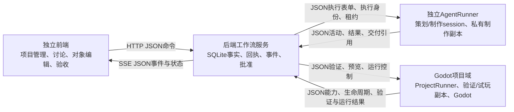

# 工作台四部分分离与持续异步通信评估

日期：2026-10-12（Asia/Shanghai）。代码基线：`6087e72`。

最终实施范围、字段命名和验收顺序以[最终修改方案](STUDIO-FINAL-MODIFICATION-PLAN.zh-CN.md)为准；本文作为架构依据。新增接口不能从本文示例直接提交给当前服务。

状态：最终设计审查后修订。审查中的时序图、类图、问题处置与验收矩阵见[最终审查](STUDIO-FOUR-PART-FINAL-REVIEW.zh-CN.md)。设计可进入分批实施；拟新增能力尚未通过实现验收。

策划/制作两种权限、只读源码检查、前端模型/effort 设置、原生事实观测及用量监督，进一步细化见[Session 参数与持续联系契约](STUDIO-SESSION-PROFILES-AND-LIVENESS.zh-CN.md)。

用户交互前端组件、完整时序和每张图对应的虚构 JSON 示例见[用户交互、完整类图与时序](STUDIO-USER-INTERACTION-SEQUENCES.zh-CN.md)。

本文是架构评估与协议草案。拟新增内容未作为现有能力陈述；本轮未启动真实策划、制作或游戏发布。

## 1. 结论与目标解释

方向合理，技术上可行。建议采用四个独立交付与运行边界、统一的 JSON 控制协议、可恢复的异步状态流，以及通过 Git 标识的游戏交付物。

“确保链接”应落实为：能够辨认对端、检测失联、保留最后可信状态、恢复订阅、查询原操作、拒绝陈旧执行结果。通信系统不能保证链路永不中断；持续连接和定时心跳也不能单独保证模型仍在响应、游戏主循环仍在推进或制作已经完成。

本评估把“后端 session”定义为可持久、可恢复的项目工作流会话，涵盖初始讨论与各轮迭代。它由现有 Project、Proposal、Packet、Job 和 Snapshot 记录构成，不再增加一套独立的会话状态机或批准数据库。一轮讨论使用 proposalId/revision；如外部称 workflowSessionId，首版直接映射 proposalId。Agent session 是按需创建的策划或制作执行，使用独立的 attemptId 和原生 session/turn 身份。若以后协调角色也需要 AI，其 AI 回合同样通过 Agent 执行边界派发；项目状态和批准事实仍由后端保存。

标准 JSON 用于命令、回执、事件、状态、能力、对象文档与交付引用。Godot 源码、场景、资源和图片保留原生格式，由受控的 Git/文件交付通道传递。JSON 中引用这些交付物，避免把整个工程和资产反复塞进状态消息。

## 2. 当前基础与实际差距

| 部分 | 当前已具备 | 为新目标需要补齐 |
| --- | --- | --- |
| 前端 | 浏览器应用、项目路由、JSON API、IndexedDB 草稿 | 独立构建和部署；协议协商；事件订阅、恢复与状态分层 |
| 后端 session | Coordinator / GenericWorkflow、SQLite、项目归属、方案与批准记录 | 复用现有工作流记录；补命令回执、事件序号、公开状态投影；执行不依赖服务内线程持续存活 |
| Agent session | 独立 app-server 子进程、stdio JSON-RPC、只读/可写执行配置、原生停止门禁 | 独立管理的 AgentRunner；执行注册、租约、活动事件、结果补送与重连核账 |
| Godot 项目 | 每项目仓库与作业 worktree、独立验证进程、Git archive 预览副本、JSON 验证输入/结果、JSON 参数读取 | 独立 ProjectRunner；验证输入与制作 worktree 分离；预览生命周期独立管理；项目能力与生命周期协议；按需运行时桥 |

当前制作和策划的执行线程归后端进程所有。后台服务重启时，现有代码把活动执行标为 `UNCERTAIN / PLANNING_UNCERTAIN`，并禁止自动重投。这是应保留的可靠性边界。

原生驱动已经解析活动事件，但公开接口仅在进程启动时保存 lease，活动摘要主要在 session 结束后返回。作业更新也未统一维护 `updatedAt`。前端仍依赖轮询与分散的本地状态推导。

通用独立验证 worker 已通过 stdin 接受 JSON 并通过 stdout 返回 JSON；它仍由后端启动。`StudioRuntime` 当前仅读取 `design/game.json`，不具有常驻网络连接或运行中命令通道。

## 3. 建议的四个边界



前端、后端、AgentRunner 与 ProjectRunner 可独立启动、停止和升级。项目包可独立运行和交付。初期运行在同一台机器足以验证这些边界；独立部署并不要求一开始迁移到云端。

四部分分离首先要求独立入口、生命周期、权限和协议版本。工作台代码可先保留在同一开发仓库，以四个包和一份共享 schema 管理，避免复制协议造成漂移；每个 Godot 项目仍有自己的 Git 仓库。独立包不直接调用另一包的内部方法，也不共同读写后端数据库。

### 前端

前端保存草稿、发出有身份的用户操作、展示用户与 AI 内容、订阅本项目事件。后端提供阶段、下一步和允许动作，前端结合连接与待核实操作状态决定当前可用按钮。

前端独立部署可通过代理保留统一浏览器入口。若采用不同 origin，需显式配置可信来源与写会话授权；分离时同步调整现有 Host/Origin/token 约束。事件流复用授权，凭据不放在订阅 URL 中。沿用请求头 token 时使用可带授权头的 fetch 流；浏览器原生 EventSource 不能直接携带自定义授权头，不能在迁移时忽略这个差异。

### 后端 session

后端保存唯一权威的项目工作流事实，负责项目归属、版本前置条件、审批、执行身份、候选接受与发布。阶段、attention 和 allowedActions 从既有工作流记录产生，不与前端或 Runner 共同维护第二套阶段。浏览器刷新、服务实例更换和 Agent 回合结束不销毁讨论与审阅记录。

后端收到用户命令后，先在一个 SQLite 事务中保存接收记录、相关业务记录与待投递事件，再返回回执。独立执行器领取已记录的工作。SQLite 中事件记录兼作可回放的投递来源，Proposal/Job/attempt 记录承担任务领取；不再另建一套通用命令总线、队列状态机或独立消息中间件。

### Agent session

AgentRunner 是进程管理与协议适配器，拥有 app-server 进程和原生活动采集。后端重启时 Runner 可继续保存执行事实，重连后补送结果。

各执行接收本类型的精确输入、基线交付引用和受限工作范围。策划只读且不要求批准表单；制作绑定精确批准表单，只写本次私有副本。原生 JSON-RPC 保持其已有格式，由 Runner 映射为工作台事件。AI 文本和自报完成不直接推进发布状态。

策划输入绑定提案修订和 ProjectInspection，仅检查精确 Git 基线的授权只读材料；制作输入绑定已批准表单和私有副本。前端保存两角色的模型/effort/限制偏好，后端校验并生成不可变的本次 profileSnapshot。目录、心跳、活动转发和预算监督由程序处理，不启动额外模型回合。

Runner 区分自己的服务存活、Agent 进程存活、原生回合活动及模型信息。模型/effort 未被原生接口实际报告时保留未知，继承配置另行标注。

### Godot 项目

ProjectRunner 管理本项目验证、预览和运行进程，接收授权的 JSON 请求并返回事实。项目包包含对象文档、稳定对象 ID、源绑定和能力清单。ProjectManifest 引用同一文档版本与 Git 交付版本，能力项只描述可执行操作及其约束，不另存可变对象值。

Agent 制作副本、Godot 验证副本、候选试玩副本和已接受发布版本分别管理。Agent 不写正在试玩的副本，试玩也不修改已接受的源版本。

完整项目在脱离工作台后仍能运行。开发期 RuntimeBridge 按需启用；标准状态包括工程可用、运行中、正常停止、失败和状态未知。Godot 未运行时应显示可用/未启动，而非链路故障。

## 4. 源码与资产如何跨边界交付

1. 后端提供批准表单和精确基线引用，Runner 将授权内容放入制作副本。
2. Agent 完成后，Runner确认原生回合完成与进程停止，封存本次交付。
3. 可信适配器形成由 Git 标识的交付物，返回项目、作业、执行尝试、源版本与文件清单。Agent 不自行批准结果或改写发布历史。
4. ProjectRunner 取得同一交付物，在独立副本中执行受保护文件、范围和技术验证。
5. 后端将验证绑定到精确交付版本，形成候选；用户接受后才更新发布快照。

独立验证必须在 Agent 停止后封存的精确 Git 版本上进行。封存输入保持不变，独立验证副本仅允许写入声明的缓存、日志和派生输出，并核对执行前后的源码与受保护文件。严格部署中的只读源/可写缓存配置需要按实际 Godot 版本实测；导入产生新源文件时不能静默改写已封存版本并沿用旧验证。验证代码不能改动交付源或已接受版本。封存、传递和保留交付物是内部 Git/文件模块，首版无需独立工件服务。

接受操作在后端事务中记录候选决定、publicationRevision 和指向精确交付物的 Snapshot。已接受交付物必须先存在且被保留。工作目录或 Git 分支的物化是可重试的派生操作，不作为另一份发布权威；避免依赖 SQLite 与多个可变目录同时提交。现有源锁和接受前的干净版本/范围检查仍需迁移保留。

制作交付至少绑定 `artifactId/projectId/jobId/attemptId/sourceCommit/baseCommit/inputCommit/sourceBindings`。baseCommit 是已接受源，初始可为 null；inputCommit 是后端受信准备后的精确输入；sourceCommit 是封存输出。GM 消费/确认及输入准备留在后端，不把批准 DB 路径或用户授权传入工程，详见[批准适配](STUDIO-FINAL-MODIFICATION-PLAN.zh-CN.md#components)。本机路径由受信适配器解析，JSON 中的任意路径不能自行成为读写授权。传输方式可先使用受控本机交付目录，保持以后通过 Git/文件服务分发的接口。

现有 Git 规格绑定、源锁、模板和受保护路径检查继续保留。构建与验收使用 Git 身份，不增加独立 SHA/MD5 校验。

## 5. 标准 JSON 契约

采用一组共享、按类型校验的 JSON Schema。统一信封与各类载荷 schema 一起校验；`payload` 不是任意对象。现有严格键、数值、对象引用、项目归属和源绑定校验继续生效。

| 契约 | 作用与关键约束 |
| --- | --- |
| Command | 用户或授权执行器的意图；`commandId` 稳定，重复提交返回原结果，同身份不同载荷拒绝 |
| Receipt | 持久的已接收/拒绝决定及结果引用；接收成功不等于执行完成。“待核实”是客户端观测状态，查询暂未找到也不证明原请求永远不会到达 |
| Event | 已观测的状态变化；稳定事件身份，后端分配项目内顺序，可回放 |
| ProjectView | 后端生成的阶段、步骤、attention、allowedActions 与当前记录引用 |
| ExecutionRequest | 执行角色、ownerRef、attemptId、工作范围、基线和租约；制作/验证绑定冻结表单，策划绑定提案修订 |
| ExecutionReport / ReportAck | Runner 的真实活动或结果、稳定 reportId、停止证据、交付引用；ACK 明确是否推进工作流或仅保存证据 |
| ProjectManifest | 对象、字段、源绑定、Git版本与运行控制能力 |
| FeedbackResult | 每条反馈的处理决定、理由、任务/需求关联、候选和用户验收状态 |
| Error | 统一错误码、操作关联与恢复建议；区分协议错误、版本冲突与执行失败 |

示意命令，所有 ID 和 Git 引用均为占位：

```json
{
  "schemaVersion": "studio.message.v1",
  "kind": "command",
  "type": "iteration.submit",
  "storeId": "store-example",
  "projectId": "project-example",
  "commandId": "command-example-01",
  "expected": {
    "publicationRevision": 3,
    "sourceCommit": "<精确Git基线>",
    "preferencesRevision": 2
  },
  "payload": {
    "targetObjectIds": ["player"],
    "fields": [
      {"objectId": "player", "fieldId": "speed", "value": 280}
    ],
    "feedback": [
      {"feedbackId": "feedback-example-01", "objectId": "player", "category": "behavior", "message": "希望转向更灵敏。"}
    ]
  }
}
```

`commandId` 标识持久用户意图，重试保持相同身份和业务内容。`eventId` 与 `reportId` 分别标识后端事件和 Runner 报告。HTTP requestId 仅为可选诊断身份；首版无需为同一次业务操作另加 messageId 或 dispatchId。幂等比较按类型校验后的确定性业务内容执行，排除重试时间等传输元数据；先检查已存在的同身份记录，再检查新的业务版本前置条件。

角色与执行引用由已授权的连接绑定。前端或 AI 在正文中填写的 `actor/projectId/jobId` 不能替代后端授权和归属检查。

首次握手返回 `storeId/serviceInstanceId/protocolVersion/supportedSchemas/capabilities`，同时说明写会话是否有效。Runner 使用独立的注册身份与项目/任务权限，不能复用浏览器操作凭据。协议主版本或必要能力不兼容时明确拒绝派发，保持项目可读并说明缺项。

身份分为三层：`storeId/projectId` 确定数据归属；`commandId/ownerRef/attemptId` 确定用户意图与执行；`sourceCommit/proposalRevision/publicationRevision` 确定精确交付与审阅版本。ownerRef 的策划目标为 proposalId/revision，制作或验证目标为 jobId，预览目标为 previewId；不为策划伪造制作 Job。消息只携带本类型需要的身份，由 schema 明确要求。

事件示意：

```json
{
  "schemaVersion": "studio.message.v1",
  "kind": "event",
  "type": "execution.activity",
  "eventId": "event-example-18",
  "storeId": "store-example",
  "projectId": "project-example",
  "causationId": "report-example-18",
  "sequence": 18,
  "ownerRef": {"kind": "job", "id": "job-example"},
  "attemptId": "attempt-example-01",
  "payload": {
    "source": "native_runtime",
    "activity": "tool_completed",
    "recordedAt": "<后端实际记录时间>"
  }
}
```

只有观测到原生事件后才发布对应摘要。完整 stdout/stderr、原始模型响应与内部工作目录保留在私有诊断记录，公开事件通过 `diagnosticRef` 关联，避免轮询与事件流携带完整内部记录。

可选 causationId 引用实际触发本事件的 commandId 或 reportId；示例原生活动由 Runner 报告触发。跨轮记录关系仍由提案、表单和作业引用提供，无需另设追踪服务。

需要展示源端活动时间时另记 `runnerObservedAt`，不能用它替代后端事件序号。跨进程时钟可能不同，业务先后以后端顺序和执行身份判断。用户图片、参考文档和 Agent 文本作为内容处理，不能自行变成派发、文件访问或发布命令。

现有对象文档 `studio.objects.v1` 可继续复用。上述 iteration.submit 是拟新增的类型化契约，现有 changeRequest 不接受新增 feedbackId；实施时明确升级受影响的修改请求/策划输出版本，并同步修改类型校验与冻结比较，不能静默扩展严格旧 schema。公开审阅投影收缩时，同步维护精确计划、修订与 Git 规格的审批绑定。各业务路由保持类型化，不增加任意 payload 的通用执行入口。

## 6. 持续异步通信的最小实现

### 传输选择

- 前端至后端：HTTP JSON 命令、回执查询和快照读取。
- 后端至前端：项目作用域 SSE，承载 JSON 事件。HTTP 命令与 SSE 下行组合已经支持异步双向交互。
- AgentRunner 至后端：HTTP JSON 注册、领取工作、续约、事件和结果提交。可先使用长轮询领取任务，结果立即推送。
- ProjectRunner 至后端：同类 JSON 注册、能力、执行报告和运行事件；Godot桥由 ProjectRunner 管理，按需使用本机 JSON 通道。
- AgentRunner 至原生 app-server：保留 stdio JSON-RPC。ProjectRunner 至 Godot：保留引擎命令行与项目文件，运行时适配器映射成标准 JSON。

WebSocket 可在确有高频双向运行控制需求时用于 RuntimeBridge；命令身份、持久回执和状态恢复规则保持不变。第一版无需把全部链路都改成 WebSocket。

### 状态提交与事件恢复

后端在事务中保存业务状态与对应事件；事件表兼作轻量 outbox，无需独立 OutboxService。前端读取一致的 ProjectView 和 `throughSequence`，再从该序号之后订阅事件，防止快照与订阅之间遗漏更新。sequence 为该项目公开事件流分配；私有诊断与不持久化心跳不占其序号。前端按游标串行应用事件，发现序号空缺则重放或重新读取快照，不能直接跨过空缺。

断开后按项目游标重放；保留期外的游标返回 `resync_required`，前端读取新快照并保留草稿。服务实例变化先更新写会话；持久 store 未变时事件顺序继续沿用。store 变化时重新建立数据命名空间，旧草稿需核对归属和基线。

游标和去重键包含 `storeId/projectId`。前端切换项目时释放旧订阅，迟到消息仍须校验页面代次与项目归属。命令响应丢失时显示“结果待核实”，按原 commandId 查询；连接恢复本身不触发新的制作意图。

传输允许至少一次投递，由事件身份去重、执行身份检查和业务版本前置条件使状态变更幂等。事件序号与 viewRevision 不替代方案修订或发布基线；高频活动不应使用户审阅的方案持续失效。

Runner 保存有界的待补送日志与自身执行记录，重连后补交未确认结果。终态结果与停止证据在后端确认接收前不得丢弃；活动摘要可合并，容量不足则暂停领取新任务。后端是工作流事实的权威；Runner 的本机日志用于核账，不是另一份项目批准数据库。

Runner 报告先校验连接授权、归属与类型，再查询原 reportId：已接收的相同报告返回原 ACK，即使此时租约已失效或工作流已前进。仅未见过的报告执行当前 attempt/租约与状态校验；陈旧或待核实的证据不能生成候选。结果落账、状态更新、事件与下一验证任务在同一事务中保存。终态后到达的活动报告不能重新开启执行。

若报告只获“证据已保存”ACK，重复报告仍返回原决定。恢复工作流通过有身份的核账操作完成：后端核对当前 attempt、执行归属、实际停止、原批准与精确源版本，再判断能否使用已保存证据继续验证。取消已提交、执行已被替换或停止不明时禁止恢复推进。核账也须事务性、幂等，不能靠 Runner 换一个 reportId 重送相同结果来突破门禁。

执行器领取任务采用事务性占用，领取请求也使用持久 commandId。Runner 先在本机保存该领取意图；响应丢失后按原身份查询或重试，返回同一领取决定，不能默默领取另一项任务。Runner 在启动外部进程前保存执行意图，启动后记录可信原生身份；崩溃窗口内身份不明则核账。重复领取不会自动启动第二个进程，后端/Runner 重启都不把原 attempt 作为新执行再启动。

Runner 保留既有角色执行时限及停止策略，心跳不无限延长原生回合。恢复时不能仅凭一个 PID 数字判定原进程身份或终止进程；必须使用本执行器持有的原生身份和可信进程记录，不能核实时保持未知。

### 心跳与状态分层

| 维度 | 所说明的事实 | 不能据此推断 |
| --- | --- | --- |
| API/事件链路 | 可以读取、订阅是否恢复、写授权是否有效 | 模型或 Godot 正在推进 |
| Runner心跳 | 执行器服务最近响应过 | 原生进程或游戏主循环正常 |
| 原生执行活动 | 对应session/turn出现过真实活动 | 已完成、已停止、代码有效 |
| Godot状态 | 工程可用、进程启动/退出、观测到的运行状态 | 用户已满意玩法或视觉 |
| 命令回执 | 原操作是否接收、关联哪些结果 | 制作成功或候选已接受 |
| 工作流阶段 | 在等用户、Agent回复、Agent制作或独立验证 | 网络连接持续健康 |

心跳频率和陈旧阈值应可配置。超过阈值显示 `STALE/UNKNOWN` 并核实状态；不能直接宣告进程停止。心跳和流保活不必逐条持久化成业务事件，只保存必要观测与状态变化。

原生用量报告是累计观测，必须按 attempt/thread 去重与保持观察次序。当前本机 turn/start schema 无直接 token 硬上限；工作台软预算通过可观察用量和中断监督，与时限/上下文限制组合。用量缺失显示未知，不能因维持连接而反复要求模型生成进度。

顶部工作状态同时展示“当前阶段/下一位行动者”和“最后可信更新/连接情况”。例如后端可读但 AgentRunner 失联时，显示“制作状态待核实”，保留上次活动时间；用户仍可查看历史、保存草稿，新的制作动作受后端门禁约束。只有能力和实际启动状态要求运行的组件才参与故障判断，未启动的游戏与空闲 Agent 不必保持执行回合。

取消操作分别记录 `CANCEL_REQUESTED → CANCELLING → CANCELLED`。取消回执是请求已接收，最终取消必须等待实际停止确认。进程启动跨越崩溃窗口时可能无法判断是否已启动；此时进入 UNCERTAIN，不声称外部进程操作实现了恰好一次。

取消与结果竞争由后端事务排序决定：取消先提交，后续结果只保留证据，确认相关进程停止后取消完成；结果先提交但仍有验证执行，则取消针对该验证；已形成候选时沿用现有候选取消动作；已发布版本不能被“取消执行”撤销。任何迟到报告不能把 CANCELLED/PUBLISHED 改回运行状态。

## 7. 执行租约与项目隔离

每次执行至少绑定 `storeId/projectId/ownerRef/attemptId/runnerId` 和有效租约。attemptId 同时作为执行代次，首版不额外增加 dispatchId/leaseEpoch。续约不创建新执行，也不靠普通心跳复活过期租约；同一 attempt 须核账确认后恢复授权/观测，不能再次启动。后端只允许当前执行的未见结果推进状态；旧进程的迟到报告不能覆盖新阶段或发布新候选。

租约过期可阻止结果落账，但不会自动阻止一个存活的旧进程继续写文件。需同时使用私有工作副本、原生停止确认与受限文件访问。停止状态未知时保留现有项目独占与核账门禁。

隔离需要分别验收：

1. 数据与上下文：命令、消息、附件、对象、反馈、事件订阅和草稿均校验项目归属。
2. 文件与交付：制作、验证、预览目录独立；交付物明确绑定项目与作业；发布只通过后端接受操作。
3. 进程与权限：原生 Agent 与游戏子进程仅能访问本次授权副本和必要只读依赖，不能访问其他项目、批准数据库或前端私有草稿；不能继承 Runner 凭据或获得派发/接受接口权限。Runner 管理进程保存的凭据与访问能力不下传到不受信项目代码。
4. 资源调度：端口、临时目录、进程组及并发资源分别管理。共享 CPU/GPU 的性能影响需通过调度配额控制。

当前配置了只读/工作区写入执行模式，但尚未证明严格跨项目文件访问隔离。独立进程与 projectId 不能单独满足“任何形式不得串扰”。需以跨项目拒绝读写与迟到事件拒绝测试形成可验证边界。

## 8. 用户持续精细迭代的保护条件

初始与迭代是不同工作流阶段。初始 Demo 接受后提供明确的迭代入口；迭代始终保留当前已接受版本和细粒度对象编辑。

READY 可继续讨论并产生新修订，旧修订不能冻结。有尚未加入本轮的反馈时，提交前明确指出对象与草稿位置。每个 feedbackId 必须有采纳、澄清、推迟或拒绝的结论与理由；READY 校验需检查反馈覆盖，不能只校验明确字段值。

采纳的反馈继续关联 task/requirement、交付与候选。技术证据和用户体验验收分别保存。接受一个候选不自动把所有未验收反馈标为解决。

运行中参数预览可通过 RuntimeBridge 的类型化能力执行；临时预览值与持久修改请求分别记录。桥不可用时，保留对象编辑、讨论与下一轮制作，不假装即时调整已生效。

## 9. 实施顺序与验收

以下为原分批概括；最终 A/B/C/D 的依赖、文件责任、参数与 GM 批准迁移细节以[最终修改方案](STUDIO-FINAL-MODIFICATION-PLAN.zh-CN.md#implementation)为准。

| 批次 | 具体交付 | 必须通过的验收 |
| --- | --- | --- |
| A：契约与交互恢复 | 共享类型schema、命令回执、公开投影；会话恢复、快照刷新、串行读取、READY回改与反馈草稿提示 | 同ID重试无第二意图；非法JSON不当成功；旧方案不能确认；草稿保留 |
| B：异步状态流 | SQLite状态/事件事务、事件表兼作outbox、SSE游标、实时安全活动摘要 | 断流补齐；重复和乱序不回退状态；快照订阅无空窗；过期游标重新同步 |
| C：独立Agent执行 | AgentRunner独立启动与注册、任务领取、租约、取消与结果补送 | 后端重启可恢复观测；旧attempt不能落账；停止未知不重复启动 |
| D：项目执行与部署 | ProjectRunner、封存交付、独立验证/试玩副本、前端独立部署和项目能力清单 | 制作不能改运行副本；游戏可脱离工作台运行；跨项目访问被拒绝；候选绑定精确Git版本 |

批次 A/B 可在现有服务中形成兼容接口，随后逐步迁移执行器，避免同时替换 UI、批准逻辑、进程管理和引擎适配。前端包与协议schema可先独立维护，部署切换在接口兼容检查通过后完成。

本次扩大了上一轮方案的范围：上一轮重点是同源服务内的交互和状态修复；新目标需要独立执行器、持续事件流和交付副本隔离。它属于边界重构。现有 REST、SQLite、对象模型、原生 JSON-RPC 和独立验证仍可复用，无需全量事件溯源或通用微服务平台。

它继续沿用重组 GM non-pk 的讨论、明确批准、独立制作、验证与用户验收闭环，以及仓库已采用的 GameStudio 稳定对象标识、输入/状态/渲染分离和试玩反馈原则。改动的是各边界的执行归属和通信恢复；不会以 Agent 输出替代批准，也不把持续在线变成持续调用模型。无需新增每项目数据库、四套对象模型或按游戏类别划分的协议。

## 10. 评估依据与范围

依据：`backend/server.py`、`backend/coordinator.py`、`backend/generic_workflow.py`、`backend/codex_driver.py`、`backend/object_protocol.py`、`backend/templates/general_2d/studio/runtime.gd`、`frontend/studio/studio.js` 和此前工作台通信审计。

本轮按上述代码确认已有边界并形成架构草案。实施成本集中在独立执行器的生命周期、事件恢复、交付与权限隔离，以及协议迁移时的审批一致性。JSON 编码本身不是主要难点。
