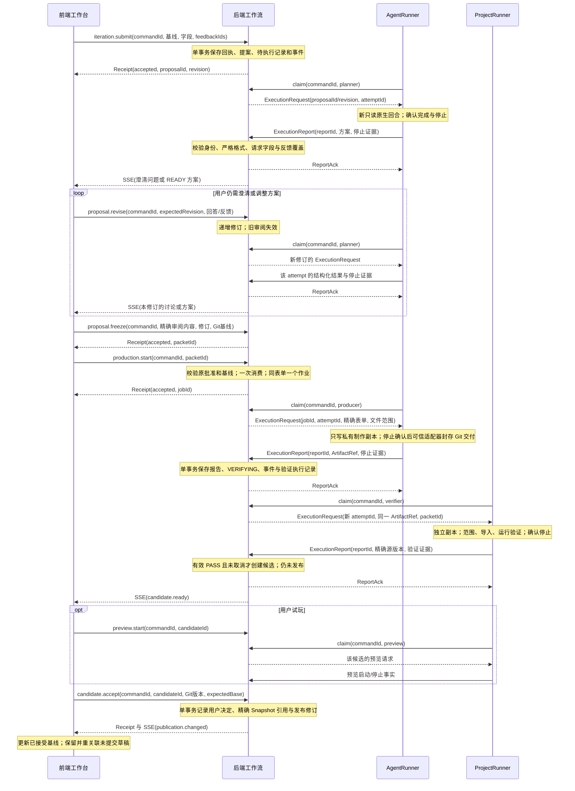
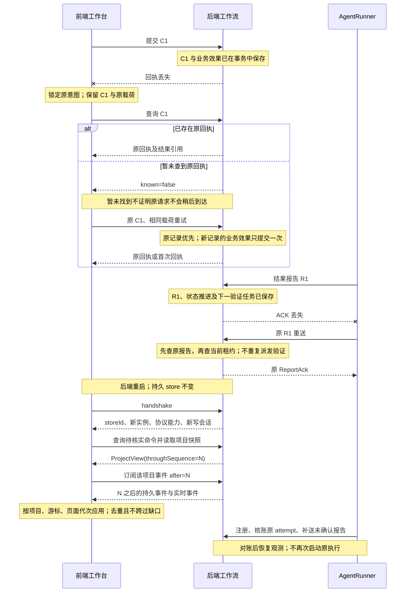
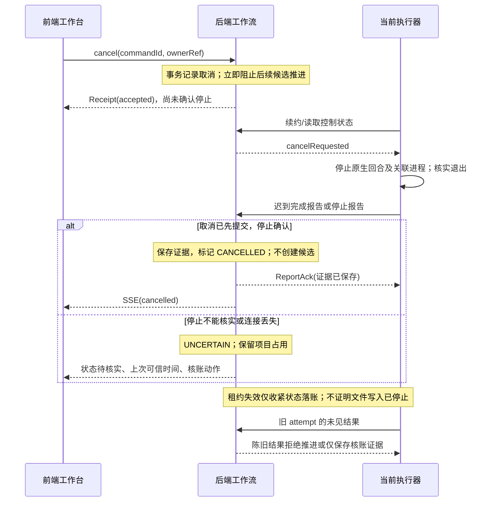
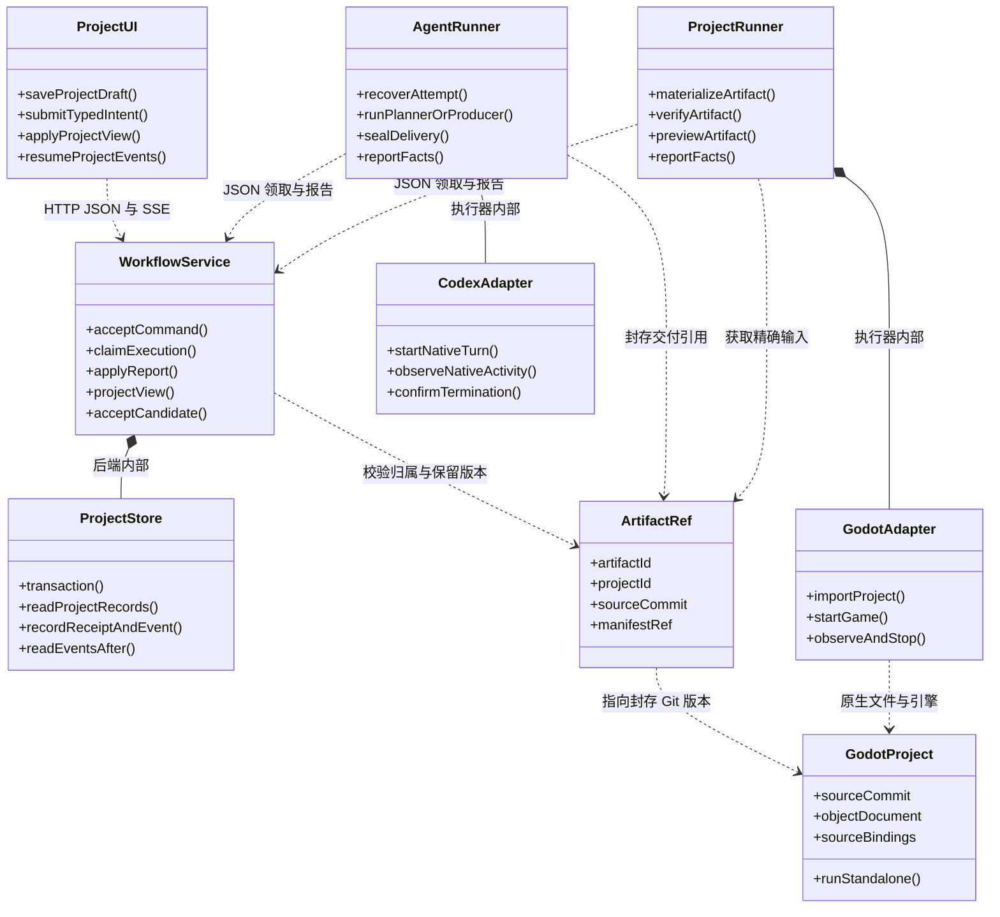
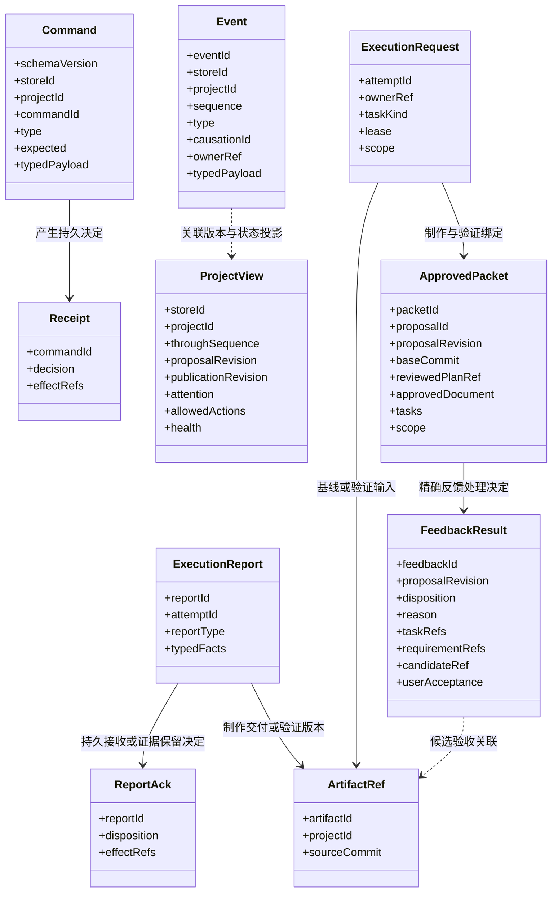

# 四部分分离：协议与组件最终设计审查

日期：2026-10-12。代码基线：`6087e72`。审查对象：[四部分架构草案](STUDIO-FOUR-PART-ASYNC-ARCHITECTURE.zh-CN.md)及当前工作台实现。

后续完整复核已收敛为[最终修改方案](STUDIO-FINAL-MODIFICATION-PLAN.zh-CN.md)。本文保留协议竞争与组件审查依据；实施范围、字段、批准适配和批次以最终方案为准。

后续用户要求的角色权限、模型/effort 参数、实时状态与 token 监督，细化见[Session 参数与持续联系契约](STUDIO-SESSION-PROFILES-AND-LIVENESS.zh-CN.md)。它补充本报告中的 ExecutionRequest/Report，不另建编排系统。

前端用户交互职责和逐图示例已补充到[用户交互、完整类图与时序](STUDIO-USER-INTERACTION-SEQUENCES.zh-CN.md)。本报告的 ProjectUI 是前端边界概括；组件设计以补充文档的 StudioShell、各交互面板、ProjectController 和 StudioTransport 为准。下面的三张图用于审查关键业务与竞争，完整用户流程由补充文档的五组时序展开。

结论：修订后的设计可以进入分批实施。职责和状态归属明确，满足通用 2D 游戏制作台所需的讨论、精细反馈、制作、验证与验收闭环。新增通信、独立 Runner 和严格进程隔离尚未实施或验收；设计审查通过不代表当前服务已经完成四部分分离。

本文中的路由、消息类型、类与时序为拟实施协议。类图表示职责与数据依赖，不要求逐框新增类、微服务或数据库。没有调用真实策划、制作、Godot 或发布；现有基础使用临时测试存储和合成执行回归。

## 1. 最终收敛范围

保留四个边界：独立前端、后端工作流服务、独立 AgentRunner、Godot 项目及独立 ProjectRunner。后端工作流 session 是现有项目、提案、冻结表单、作业与发布快照组成的持久上下文；首版不再增加一套 workflowSession 状态机。一轮讨论复用 proposalId/revision。

前端发用户意图并保存项目草稿；后端维护唯一业务状态和批准事实；AgentRunner 管理原生策划/制作；ProjectRunner 管理验证/试玩及引擎进程。只有后端可推进阶段、产生候选或接受版本。执行器报告可观测事实，不直接写后端数据库。

JSON 用于控制、状态与交付引用。Godot 原生工程通过受控 Git/文件通道交付。对象文档继续使用 `studio.objects.v1`，manifest 引用同一文档和交付版本，避免第二份可变对象值。

首版采用类型化 HTTP 路由、项目 SSE 和一个 SQLite。事件表兼作可重放投递来源，任务领取复用提案/作业及 attempt 记录。独立包可以保留在同一开发仓库；项目游戏各自使用独立 Git 仓库。

## 2. 时序图：讨论、制作与验收



检查结果：接收、原生完成、停止、技术验证、用户接受分别有明确的事实来源。初始阶段使用同一闭环，首个已验证且用户接受的 Demo 才开放迭代入口。制作和验证是同一 Job 的不同 attempt，策划是 Proposal 的 attempt；不为策划创建假的制作作业。

每条反馈须有稳定 feedbackId、处理决定和理由。采纳的反馈关联对象、需求、任务与候选；需要澄清的反馈阻止 READY；推迟或拒绝必须可供用户审阅。技术 PASS 和候选接受不自动解决所有体验反馈。

## 3. 时序图：丢失响应、重启与重放



补充规则：游标过期返回 resync_required；storeId 改变后切换数据命名空间，旧草稿保持待核对；服务实例变化但 store 不变时只更新连接授权并恢复原状态。已记录的重复命令或报告返回原决定，不能因现在的基线或租约变化而重新解释原操作。

若原报告仅保存为核账证据，恢复推进由后端的幂等核账操作读取这些证据决定：当前 attempt 未被取消/替换，归属和实际停止可核实，批准及源版本仍一致，才可继续原验证链路。Runner 不通过换 reportId 重新提交来把证据变成成功。原 ACK 保持原决定，核账的状态变化使用新的后端事件和回执。

重放由 eventId 和项目内 sequence 去重/排序；sequence 不替代 proposalRevision 或 publicationRevision。活动事件不使已审阅方案自动失效。Runner 的 reportId 用于上行幂等，后端 eventId 用于下行重放，两者职责不同。首版不再增加 messageId、dispatchId 或独立 leaseEpoch。

## 4. 时序图：取消、迟到结果与租约失效



结果先提交的情形：若仍处于验证，取消针对当前验证 attempt；若已有候选，沿用候选取消语义；若已发布，取消执行不撤销已接受版本。终态不能被迟到活动重新打开。独占与停止门禁由后端统一决定，租约不代替私有副本和进程权限限制。

## 5. 类图：职责、内聚与依赖



虚线跨进程关系表示协议依赖，不是直接调用另一包的内部方法。Runner 内含小型执行日志及待确认报告，不另设 JournalService。ProjectUI 的草稿和订阅按项目隔离，不另设跨项目共享的业务 ViewModel。

内聚判断：前端围绕用户编辑与展示；后端围绕工作流不变量；AgentRunner 围绕原生执行；ProjectRunner 围绕交付物的验证和运行。后端事务同时覆盖批准、状态、回执和事件，拆成各自独立服务会增加分布式一致性成本。CodexAdapter/GodotAdapter 只翻译运行时与进程事实，不理解候选接受规则。

耦合判断：前端只依赖公开 ProjectView、动作和事件；执行器只依赖自己任务类型的请求及报告。前端不依赖原生 session 日志；AgentRunner 不依赖 Godot 运行副本；ProjectRunner 不依赖 AI 对话；游戏独立运行不依赖工作台在线。共享契约是必要的版本依赖，不共享可变数据库或工作目录。

## 6. 类图：协议记录与版本绑定



图中只列关键字段；各请求与报告都需携带/绑定 storeId、projectId 和授权执行身份。planning 请求使用 proposalId/revision，不要求 ApprovedPacket；执行角色、必需字段与 payload 由该类型 schema 决定。新增反馈版本不能静默进入旧 changeRequest 或旧 planner 的严格键集合。

event.sequence 只覆盖项目公开事件，私有诊断不在该序号空间内。causationId 是可选的实际触发 commandId/reportId 引用；不为整轮交互额外分配另一种必需身份。

跨层检查：已批准表单绑定 proposalRevision/baseCommit；交付物绑定项目和执行；验证绑定该交付物与表单；候选绑定验证版本；接受绑定候选及当前 publicationRevision。只有这些关联全部一致，后端才能更新 Snapshot。

## 7. 所有组件的充分性和必要性

| 组件/机制 | 所承担的必要功能 | 最小决定 |
| --- | --- | --- |
| 项目前端与本机草稿 | 持续精细编辑、来源标注、逐步展开、切换不串扰 | 必需；内部模块，不另设草稿服务 |
| 后端 WorkflowService | 修订、批准、独占、候选及接受的唯一裁决 | 必需；复用既有业务记录 |
| ProjectStore / SQLite | 命令、批准、状态与事件原子保存 | 必需；一个后端数据库，不为每组件另建业务库 |
| 类型化协议与公开投影 | 边界校验、状态来源、兼容迁移、安全摘要 | 必需；共享静态 schema，不设 SchemaService |
| 命令/报告回执 | 防重复意图、ACK 丢失后查询与补送 | 必需；原记录优先于新基线/租约检查 |
| SSE / 事件记录 | 持续下行状态、重放、页面恢复 | 必需；事件表兼作 outbox，不设 EventBus/OutboxService |
| 任务领取、占用与租约 | 解耦执行生命周期，拒绝旧执行推进 | 必需；后端事务与记录，不设调度平台或 LeaseService |
| AgentRunner / CodexAdapter | 独立原生 session 管理、活动事实、停止确认 | 必需；策划与制作角色共用一个 Runner 实现 |
| ProjectRunner / GodotAdapter | 独立验证/试玩、引擎事实与进程管理 | 必需；验证与试玩模块共用一个 Runner 实现 |
| Runner 本机执行日志 | 启动崩溃窗口核账、未确认报告补送 | 必需；有界内部日志，终态证据确认前保留 |
| Git 交付与副本隔离 | 精确版本验证、制作不改试玩或已接受源 | 必需；内部 Git/文件模块，首版不设工件服务 |
| 进程权限与凭据限制 | 阻止 Agent/游戏主动访问另一项目或批准接口 | 严格隔离目标下必需；独立进程本身不足以满足 |
| RuntimeBridge | 有能力的字段在运行中临时预览 | 按需；首版讨论、对象编辑和反馈闭环不依赖它 |
| WebSocket | 高频双向运行控制 | 暂缓；常规操作用 HTTP + SSE |
| 常驻后端 AI session | 为协调增加另一个模型回合 | 当前无必要；需要 AI 时仍派发已有 Runner |
| Kafka、Redis队列、通用微服务平台、全量事件溯源 | 大规模调度或重建平台 | 当前无必要；没有相应负载或功能证据 |

充分性结论：除按需运行时预览外，四边界和上述必需机制覆盖当前用户流程。持续连接不需要让所有 Agent 或游戏永远执行；未启动的组件显示空闲/可用。顶部的阶段与行动者由后端生成，链路、执行器、原生活动和游戏状态分别展示，避免一个“在线”徽标掩盖执行未知。

## 8. 发现的问题与已修订内容

| 编号 | 审查发现 | 草案修订 |
| --- | --- | --- |
| F01 | workflowSessionId 可能引出第二套阶段和批准状态 | 复用 Project/Proposal/Job；讨论身份映射 proposalId |
| F02 | 重复结果若先验租约，会在 ACK 丢失后无法结束补送 | 先查同 reportId 原记录，再校验未见报告的当前执行 |
| F03 | 取消与完成的事务顺序未定义 | 明确取消、验证、候选和发布的竞争处理及终态规则 |
| F04 | jobId 对策划不适用，messageId/dispatchId 重复表达身份 | ownerRef 区分提案/作业/预览；attemptId 作为执行代次 |
| F05 | 原草案不足以约束先封存后验证及发布物化失败 | 验证精确封存版本；Snapshot 引用为发布权威；物化可重试 |
| F06 | Manifest 可能成为另一份可变对象数据库，outbox 可能变成额外服务 | 仅引用对象版本；事件表兼作投递来源 |
| F07 | known=false、领取响应丢失和事件空缺的行为未明确 | 原命令/领取同 ID 重试；缺口重放/快照同步，禁止越过 |
| F08 | 旧严格 feedback/planner schema 与新增 feedbackId 不兼容 | 明确受影响类型的版本升级，保留原对象文档协议 |
| F09 | 将预览副本描述为全部缺失，不符合现有 Git archive 预览实现 | 区分已存在的预览副本与待独立的生命周期/验证副本 |
| F10 | 仅保存证据的 ACK 如何进入后续恢复缺少定义 | 后端幂等核账重新验证事实；原 ACK 不改；禁止换报告身份绕过 |
| F11 | 现有 GM 工程绑定直读后端批准数据库，与独立边界冲突 | 最终方案明确后端消费/复核、幂等输入准备及跨边界只读确认引用；不删除 GM 门禁 |
| F12 | 输入基线、偏好冻结时点、问题字段和备份回退规则存在歧义 | 最终方案区分 base/input/output Git，接收时冻结 profile，保留问题模型并约束数据代次 |

三次复核分别检查业务时序与竞争、组件边界与状态归属、图文契约一致性与当前基础回归。以上问题已修订到主方案；未将未实施的能力写成测试通过。

## 9. 协议实施必须覆盖的场景

| 场景 | 规定结果 |
| --- | --- |
| 相同 commandId、相同业务内容重试 | 返回原决定，业务效果不重复 |
| 相同 commandId、不同业务内容 | 明确冲突，不按新内容执行 |
| 原命令回执丢失，查询暂未找到 | 保持原 ID 和内容，不创建另一意图 |
| 原命令已接收后基线变化，再次重试 | 返回原回执；新的不同命令才校验新基线 |
| 重复领取或领取响应丢失 | 原领取 commandId 返回原决定；同 attempt 不启动第二个原生进程；身份不明则核账 |
| 已接收结果的 ACK 丢失，租约随后变化 | 同 reportId 返回原 ACK，不重复验证或创建候选 |
| 未见过的旧 attempt 结果 | 不推进当前状态；仅拒绝或保存待核账证据 |
| 当前 attempt 的结果仅保存为证据，后来核账 | 核对停止、归属、批准和源版本后决定恢复；原 ACK 不改；新报告身份不能绕过 |
| 取消先提交，完成报告后到 | 停止确认后取消完成，不产生新候选 |
| 制作完成先提交，验证尚在执行时取消 | 停止当前验证；保留原已接受版本 |
| 已形成候选/已发布后取消执行 | 候选可取消；已接受发布不被撤销 |
| 心跳失联或租约到期 | 显示未知/陈旧并核账；不推断进程停止或自动重投 |
| Backend 重启而 Runner 仍执行 | 更新授权、对账原 attempt、补送事实，不重开回合 |
| Runner 启动进程前后崩溃 | 核实可信执行身份；未知则保留占用，不盲目重启 |
| 快照读完、订阅建立前发生更新 | 从 throughSequence 之后回放，更新不丢失 |
| 事件重复、空缺、过期或切换项目后迟到 | 去重；缺口恢复；旧项目事件不改变当前页面 |
| 对象与附件来自另一项目 | 后端拒绝，执行器不能获得另一项目内容 |
| Agent/游戏代码尝试访问其他项目或 Runner 凭据 | 进程权限拒绝；应用层归属检查不能替代该实测 |
| 验证源被修改或不等于候选源版本 | 不生成/接受候选，不能挪用旧 PASS |
| READY 后用户继续反馈 | 新修订并重新审阅；旧批准不能用于新方案 |
| RuntimeBridge 未提供、断开或能力不支持字段 | 保留草稿和制作闭环，明确未产生即时预览效果 |

## 10. 已执行检查与尚待证明

现有基础回归执行：

```sh
.venv/bin/python -m unittest backend.tests.test_object_protocol backend.tests.test_generic_workflow backend.tests.test_project_scoping backend.tests.test_codex_driver -q
```

72 项通过，覆盖当前对象契约、精确冻结、制作/停止门禁、技术验证/接受、项目归属和合成原生驱动。测试在临时存储与合成进程中运行，不是新增 SSE、独立 Runner 或 OS 隔离的集成验收。

文档机械检查通过：2 个 JSON 示例可严格解析；本地引用存在；代码围栏、3 张时序图的参与者/分支、2 张类图的类型引用与括号一致。Mermaid 检查覆盖源码结构，没有调用外部图形渲染器。业务源码和运行服务未改变。

源码事实核对：当前 Coordinator 拥有 SQLite、执行线程、作业与预览；CodexDriver 解析原生事件但只提供启动回调；通用验证使用独立子进程并验证当前制作 worktree；预览从 Git archive 物化独立副本；StudioRuntime 只读对象 JSON。当前还没有本文的独立 Runner、命令/报告回执和可回放 SSE。

仍需在实施中证明：Runner 崩溃恢复与任务占用、事件恢复和流授权、协议升级下的批准一致性、精确封存交付验证，以及原生 Agent/Godot 子进程的跨项目访问限制。Godot 导入缓存和派生文件权限需实际引擎测试，不能以图表或只读配置声明为证据。

审查结论是设计层通过，实施顺序为“契约与交互恢复及明确参数 → 异步事件 → AgentRunner 与批准适配 → ProjectRunner 与独立部署”，详见最终方案。严格进程隔离与交付验证列为对应执行边界的验收条件。遵循 GM non-pk 与仓库既有 GameStudio 原则，保留源锁、Git 基线、停止确认和人工决定；没有运行独立 SHA/MD5 校验，也未调用 Ptah 技能。
