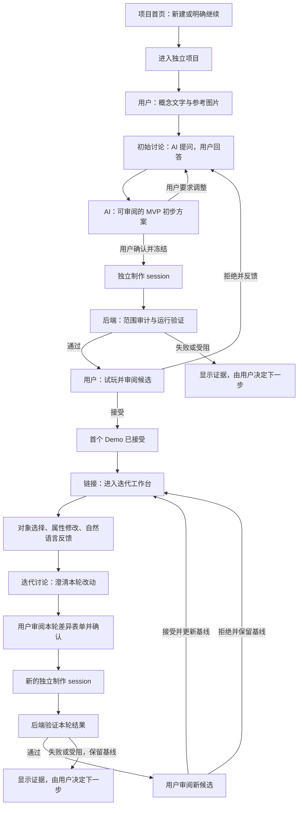

# 工作台项目隔离与分阶段交互改进方案

日期：2026-10-10。状态：**原始方案，实施范围已复核收敛**。代码评估基线：Git `972e51b`。此文件记录初次设计；最新实施范围与验证见[可行性复核](STUDIO-PROJECT-STAGES-REVIEW.zh-CN.md)。

复核后保留现有 SQLite、对象协议与制作链路，采用项目作用域读取、附件归属、轻量页面导航和真实状态展示。下文的分库迁移、通用命令总线、新消息协议及受限 worker 前置条件暂缓，不作为本轮实施要求。

本轮目标是整理通用 2D 游戏制作工具的项目管理与用户流程。以此前重组的 GM non-pk 和 GameStudio 为参考，继续使用现有对象通信契约，使用户能够持续、精细地调整和反馈。方案针对工作台，不以具体游戏案例决定产品结构。

## 1. 四项要求与设计结论

| 用户要求 | 改进设计 | 完成判据 |
| --- | --- | --- |
| 项目分别管理，不能串扰 | 独立项目首页；先创建项目再讨论；数据、附件、草稿、通信、执行、预览均绑定项目 | A 项目的任何资源与迟到响应都不能进入 B 的界面、请求或执行上下文 |
| 用户与 AI 信息明确区分，逐步展开 | 用户输入、AI 提问、AI 方案、后端状态分别标注；按服务端状态挂载当前阶段内容 | 初始讨论中没有“初步方案”正文或制作按钮；用户原文不冒充 AI 方案 |
| 初始讨论与原型迭代分开 | 初始阶段独立页面；首个 Demo 经技术验证和用户接受后，出现“进入迭代工作台”链接 | 未接受的候选不能成为迭代基线；已接受 Demo 可以直接进入对象工作台 |
| 顶部显示正在等谁 | 固定顶部状态栏，由当前项目的后端状态投影驱动 | 清楚区分等用户、等策划 agent、等制作 agent、后端验证、受阻与状态未知 |

建议沿用现有只读策划、独立制作 session、冻结批准、Git worktree、后端验证和候选接受链路；重构项目边界和前端页面组织。隐藏面板只能改善显示，必须同时补齐后端资源归属约束。

## 2. 当前逻辑与具体缺口

以下结论来自代码基线，不代表已经发现任意原生进程跨项目读取文件。

| 当前行为 | 实际缺口 | 改动位置 |
| --- | --- | --- |
| 已有 Project、项目 Git 仓库和制作 worktree | 项目主要是概念提交时隐式创建，没有明确的新建、继续、重命名、归档流程 | `backend/coordinator.py`、`backend/generic_workflow.py` |
| `/api/workspace` 返回所有项目的提案、表单和作业 | 当前页面同时持有多个项目的完整上下文，项目隔离依赖前端筛选 | `backend/coordinator.py:workspace()`、`backend/server.py` |
| `start()` 自动选取最新可恢复提案所属项目 | 打开首页会带入旧讨论或失败任务，用户无法区分新建与继续 | `frontend/studio/studio.js:start()` |
| “创建一个新 Demo”仅重置部分字段 | 提案、冻结表单、作业、附件等状态未全部释放 | `frontend/studio/studio.js:bind()` |
| 附件存在全局目录，Asset 记录没有 `projectId` | 附件归属和跨项目引用没有完整约束 | `backend/coordinator.py:upload_asset()`、`asset_file()` |
| 概念、问答、方案、作业、对象编辑在同页展开 | 初始策划与原型迭代混合；策划尚在运行时也使用“初步方案”标题 | `frontend/studio/index.html`、`studio.js:renderProposal()` |
| 有选择代次和异步响应保护 | 保护分散在可变单例状态中，仍缺少统一项目页面生命周期 | `frontend/studio/studio.js:StudioApp` |

已有隔离机制应保留，但不能把这些基础直接描述成全链路无串扰已经完成。

## 3. 改进后的用户流程



所有“用户确认”都针对可审阅的具体方案或候选。讨论提交、agent 回合结束、技术 PASS 均不能替代制作批准或候选接受。失败、取消和未知结果不会自动重投。

### 项目首页

建议路径：`/studio/`。只显示项目摘要与“新建项目”。每张项目卡片显示名称、初始/迭代阶段、当前状态、最近更新时间，以及“继续”入口；可以重命名和归档，归档保留历史。

首页不自动选择最近项目，不加载任何项目的讨论正文、候选或对象编辑器。项目标题是用户可编辑的名称，项目 ID 是不可变身份。创建项目先分配 ID 和空白项目上下文，再进入概念输入与上传；创建过程不启动 agent。

“继续”打开对应项目的当前阶段；直接刷新项目链接仅恢复链接所属项目。任何页面返回首页，都解除当前项目视图。归档需要项目没有活动或未知执行；有占用时返回明确原因，先完成停止或核账。

### 初始阶段

建议路径：`/studio/projects/<projectId>/discovery`。这里完成概念、初始讨论、初步方案、制作与首个 Demo 审阅。进入迭代后，初始过程作为项目内只读历史保留。

| 当前步骤 | 显示内容与主要动作 | 后续内容的显示条件 |
| --- | --- | --- |
| 概念草稿 | 用户输入与参考图片；“开始讨论” | 不挂载 AI 方案、冻结表单、制作区域或对象编辑器 |
| 等待策划 | 已提交的用户输入；“AI 正在整理问题或方案” | 不把概念原文放进“初步方案” |
| 初始讨论 | AI 问题、用户答案、已讨论的决定；“发送回答” | 只显示问题与讨论；未来步骤最多保留简短流程名称 |
| 方案审阅 | AI 摘要、对象与关系、范围、任务、验收条件；“调整方案”或“确认方案并制作” | 仅合法 `READY` 方案显示完整方案和批准动作 |
| 制作与验证 | 已冻结范围、制作状态、后端证据 | 讨论折叠为只读历史；不显示尚未返回的候选 |
| 候选审阅 | 可运行候选、验证范围与待人工体验项；“试玩”“接受”“拒绝并反馈” | 用户接受前保持初始阶段 |
| 首个 Demo 完成 | 已接受版本和“进入迭代工作台”链接 | 当前快照与技术证据绑定一致，且存在真实用户接受记录 |

流程导航标明当前步骤，已完成步骤可以查看，尚未进入的步骤不展示空白正文或操作。错误与未知状态留在发生问题的步骤，不伪装成已经前进。

用户可在问答中补充文字或参考图片。后端记录其项目归属，递增讨论修订，启动新的只读策划回合；不把补充输入当作制作批准。

### 迭代阶段

建议路径：`/studio/projects/<projectId>/iteration`。未满足首个 Demo 门槛时，返回该项目初始阶段并说明缺少的步骤。已经有可用基线时，后续候选制作、拒绝或失败不撤销进入迭代的资格。

页面参考重组交付中的 GM 适配对象工作台：

- 顶部：项目、当前版本、工作状态和“返回项目首页”。
- 左侧：对象导航与场景/机制等视图，使用统一对象 ID；视图不是各自独立的对象数据库。
- 中间：当前已接受 Demo 的预览、选中对象上下文和候选切换；明确标记“当前版本”与“待接受候选”。
- 右侧：选中对象的属性、自然语言要求和定向反馈；标记“本地草稿，尚未提交”。
- 审阅区域：本轮净差异、反馈、目标对象、基线、文件范围和验收条件；内容改变后重新审阅。

窄屏按对象导航、预览、编辑区顺序堆叠，保留顶部状态和主动作。属性修改不会立即调用 agent；点击“整理本轮调整”进入该项目的迭代澄清。迭代讨论和初始讨论具有不同阶段标签、操作 ID 和讨论记录，但共用问题、对象计划与冻结表单协议。迭代讨论显示本轮改动和已接受基线，不重新要求用户描述整个游戏。

参考依据是 `frontend/src/workbench.jsx`、[语义对象方法](../frontend/docs/SEMANTIC-OBJECT-METHOD.md)和[历史 GM 适配说明](../frontend/docs/GM-ADAPTER-V2.md)。GM non-pk 来源本身没有本次找到的独立网页工作台；不能将适配前端冒称为 GM 原生网页。参考对象选择、草稿、差异审阅和结果分层，不沿用旧项目内容、旧单线程绑定或历史校验示例，不调用 Ptah 技能。

GameStudio 的对象标识、输入/状态/渲染分离和试玩反馈原则继续作为参考，来源版本与采用范围见[通用对象工作流实施契约](GENERAL-GAME-TOOL-PLAN.zh-CN.md)。本轮没有增加新的插件执行授权。

## 4. 用户、AI 与后端信息的显示规范

信息来源必须使用文字标识，颜色与排列只作辅助。消息记录由后端确定作者；前端输入只能提交用户内容，不能声明自己是 AI 或后端。

| 来源 | 显示标签 | 信息内容 |
| --- | --- | --- |
| 用户 | “你 · 初始想法”“你 · 回答”“你 · 本轮调整” | 用户原文、图片用途、结构化属性变化与反馈 |
| 策划 agent | “AI 策划 · 澄清问题”“AI 策划 · 初步方案”“AI 策划 · 迭代提案” | 原生策划返回的合法问题或计划 |
| 制作 agent | “AI 制作 · 执行说明” | 制作过程说明；不作为完成或验证依据 |
| 后端 | “系统 · 工作状态”“系统 · 验证结果” | 派发、进程、验证、候选和核账事实 |
| 用户决定 | “你 · 方案确认”“你 · 候选接受/拒绝” | 绑定具体项目、修订、版本的审阅记录 |

用户原文与 AI 生成摘要分别存储和渲染。方案摘要来自合法策划结果的 `summary`，不是 `proposal.text`。本地未发送内容显示“草稿”；已持久化但还在执行的用户请求显示“已接收，等待处理”。

制作 agent 报告“完成”时，顶部仍依据真实 Job 状态显示制作、验证或受阻。展示验证来源与未覆盖项目，不能用启动成功替代玩法验收。

## 5. 项目隔离契约

### 数据与资源归属

每个项目拥有自己的概念草稿、讨论、提案、冻结表单、作业、session 绑定、附件、候选、快照、反馈、日志和预览。所有内容实体必须具有可验证的 `projectId`；对象身份是 `(projectId, objectId)`，允许不同项目各自存在名为 `player` 的对象。

全局只保存项目管理摘要和服务能力。建议将内容存储拆成按项目独立的库；读取入口为 `ProjectStore(projectId)`，不允许业务代码先全局取资源再由浏览器决定归属。

建议目录结构如下；这是迁移目标，不是当前目录状态：

```text
.workbench/
  catalog.sqlite3                         # 项目名称、阶段和状态摘要
  project-data/<projectId>/
    state.sqlite3                        # 该项目的内容和批准记录
    attachments/
    planning/<proposalId>/round-<revision>/
    jobs/<jobId>/
    session-metadata/
    logs/
    previews/
  projects/<projectId>/                   # 保留已存在的项目 Git 仓库
```

项目卡片的状态摘要允许跨项目管理；项目正文、附件、执行上下文和编辑状态不得跨项目共享。首轮不增加自动复用资产或会话的功能。

每个资源请求与动作都校验：路径项目存在、资源属于此项目、操作人有效、当前修订有效、允许该动作。关联链中的 Proposal、Packet、Job、Candidate、Snapshot 和 Session 必须全部属于同一项目。错误引用另一个项目的资源时返回通用“资源不属于当前项目”错误，不返回该资源正文。

附件上传、读取和引用都经过项目作用域。物理文件路径由后端记录生成并核对解析后的目录；不接受浏览器提供的文件路径，拒绝越界链接或路径。日志和预览也不能仅凭全局 Job ID 定位文件。

### 页面、草稿与异步通信

拆分 `ProjectManager`、`DiscoveryPage`、`IterationPage` 和共享 `ProjectStatusBar`。项目页面只持有一个项目的 ViewModel，避免继续在同一个可变单例上零散清空字段。

切换页面时保存旧项目自己的草稿，释放输入、附件列表、选择对象、讨论、表单、作业、候选与预览；停止旧页面的订阅/轮询，取消浏览器未完成读取，并递增页面代次。取消浏览器请求不等于取消后端制作。

响应只有在 `storeId + projectId + 页面代次 + operationId/修订` 与当前上下文一致时才渲染；旧响应由后端继续记入原项目，不改变新页面。列表点击“查看作业”必须先进入该作业所属项目，不能在 B 项目页单独加载 A 的作业。

草稿与未确认提交键至少包含：`storeId/projectId/stage/basePublicationRevision/draftId`。`storeId` 是持久化的存储实例身份，防止同一浏览器中两个本地服务或生产/测试环境共享草稿。主题等无内容偏好可以全局保存。刷新新建入口和回到首页都不能触发“恢复最新提案”。

### Agent 和执行边界

策划与制作 session 绑定不可变的 `projectId + operationId + 基线`。每轮策划只接收本项目的讨论与附件；制作只接收本项目冻结表单与对应 worktree。使用新 session 时不继承其他项目的聊天、工作目录或任务历史。

同项目保持单个活动写入者；取消/未知执行保持占用，确认进程退出或核账后才能重新制作。锁、进程租约、核账、Godot 预览和结果归属均绑定项目与作业，不能通过“最新 session”或“当前全局预览”定位。

当前原生执行使用同一 OS 账号，Git worktree 与提示词范围不是经过验证的 OS 文件访问隔离。如果“任何形式不得串扰”包含 agent 任意读取其他项目，则还必须提供真正受限的执行 worker：只能挂载本项目的输入与 worktree，并独立维护原生 session 存储；不能暴露宿主项目目录或其他 session 历史。实施时需要实测原生执行与 Godot 所需能力在该环境中可用。

因此交付结果应分别报告“应用与上下文隔离”及“进程文件访问隔离”。前者完成不能自动宣布严格隔离完成。严格模式下，如果后者未配置或未验证，新制作保持受阻并展示具体原因。项目管理和讨论界面重构不依赖伪造这个能力状态。

## 6. 前端与后端的标准通信

保留 `studio.objects.v1` 和现有 `changeRequest`，在其外围增加项目作用域与消息来源协议，不按游戏类别设计额外接口。

### 页面与操作 API（拟新增）

| 接口 | 用途 |
| --- | --- |
| `GET /api/projects` | 项目卡片摘要，不返回全部讨论与制作载荷 |
| `POST /api/projects` | 只创建命名项目和项目存储，不启动策划 |
| `PATCH /api/projects/<projectId>` | 重命名、归档/恢复，使用项目修订防止覆盖 |
| `GET /api/projects/<projectId>/view` | 原子返回当前项目、阶段、状态栏、允许动作和当前步骤所需数据 |
| `GET /api/projects/<projectId>/messages?after=<sequence>` | 读取本项目的标注来源消息 |
| `PUT /api/projects/<projectId>/drafts/<draftId>` | 保存本项目概念或迭代草稿；保留浏览器本地未同步提示 |
| `POST /api/projects/<projectId>/assets` | 上传本项目附件 |
| `GET /api/projects/<projectId>/assets/<assetId>` | 读取经过归属校验的附件 |
| `POST /api/projects/<projectId>/commands` | 提交有类型、有基线、有幂等身份的动作 |
| `GET /api/projects/<projectId>/commands/<commandId>` | 网络结果未知时核对是否接收 |

命令类型包括提交概念、回答问题、请求方案调整、冻结并批准、派发已批准表单、提交迭代、审阅候选、取消和核账。由后端维护允许状态和每种载荷规则；现有冻结/派发关系和批准消耗仍需保持幂等，不能因新入口自动重复执行。

命令信封包含 `schemaVersion/projectId/commandId/type/expectedViewRevision/payload`。影响方案和游戏的命令还携带对应的 `proposalId + proposalRevision` 或 `basePublicationRevision + sourceCommit`；候选审阅绑定精确 `jobId + candidateId + candidateCommit`。无已接受版本的初始草稿使用空基线，不能伪造一个已发布版本。

前端先持久化 `commandId` 再发送。后端以 `(projectId, commandId)` 保存唯一接收凭据；相同命令重查只返回原结果，同 ID 的不同载荷拒绝。连接中断和 5xx 显示“提交结果待核实”，先查原 ID，不创建第二条命令。

现有 `/api/workspace` 收缩到环境身份、能力和摘要；旧资源路由通过同一项目归属层。历史工作流的兼容适配不能绕过隔离。当前会话 token、Host/Origin、版本校验与用户决定绑定继续保留。

### 消息与状态投影

消息采用 `studio.project-message.v1`：必须含 `projectId/messageId/sequence/operationId/actor/kind/createdAt/payload`。`actor` 为 `user/planner/producer/backend`；`kind` 区分概念、问题、答案、方案、执行说明、验证、反馈与审阅。按需带上 Proposal、Job、Candidate 的精确引用。

后端分配作者、顺序和执行引用；文本不能自行推进状态。用户内容、AI 结果和系统证据分别保存。讨论轮次明确标记 `INITIAL` 或 `ITERATION`，每轮都可追溯到用户请求与本项目基线。

项目 `view` 返回 `storeId/projectId/viewRevision/phase/step/attention/activeOperation/allowedActions/currentData`。其中 `phase` 区分初始和迭代；`step` 是当前步骤；`attention` 指明正在等谁。这些由真实 Proposal/Job/接受记录投影，前端不从自然语言推测。`viewRevision` 是项目内持久化单调序号；环境重连另用实例代次隔离旧响应。

## 7. 顶部工作状态栏

状态栏位于项目页面最上方，滚动时保持可见。统一显示“项目名称 · 初始/迭代阶段 · 当前基线/方案修订 · 当前工作状态 · 下一步”。状态必须有文字，不只依赖颜色或转圈。

| 服务端事实或通信情况 | 顶部主状态 | 下一步或解释 |
| --- | --- | --- |
| 项目为空、概念未提交 | 等待你提出想法 | 输入文字或添加参考图片 |
| 请求发送中，未收到持久化接收凭据 | 正在提交 | 保留请求身份，等待确认 |
| 连接中断/5xx，接收结果未确认 | 提交结果待核实 | 按原命令 ID 核账，不重复发送 |
| Proposal `PLANNING` | 等待 AI 策划反馈 | AI 正在整理问题或方案 |
| Proposal `NEEDS_CLARIFICATION` | 等待你回答问题 | 显示需回答的问题数量 |
| Proposal `READY` | 等待你审阅方案 | 查看范围、调整或确认制作 |
| Proposal `FROZEN` 且无关联 Job | 方案已确认，等待制作派发 | 查原派发凭据或恢复一次派发，不再次批准 |
| Job `QUEUED` / `DISPATCHING` | 等待 AI 制作 | 分别说明排队或准备执行环境 |
| Job `RUNNING` | AI 正在制作 | 展示本项目作业身份与最后更新时间 |
| Job `VERIFYING` | 系统正在验证 | 展示实际验证步骤 |
| Job `PROJECTING` | 系统正在整理结果 | 整理对象映射与验证结果 |
| Job `READY_FOR_REVIEW` | 等待你试玩并审阅 | 接受或拒绝当前候选 |
| 首个候选 `PUBLISHED`，且接受/证据绑定有效 | 首个 Demo 已完成 | 显示“进入迭代工作台”链接 |
| 迭代无活动作业、存在已接受基线 | 等待你调整或反馈 | 显示当前版本与本地草稿是否提交 |
| Job `PUBLISHED`（迭代候选已接受） | 本轮完成，等待新的调整 | 更新基线与对象状态 |
| `PLANNING_CANCELLING` / `CANCEL_REQUESTED` / `CANCELLING` | 正在停止 | 确认进程退出前仍保持占用 |
| `PLANNING_UNCERTAIN` / `UNCERTAIN` | 执行状态待核实 | 展示核账入口，禁止依赖该执行启动下一轮 |
| `FAILED` / `BLOCKED` | 当前步骤失败/受阻 | 显示原因和实际可用的重试、调整或核账动作 |
| `CANCELLED` / `REJECTED` | 已停止/候选未接受 | 保留原基线，等待用户决定下一步 |

状态投影以当前项目的 `activeOperationId` 为锚点，再沿精确 Proposal→Packet→Job 关系计算。未关联的旧失败、被替代提案和其他项目任务不会覆盖顶部。历史任务终态保留在历史记录；用户开始新一轮后，顶部显示新一轮事实。

服务断开时显示“连接中断，当前状态未确认”，旁边可保留带时间的上次状态；不继续声称 agent 当前仍在运行或已经完成。到达率和未被观测的进度不换算为虚假完成百分比。状态栏使用 `aria-live="polite"`，避免每次轮询重复播报。

## 8. 迁移规则

1. 先备份当前状态、项目 Git 仓库及运行记录。迁移前确认活动执行停止；未知租约先核账。生产与测试存储分别处理。
2. 保留 Project ID、工作流类型、Git 基线、讨论、冻结载荷、批准消费和候选接受记录。将项目内容与批准记录分配到独立项目存储，建立外部归属索引，不改写历史冻结表单。
3. 旧附件按已存的项目引用关系迁移。一个旧附件被多个项目引用时，为各项目保存独立文件与归属记录，可以在各自命名空间保留旧 Asset ID，避免改写冻结载荷；不得继续指向同一可写文件。无明确引用或归属冲突的附件进入待认领区，不能用于新制作。
4. 旧草稿只在原有存储实例身份可证明时按项目和版本重新关联。浏览器中仅以旧 `workspaceId`、项目 ID 和版本构造的记录不具备可靠存储归属，新版不会自动读取或改写它们；记录保留在浏览器中，用户可自行复制需要的内容。存储失败明确提示，不静默丢弃。
5. 有真实接受记录且当前快照/验证绑定有效的项目可进入迭代。合成 CONCEPT 快照、只完成制作、只有技术 PASS 或测试合成接受，都不能升级为生产 Demo 已接受。
6. 旧 collect-loop 项目继续标记自己的工作流并进入兼容页面；旧批准不转换为 objects-v1 批准。全局首页负责入口，项目内不能混用两种协议。
7. 通过记录数、引用关系、Git 身份与 diff 审阅迁移，并支持失败回滚；不运行独立 SHA/MD5 校验。保留既有 HUD/title_screen 拒绝检查和 `frontend/tools/velvet-source-lock.json`。

项目私有想法、参考图片、session 正文、配置和凭据留在运行数据中，不放入本方案或 Git 交付报告。

## 9. 建议实施顺序与验收

| 顺序 | 交付内容 | 必须通过的检查 |
| --- | --- | --- |
| A：项目边界 | 显式项目创建、项目内容存储、附件归属、统一资源校验、项目级 API | 错误跨项目资源 ID 被拒绝，引用链一致，迁移不改变批准范围 |
| B：页面与状态 | 项目首页、初始页面、迭代页面、统一状态栏、消息作者标注 | 新建为空、逐步展开、旧响应丢弃、状态对应真实后端事实 |
| C：精细迭代 | 对象工作台布局、草稿、反馈、迭代澄清与差异表单 | 修改字段/对象后复核范围，拒绝候选保留基线，接受后更新版本 |
| D：执行隔离 | 受限 worker、独立 session 存储、项目内租约与预览 | 对其他项目的文件/session/预览访问实际被拒绝，原生链路仍能运行 |
| E：交付 | 更新用户与部署手册、迁移恢复说明和验证报告 | 分别报告已实现能力、验证范围、未完成项，不将方案称为已上线 |

先实施 A 再接新页面；B 与 C 复用现有对象、批准和验证核心，避免同时重写游戏制作链路。D 在宣称严格执行隔离之前完成；若 D 尚不具备，保留诚实的能力状态。

可行性上，A 至 C 能在现有 Python 后端和 Studio 前端上逐步实现，主要工作是资源归属、存储迁移和页面生命周期。D 涉及本机原生 session 与 Godot 的受限运行，需要先做能力探针，再确定 worker 部署方式；不能只增加一个配置标志就把它列为已完成。

验收至少覆盖以下情况，使用独立测试存储和合成数据，不操作现有生产游戏：

- 新建 B 时 A 有未完成讨论、失败策划或活动作业：B 只出现空白概念，A 状态只在 A 卡片/页面显示。
- A、B 都有相同对象 ID：B 的属性、反馈、候选接受和源文件修改只能作用于 B。
- 从 A 切换 B 后，A 的策划/上传/作业响应迟到：不能写入 B 的附件列表、方案、状态栏或草稿。
- 使用 B 路径引用 A 的附件、Proposal、Packet、Job、Candidate、Snapshot 或预览：后端拒绝，两个项目不产生内容变化。
- 刷新首页、刷新项目深链、服务重启、切换生产/测试环境：只恢复明确目标及其存储身份，不按“最新任务”恢复。
- 初始讨论/策划运行期间：没有“初步方案”正文和批准制作按钮；方案 READY 才出现 AI 方案。
- 验证通过但未接受首个候选：不开放迭代；用户接受后显示链接；后续失败或拒绝不覆盖可用基线。
- 问题、答案、方案、制作说明和验证报告：均具有真实来源标签，AI 自述无法把 Job 改成完成。
- 排队、制作、验证、等用户、取消、失败、断连和未知状态：顶部文案与允许动作匹配，不自动重复派发。
- 多标签页提交旧修订、网络未知接收、取消后迟到结果：版本冲突或原 ID 核账生效，批准只消费一次。
- 附件迁移多项目引用和无法归属：保持冻结载荷不变，物理文件独立，无法归属的内容不进入新制作。
- 受限执行环境尝试访问另一项目目录和原生 session 存储：被实际阻止；本项目策划、制作、Godot 验证与预览具备所需能力。

## 10. 与既有方案的出入

这次调整保留通用 2D 对象模型、只读多轮策划、独立制作 session、精确批准、技术验证与人工验收分层。对象切分仍服务于细粒度迭代，不引入游戏类别模板作为入口。

变化集中在五处：项目从隐式概念副产物变成明确管理单元；首页从自动恢复改成显式新建/继续；单页流程分为初始与迭代；通信从前端筛选全局记录改成后端项目作用域；顶部工作状态成为后端统一投影。严格的进程隔离属于新增实施范围，当前 worktree 机制不能代替它。

本方案的提交不会修改现有项目、批准新游戏制作、接受任何候选或启动新 session。下一轮工具实现应依照上述顺序交付，并在实现报告中逐项标明验收结果。
