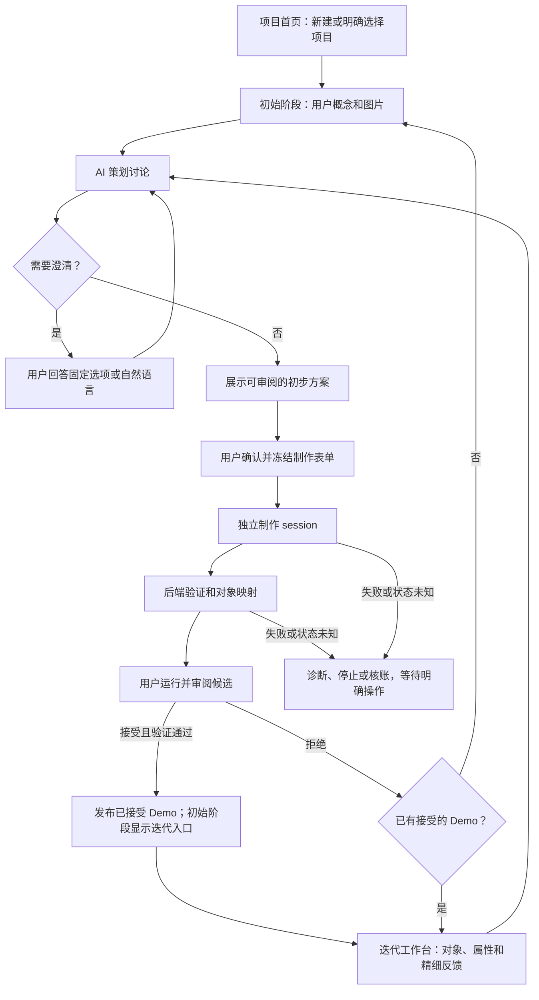

# 项目与阶段改造：可行性复核和实施范围

日期：2026-10-10。状态：已实施并通过验证。本文件修订[原始改进方案](STUDIO-PROJECT-STAGES-PLAN.zh-CN.md)的实施范围，优先满足用户流程，避免扩大系统基础设施。

## 目标对齐

本轮仍面向通用 2D 游戏制作工具，核心是按标准对象持续、精细地调整和反馈。用户要求的是项目内容不串扰、用户与 AI 来源清楚、初始讨论与原型迭代分开，以及顶部明确显示等待谁。首个 Demo 完成后进入迭代，迭代沿用 GM 适配对象工作台的对象选择、属性编辑、自然语言反馈与差异审阅。

这四项要求不需要改变游戏对象格式、改写原生制作链路或按游戏类别增加模板。继续以重组的 GM non-pk 和既有 GameStudio 参考为依据，不调用 Ptah 技能。

## 本轮流程



首个候选被拒绝且没有已接受 Demo 时，返回初始讨论；已有 Demo 的后续候选被拒绝时，继续基于已接受版本迭代。图中的讨论、制作和记录始终绑定所选项目，顶部状态栏显示当前步骤及下一位行动者。

## 可行性与合理性结论

现有 Project、Proposal、Packet、Job、Snapshot、Git worktree、批准消费和候选接受已经提供必要基础。缺口是对象外围的项目边界与页面生命周期，而不是缺少一整套编排平台。

| 原方案选项 | 本轮决定 | 原因 |
| --- | --- | --- |
| 每项目单独数据库和全量迁移 | 暂缓，保留单一 SQLite | 现有记录有项目身份；项目级读取与归属检查可以在现有存储中强制执行，避免批准记录迁移风险 |
| 新的通用命令信封与消息总线 | 暂缓，复用现有类型化接口 | 当前问答、冻结、派发、审阅已有明确载荷、修订和幂等语义；来源标注不需要事件系统 |
| 全新前端框架与路由层 | 保留静态 Studio，增加轻量项目/阶段导航 | 可沿用当前 DOM 与对象编辑控件，避免同时重写交互和业务协议 |
| 为阶段增加第二套策划/制作协议 | 不增加 | 两个阶段使用同一对象协议，基线和本轮请求不同；界面和讨论标签分开即可 |
| 新执行容器作为本轮前置条件 | 不在本轮安装 | 原生 session 和 Godot 的受限部署需要独立实测，不应阻塞已经可交付的工作台改进 |
| 独立项目管理与项目作用域 API | 实施 | 直接解决自动带入旧任务与全局上下文的问题 |
| 新附件的项目归属与旧资源约束 | 实施 | 仅清空界面不能阻止跨项目引用 |
| 逐步显示、初始/迭代分开、状态栏 | 实施 | 直接解决用户感知和下一步操作不明确的问题 |

保留同一数据库不意味着浏览器可以读取全局内容。首页只返回项目摘要；项目正文、提案、表单、作业和附件必须通过对应项目作用域访问。未指明项目的资源接口不能作为绕过入口。

## 最小实施边界

### 项目

- 先命名并创建空项目，再开始概念讨论或上传参考图。创建项目不启动 agent。
- 首页明确新建/继续，不自动恢复最近任务。刷新项目链接只恢复该项目。
- 保留现有项目和批准；重命名与归档不改变项目 ID，不覆盖游戏版本。活动或未知执行需先停止或核账。
- 项目页面仅接收该项目记录。不同项目可以使用相同对象 ID，各自维护属性、草稿、反馈和候选。
- 新附件创建即绑定项目；读图、引用图和重试都验证归属。旧附件只允许依据明确历史引用判定归属；歧义不能被自动认领。

### 页面与精细反馈

采用项目首页、初始阶段和迭代阶段三个视图。初始阶段按概念、问答、合法 READY 方案、制作/验证、候选审阅、Demo 完成逐步展示。继续复用现有控件，不为了“分页面”引入新的组件平台。

每个信息块标注“你”“AI 策划”“AI 制作”或“系统”。用户概念原文与 AI 方案摘要分别展示。尚未生成的方案和未进入的制作区域不显示。

首个 Demo 需要当前项目的已接受版本、对应候选和有效技术验证；单纯生成候选不能打开迭代。迭代展示对象导航、当前版本上下文/预览、属性和反馈。用户草稿不自动触发模型；整理改动、澄清、审阅冻结、制作和候选决定继续逐轮执行。

切换时保存原项目草稿，释放所有项目可变显示状态，停止旧轮询，丢弃迟到响应。浏览器读取停止不等于取消后端作业。草稿包含服务存储身份、项目、阶段和版本，生产/测试不共用。

### 顶部状态

复用真实 Proposal/Job 状态推导等待用户、等待 AI 策划、等待 AI 制作、系统验证、候选审阅、停止、受阻和待核实。状态来自当前项目的关联记录，不从 agent 文本或其他项目最近作业推测。

连接断开时显示状态未确认，保留带时间的上次状态；不自动重投。生成结果与用户接受仍是不同事实。

## 执行边界

本轮交付应用内容与交互上下文的项目隔离。当前原生 session 仍在同一 OS 用户下运行，Git worktree 和项目参数不能证明进程无法读取其他宿主目录。部署说明继续如实保留这一边界，不宣称已实现 OS 沙箱。

若后续要求抵御 agent 或项目代码主动访问其他工程，需要单独设计并验证受限执行环境；这不等同于当前工作台的项目内容串扰修复。本轮不通过虚构能力标志关闭已有制作流程，也不添加未实测的隔离承诺。

## 验证原则

验收聚焦工具，使用临时测试存储和合成记录，覆盖不同项目的相同对象 ID、错误资源归属、迟到响应、新建空白状态、READY 显示门槛、首个 Demo 迭代门槛、顶部等待状态、停止与未知结果。保留现有批准、诊断、对象字段、反馈和版本重关联测试。

不在用户生产项目中自动策划、批准、制作或接受候选。本轮未修改游戏代码，因此无需重新制作示例游戏。按 Git 身份与 diff 检查交付，不运行独立 SHA/MD5 校验。

## 实施与最终检查结果

### 实际交付

- 项目首页提供创建、继续、重命名、归档和恢复。`POST /api/projects` 只创建命名空项目，不启动策划或制作；项目名称不会被发布的游戏标题覆盖。
- `GET /api/workspace` 只返回项目摘要及服务能力，不诊断或加载其他项目讨论。正文通过 `/api/projects/<id>/workspace` 读取；提案、表单、作业和附件接口都带同一项目前缀并检查归属。旧附件歧义会被拒绝；冻结、派发和读取图片字节时再次检查。
- `/studio/?project=<id>&stage=iteration` 支持直接打开和刷新。初始阶段逐步显示讨论、方案、制作、验证和接受；首个已验证且用户接受的当前 Demo 才能开放迭代。
- 迭代工作台保留对象导航、当前版本、属性和自然语言/对象反馈。本轮澄清、方案与冻结表单继续在迭代页面展开，已完成的初始方案不会再次填充页面。首个候选被拒绝时回到初始讨论，后续候选拒绝时保留已接受的迭代基线。
- 顶部固定显示项目、版本、阶段、当前行动者和下一步。新策划优先于历史结束作业；项目切换会保存草稿、清除显示状态，并使迟到的读取、建项、设置和派发响应失效。
- 浏览器草稿使用持久化 `storeId`、项目、阶段和版本作为键。旧格式草稿保留，但不凭 `local`/`test` 标签自动认领。预览按项目分别管理，每个项目同时一个窗口、最多 15 分钟。

### 回归和部署验证

后端完整回归 **134 项通过**。四套 Studio QA 均实际运行通过，覆盖项目首页和作用域、对象字段和反馈、草稿重关联和异步切换、策划重试/恢复，以及迭代阶段的澄清和方案可见性。测试使用合成记录和临时存储，未在用户项目中发起原生制作。前端 QA 使用现有 Node 24.19.0 与 jsdom，没有安装新依赖，也没有以跳过测试代替通过。

可复跑的核心命令（仓库根目录，Node 需可从 PATH 调用）：

```sh
.venv/bin/python -m unittest discover -s backend/tests -q
node frontend/tests/studio-qa.cjs
node frontend/tests/studio-objects-qa.cjs
node frontend/tests/studio-draft-regression-qa.cjs
node frontend/tests/studio-planner-regression-qa.cjs
git diff --check
```

本机服务已在 `http://127.0.0.1:8765/studio/` 重启，现有浏览器已刷新到项目首页。升级前保存一致性 SQLite 备份；升级后的项目实体记录逐条比较保持一致：2 个项目、5 条提案、6 个附件，没有新增制作作业或批准。只读现场核对通过了 17 次跨项目资源拒绝，以及未指明项目的接口拒绝、嵌套作用域拒绝和项目链接刷新。首页原生浏览器核对确认讨论、方案和迭代区域均未提前显示。

`frontend/tools/velvet-source-lock.json` 以及 HUD/title_screen 的既有拒绝检查保持不变。交付用 Git diff 和原生身份检查，没有执行独立 SHA/MD5 校验。

### 多轮自检记录

采用 `self_check` 流水线和 `round_guard.py` 记账。范围为当前工作台完整后端、Studio 前端和相关文档，历史交付、供应商源码和用户私有运行目录不作风格改写。每轮均检查固定六科：`correctness`、`comparison`、`standards`、`emoji`、`style`、`smoke`；Python AST、Studio HTML 引用、JSON、Git 差异/源锁和 Node 语法检查通过，活动范围 emoji 检出为 0。

| 轮次 | 动态科目（每轮不同） | 选择依据与结果 | 问题/修复 | 冒烟 | 连续干净轮次 |
| --- | --- | --- | --- | --- | --- |
| 1 | api-contract-project-ownership; concurrency-project-navigation; data-integrity-draft-store; testability-retained-regressions; documentation-preview-limits | 项目改造涉及资源、迟到响应、草稿和原测试保留，发现并修复下表十项 | 10 / 10 | PASS | 0 |
| 2 | security-frozen-attachments; backward-compat-historical-proposals; testability-object-feedback; boundary-accepted-demo-gate; error-handling-storage-failures | 完整回归和路由复核，发现项目阶段链接刷新被静态入口拒绝 | 1 / 1 | PASS | 0 |
| 3 | compatibility-static-stage-links; data-integrity-preserved-records; concurrency-dispatch-catch; robustness-initial-rejection; documentation-scope-alignment | 端到端目标核对，发现迭代本轮讨论被阶段布局隐藏 | 1 / 1 | PASS | 0 |
| 4 | api-contract-scope-whitelist; concurrency-manager-catalog; boundary-iteration-discussion; backward-compat-legacy-assets; testability-recovery-controls | 复核完整后端结果及四套前端回归，未发现新问题 | 0 / 0 | PASS | 1 |
| 5 | compatibility-deployed-entry; data-integrity-service-restart; security-resource-denials; resource-usage-service-ownership; error-transparency-live-home | 重启并核对生产记录、作用域拒绝与浏览器首页，未发现新问题 | 0 / 0 | PASS | 2 |
| 6 | documentation-user-deployment-consistency; security-committed-data-scope; dependency-health-unchanged-runtime; maintainability-minimal-architecture; determinism-git-checkpoint | 核对说明书、提交范围、依赖和架构边界，未发现新问题 | 0 / 0 | PASS | 3 |

| 问题标识 | 修复内容和验证 |
| --- | --- |
| legacy-draft-store | 移除缺乏服务身份的自动草稿认领；不同存储同项目 ID 回归通过 |
| qa-retention | 恢复策划重试/恢复与草稿重关联的有效旧覆盖，新增独立回归入口 |
| concept-storage-errors | 概念草稿存储故障降级提示，导航不再因未处理异常中止 |
| iteration-layout-breakpoints | 迭代三栏使用完整宽度；移动状态栏与页头断点一致 |
| documentation-limits | 预览限制改为每项目；去除未实现的历史讨论查看承诺 |
| frozen-asset-ownership | 冻结、派发、历史读取和图片访问重新验证附件归属 |
| archive-cancel | 禁止通过取消策划修改已归档历史，保留恢复入口 |
| initial-terminal-recovery | 首个候选被拒绝后释放初始概念入口，保留作业诊断和后端历史 |
| late-navigation-results | 迟到的创建/设置/派发错误不能导航或改变另一项目状态 |
| historical-status-priority | 新策划状态优先于历史拒绝或受阻作业 |
| studio-stage-link-refresh | 静态 Studio 接受项目/阶段链接，API 仍拒绝查询参数 |
| iteration-discussion-visibility | 迭代本轮提问、方案、失败恢复和待派发表单可见；完整回归通过 |

最终达到连续三轮零问题。此次修复直接改变上述缺陷行为；对象协议、批准语义、制作边界与既有用户项目记录保留。应用层项目隔离已落地，同用户进程的 OS 沙箱边界仍按前文如实说明。
