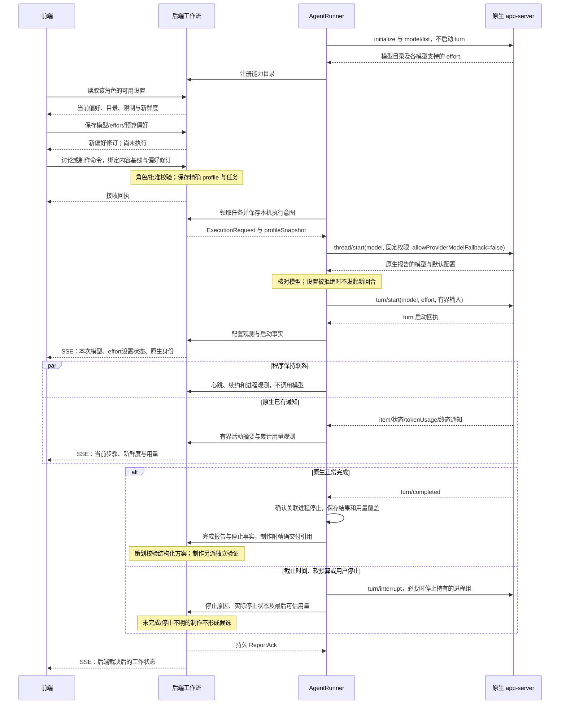
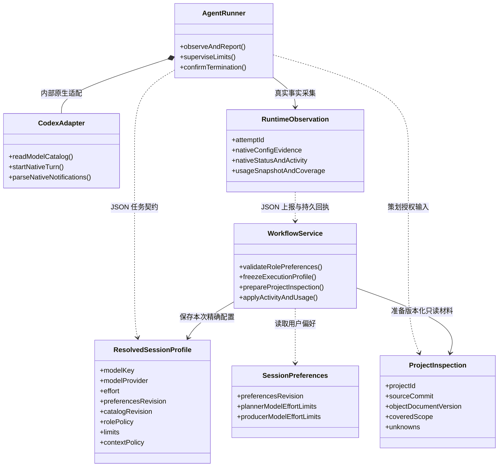

# 策划与制作 session：参数、实时联系与用量控制

日期：2026-10-12（Asia/Shanghai）。代码基线：`6087e72`。本文件细化[四部分架构](STUDIO-FOUR-PART-ASYNC-ARCHITECTURE.zh-CN.md)，是拟实施契约，不是已经上线的接口。

最终实施范围、字段命名、配置冻结时点、GM 批准边界和验收顺序以[最终修改方案](STUDIO-FINAL-MODIFICATION-PLAN.zh-CN.md)为准；本文保留角色、原生协议和用量依据的详细说明。

结论：保留一个 AgentRunner 实现，分别创建只读策划与可写制作 session。前端选择执行偏好，后端校验并保存本次精确配置，Runner 管理原生执行与事实采集。心跳、租约、状态传输和用量记录由程序完成；维持联系不增加模型回合。

用户交互前端的完整组件、五组端到端时序及逐图消息示例见[用户交互、完整类图与时序](STUDIO-USER-INTERACTION-SEQUENCES.zh-CN.md)。本文中的图专门展示 session 配置与执行事实，不代替完整用户工作流。

## 1. 两种执行角色

| 项目 | 方案制作：planner | 游戏制作：producer |
| --- | --- | --- |
| 用户入口 | 初始概念、问答、对象调整与反馈 | 审阅并确认精确方案后启动制作 |
| 工作流归属 | proposalId/revision | jobId/packetId |
| 项目输入 | 新项目无源版本；已有项目取精确 Git 基线的只读检查材料 | 已批准表单、精确基线及私有制作副本 |
| Agent 能做什么 | 读取授权检查材料、澄清、提出计划、指出未知项 | 在批准文件范围内实际修改游戏，报告执行结果 |
| Agent 不能做什么 | 修改游戏、改变批准、运行项目代码、生成候选 | 改冻结规格、接受候选、写试玩或已接受副本 |
| 输出 | 严格结构化问题/方案、反馈决定与检查覆盖引用 | 实际源文件变化、原生结果、停止事实与交付引用 |
| 后端负责 | 身份、修订、检查基线、请求字段及反馈覆盖校验 | 批准、范围、独占、交付版本、验证和候选接受 |
| 验证/发布 | 只读检查不等于运行验证；不创建候选 | 停止确认后封存，再交 ProjectRunner 独立验证 |

前端不直连原生 Agent。策划和制作使用不同原生 session、输入包、工作目录和权限，代码可复用同一个 Runner/Adapter。后端工作流 session 始终是持久业务上下文，不是另一个常驻模型回合。

### 策划如何只读检查项目

已有项目由后端根据已接受 sourceCommit 和目标对象准备 ProjectInspection：

- 当前对象文档、相关需求和 sourceBindings；检查覆盖范围与未覆盖项。
- 对应 Git 版本的文件清单和有界源片段，必要时提供受限只读快照。
- 本轮字段差异、未解决 feedbackId、已确认决定和新回答。
- 与本轮相关的已授权参考图，注明哪些真正进入本次原生输入。

检查不能指向正在制作的可变目录或“最新工程”。没有游戏源的初始项目明确记录 sourceAvailable=false、sourceCommit=null，不装载其他项目。后端项目记录仍然存在，不能将“尚无游戏源”写成“没有项目”。相同基线与范围的确定性检查材料可以复用，不在每次键入时重新读取全工程。

ProjectInspection 至少绑定 projectId、sourceCommit、对象文档版本、目标对象/文件范围、截取限制、实际覆盖与未知项。文件引用由可信适配器解析到该版本，不能通过绝对路径、符号链接或其他项目引用扩大读取范围。材料被截断时记录未覆盖部分；复杂问题需要扩大检查范围时，先补材料，不能把片段检查说成全工程理解。

只读检查保留事实来源，不将静态读取称为已运行或已验证。禁止导入、启动游戏或执行项目脚本。不能实测限制原生读范围/工具执行时，使用后端准备的检查材料并如实报告能力；不能靠提示词宣称已实现严格权限隔离。

当前代码的 planner 主要接收 currentDocument、changeRequest、discussion 与参考图，并未提供上述版本化源码检查材料。这是此次细化需要补齐的功能。

## 2. 前端可以设置什么

项目内保存两组执行偏好，角色键为 planner 和 producer（策划和制作）；任务类型键为 plan/produce/verify/preview。前端展示当前角色适用的设置；讨论时显示策划设置，制作入口出现后显示制作设置。运行中的 attempt 展示已保存配置，不随编辑偏好改变。

| 前端可选择 | 后端如何处理 |
| --- | --- |
| modelKey | 从目标 Runner 目录中选择实际 model 键；校验该角色的允许范围 |
| effort | 只展示所选模型的 supportedReasoningEfforts，不使用全模型共用的固定枚举 |
| 执行时间上限 | 在角色允许上限内校验；超出范围明确拒绝，不静默截断 |
| token 软预算 | 显示测量来源和限制能力；与时间/上下文限制组合 |
| 恢复为角色默认 | 后端解析为具体配置并回显，不将未解析的默认值冒充已确认模型 |

权限、审批策略、读写根目录、allowedFiles、工具/插件范围、Runner 凭据和原生任意 config 由后端控制，不是前端参数。原生接口即使允许覆盖 sandboxPolicy，工作台也不对用户载荷开放该字段。

模型目录由 Runner 的原生 model/list 获取并缓存，不创建模型回合。后端返回 catalogRevision、observedAt、nativeVersion、模型实际键、显示名称、支持的 effort 和输入模态。可先在注册、设置页读取或已知目录变化时刷新，不在每次心跳查询目录。

目录元数据不能单独证明账户最终可执行某模型；启动时仍处理认证、可用性与配置拒绝。选择了图片参考时校验输入模态。模型或 effort 不可用则说明原因，不静默换模型、提升 effort 或删除参考图。

精确配置还绑定 modelProvider 和角色策略版本；目录必须属于实际领取任务的 Runner 环境。由后端选择执行器并检查该环境的目录修订，不能把一台机器的目录当作所有执行器的能力。首版只有一个 AgentRunner 时无需调度平台。派发前能力变化则返回明确冲突，保留用户偏好；不自动重新解析为另一模型。

### 偏好、精确配置与原生观测

1. SessionPreferences：用户意图，可编辑，有 preferencesRevision。
2. ResolvedSessionProfile：后端解析后的本次配置，绑定 attempt，不再改变。
3. RuntimeConfigObservation：原生实际报告或接受的配置，附事实来源。

首版两角色偏好共同使用项目作用域的 preferencesRevision，更新任一角色都返回新修订；catalogRevision 属于绑定的 Runner 环境。二者均不代替 proposalRevision 或 publicationRevision。原生观测只能追加执行事实，不能覆盖冻结 profile；启动报告与精确模型/供应方不符时不发 turn，已启动后发现不符则停止并记录差异。

角色默认或继承配置须解析为具体值并显示；前端提交讨论/制作命令携带 expected.preferencesRevision。后端接收该命令的事务中绑定目标 Runner 环境和目录、冻结 profile 与待执行 attempt，不等到领取时再选择模型。领取前重验兼容性；变化时明确冲突，不静默替换。设置变化只作用于后续执行，重复命令先返回原回执，不因现在的偏好版本变化而创建新执行。

制作计划批准与执行偏好分别保存：改变模型偏好不自动改变游戏方案，也不启动制作。production.start 在原有批准门禁内保存精确执行配置；运行中改偏好不热切换模型。停止、重试与新 attempt 继续遵守既有批准和独占规则，不复用已消费批准绕过门禁。

### 拟新增的前端命令示例

示例数据均为虚构；预算数值仅说明契约，不是当前部署默认。

```json
{
  "schemaVersion": "studio.message.v1",
  "kind": "command",
  "type": "session.preferences.update",
  "storeId": "store-example",
  "projectId": "project-example",
  "commandId": "preferences-command-example",
  "expected": {"preferencesRevision": 1},
  "payload": {
    "role": "planner",
    "modelKey": "<执行器目录中的实际模型键>",
    "effort": "medium",
    "limits": {
      "maxDurationSeconds": 420,
      "softTotalTokens": 12000
    }
  }
}
```

此命令只保存设置，不调用模型。现有 `/settings` 仅接受 title/archived，不能直接加入这些字段；实施时增加类型化接口并更新其严格校验。

后端生成的策划任务片段：

```json
{
  "schemaVersion": "studio.execution.v1",
  "taskKind": "plan",
  "projectId": "project-example",
  "ownerRef": {"kind": "proposal", "id": "proposal-example", "revision": 2},
  "attemptId": "planning-attempt-example",
  "profileSnapshot": {
    "preferencesRevision": 2,
    "catalogRevision": 8,
    "modelKey": "<执行器目录中的实际模型键>",
    "modelProvider": "<实际供应方键>",
    "effort": "medium",
    "rolePolicy": "planning-readonly-v1",
    "limits": {"maxDurationSeconds": 420, "softTotalTokens": 12000},
    "contextPolicy": "targeted-project-inspection-v1"
  },
  "inputRefs": {
    "sourceAvailable": true,
    "sourceCommit": "<精确 Git 基线>",
    "inspectionRef": "inspection-example",
    "planningInputRef": "planning-input-example"
  }
}
```

这是执行契约片段，完整任务仍需绑定 store、授权 Runner 与租约。producer 使用另一 rolePolicy、job owner、approvedPacketRef 和私有制作输入；前端不能自行填写或改变这些服务端字段。

## 3. 配置和活动时序

下面是配置和活动的局部时序。包含用户动作、项目管理、澄清、精确审阅、独立验证、试玩、反馈和恢复的完整流程，见[完整时序与相邻示例](STUDIO-USER-INTERACTION-SEQUENCES.zh-CN.md#sequence-project)。



原生 thread/start 返回的 reasoningEffort 是启动时配置；后续 turn/start.effort 可能覆盖它。当前导出的 TurnStartResponse 不返回最终 effort。界面区分“请求值”“原生已接受设置”“原生报告值”，不能把启动默认或请求值标为本回合已观测的实际 effort。

设置被接受仅表示原生请求获得成功回执，不证明内部执行参数已经逐项被观测。没有对应事实时保留未知；启动时报告的 model/modelProvider 同样注明其来源与时点，不能冒充后续每个内部请求的配置证据。

可用模型不一致、effort 拒绝或启动响应未知时，不通过更换身份再启动回合。保留原 attempt 并沿用回执/核账规则。

## 4. 持续联系不消耗额外模型回合

建议起始配置：活动执行时约 5 秒 Runner 心跳/续约，约 30 秒租约；SSE 约 15 秒保活；公开活动/用量摘要按 1–2 秒合并发送。实际阈值可按本机响应调整，由后端/Runner 策略维护，不向模型发送这些保活请求。

| 观测 | 来源 | 界面含义 |
| --- | --- | --- |
| 后端 API 与写会话 | HTTP 握手/读取 | 是否可读、是否可提交 |
| 前端订阅 | SSE 保活、游标及连接状态 | 状态流是否连续、是否需要同步 |
| Runner 存活 | 独立程序心跳 | 执行器最近有响应 |
| 原生进程/传输 | Runner 持有的进程和 stdio/RPC | 原生进程与联系是否可观测 |
| 原生回合/活动 | thread/status/changed、item/turn 通知 | 最近真实步骤和回合状态 |
| 模型/工具用量 | thread/tokenUsage/updated | 最近原生报告的累计用量 |

长时间没有新活动不等于断线；推理、工具或网络重试期间可能没有通知。分别显示 lastRunnerHeartbeatAt、lastNativeNotificationAt、lastActivityAt、lastUsageAt。模型网络未被原生事实确认时保持未知，不用 Runner 在线证明模型仍在推进。

Runner 采集线程与 HTTP 上报解耦，避免慢上报阻塞 stdout 读取。断线期间保存有界待确认记录、合并活动；终态证据在接收确认前保留。租约失效不证明进程已停止，禁止自动重开制作。配置中的时间与预算监督在 Runner 本地执行，后端断开后仍然有效；无法确认停止继续保持未知。

租约截止使用后端时间，本地执行截止使用单调计时；不能靠机器墙钟一致判断占用或运行时长。maxDurationSeconds 从本次原生进程启动计时，包含初始化、工具和原生网络重试；排队与等待用户答复不计为活动执行。Runner 失联、原生传输异常与活动沉默分别报告。原生启动响应丢失时先核对既有原生身份；状态查询属于程序 RPC，不增加模型回合。无法确认身份时保留不确定状态，不能为恢复界面而再发 turn/start。

前端刷新/切换项目只恢复快照、更新写授权和重放事件。原生通知不需要模型另写“进度总结”，也不向模型循环发送“还在吗”。等待用户反馈期间不保持活动模型回合；偏好编辑、对象草稿、刷新状态和心跳都不启动 Agent。

### 后端如何向前端解释当前状态

顶部主状态由后端业务事实生成；连接和用量是附加观测，不另建前端工作流状态机。

| 事实条件 | 顶部主文案 | 工作台显示 |
| --- | --- | --- |
| 初始输入或需要澄清，当前无活动回合 | 等待用户反馈 | 用户输入和已收到的 AI 问题；初步方案未形成时不展开方案区 |
| 已接收讨论意图，尚未实际开始 | 等待策划开始 | 接收回执和本次设置；不能用排队代替原生活动事实 |
| planner 已领取并实际开始 | 等待 Agent 整理方案 | 本次策划模型/effort、只读检查范围、最近真实步骤 |
| 已接收制作意图，尚未实际开始 | 等待制作开始 | 接收回执、冻结方案和配置；不能写成正在制作 |
| producer 已实际开始 | 等待 Agent 制作 | 本次制作配置、活动、停止操作及最后可信更新 |
| 制作结束，独立技术验证执行中 | 等待后端验证 | 精确交付版本和验证状态；不能宣称候选可发布 |
| 方案可审阅或候选可验收 | 等待用户确认 | AI 输出与用户决定分区，按当前阶段开放下一步 |
| 执行联系或停止事实不足 | 执行状态待核实 | 保留上次可信状态、独占和草稿；提供核账，不自动重开 |

SSE 断开只改变页面对状态流的新鲜度判断，不能自行将后端作业判为失败。原生工具等待审批时显示“等待审批处理”，由后端按角色政策拒绝或走已有审批入口；不能让模型在后台反复重试。公开活动只传步骤类别与安全摘要，不把推理片段、原始工具输出或完整诊断当成用户讨论内容。

### Runner 上报示例

下例仍是拟议协议，身份、时间与用量均为虚构。与统一信封一致的报告经过授权、归属与类型校验，再依原 reportId 回执/当前 attempt 规则处理。

```json
{
  "schemaVersion": "studio.message.v1",
  "kind": "report",
  "type": "execution.observation",
  "storeId": "store-example",
  "projectId": "project-example",
  "ownerRef": {"kind": "proposal", "id": "proposal-example", "revision": 2},
  "attemptId": "planning-attempt-example",
  "reportId": "observation-example-04",
  "payload": {
    "observationSequence": 4,
    "nativeRef": {"threadId": "thread-example", "turnId": "turn-example"},
    "runnerObservedAt": "2026-10-12T03:00:00Z",
    "config": {
      "requested": {"modelKey": "<执行器目录中的实际模型键>", "effort": "medium"},
      "threadStartReported": {"modelKey": "<执行器目录中的实际模型键>", "effort": "high"},
      "turnStartAcknowledged": true,
      "turnEffortReported": null
    },
    "nativeState": {"process": "running", "turn": "inProgress"},
    "activity": {"kind": "tool_completed", "observedAt": "2026-10-12T02:59:58Z"},
    "usage": {
      "source": "thread/tokenUsage/updated",
      "coverage": "native_thread",
      "totalTokens": 9000,
      "observedAt": "2026-10-12T02:59:59Z"
    }
  }
}
```

这里的 threadStartReported.effort=high 是启动默认；本回合请求 medium，原生已回执，但实际 turn effort 未另行报告，所以仍为 null。observationSequence 只在本 attempt 内判断 Runner 观测先后，不替代后端 event.sequence；合并摘要时可跳号。心跳时间以后端接收时记录，不能用重连补送的旧 observedAt 假装新心跳。状态、活动和用量有各自观测时间，不能把 1–2 秒的摘要发送间隔当成原生用量更新频率。

## 5. token 用量控制

### 能够直接约束的部分

- 默认每次显式提交讨论对应一个策划回合，制作对应明确批准的一次执行；保存草稿与普通字段编辑不在此列。不后台循环澄清或自动创建更多模型回合。
- 心跳、查询、状态映射和预算计算只用程序；不调用额外总结 Agent。
- 上下文发送已确认决定、未解决问题/反馈、目标对象、关键约束和本轮输入；不重新发送完整历史、原始诊断、全项目源代码及无关图片。
- 相关源码通过有界片段或受限读取提供；保持源绑定、验收条件和未解决反馈，不能为了省 token 删除关键约束。
- 固定角色契约前缀、复用确定性检查材料；原生缓存是否命中由实际用量体现，不承诺固定节省比例。
- 模型/effort 默认由角色和支持目录解析，界面明确展示。可从 medium 或模型推荐档起步；复杂轮次由用户明确选更高档，不默认使用最高档或自动升级。
- 设置本次执行时限、可观察 token 软预算与上下文大小策略；没有自动的新 Agent 回合重试。原生 SDK 自身的网络重试另行观测，不能将“不创建新回合”写成“绝无重试消耗”。
- 首版维持现有 managed profile 关闭 multi_agent 的做法；不自动创建额外模型子任务。未来若开放子 Agent 或内部调用模型的工具，必须显式声明其权限、预算归属和可观测覆盖，不能假设主线程计数包含这些消耗。

只读源码检查、模型目录读取和 JSON 传输本身不生成模型 token；检查内容随后进入模型上下文或工具结果时仍计入模型用量。

### 预算不是未经证明的原生硬上限

本机 TurnStartParams 没有直接的最大 token/输出 token 字段。softTotalTokens 是工作台的用量监督阈值，不传成一个不存在的原生 max_output_tokens 参数。

Runner 使用原生累计 total 监督本 attempt；接近阈值时更新提示，超过阈值时请求中断并核实停止。原生用量通知的频率和延迟未被 schema 保证，单次生成/工具往返及停止延迟可能超过阈值。用量缺失时显示未知，仍使用上下文与执行时限；不能显示 0 token 或宣称 token 硬上限正在生效。

停止记录由程序保存，包含 stopReason、最后可信用量、原生状态和工作副本。预算耗尽后不要求模型再生成一份长总结。未完成交付不进入候选；后续继续由用户操作并经过现有门禁，不能自动加预算重开 session。

### 用量记账与展示

原生通知包含 threadId、turnId 和 tokenUsage，其中有 last、total、modelContextWindow；Breakdown 有 inputTokens、cachedInputTokens、outputTokens、reasoningOutputTokens、totalTokens，另有可选 cacheWriteInputTokens。

用量报告按 attempt/thread 保存最后可信累计快照与观察次序，去除重复 reportId，拒绝迟到观测回退。不能将连续累计 total 相加，也不自行重复叠加缓存或推理分项。线程复用、累计值重置或来源不完整时明确标记覆盖范围；last 的具体计量窗口未由此 schema 说明，不把它猜成当前 turn 的完整账单。

每次讨论修订使用新只读 session；后端可按唯一 attempt 汇总已知用量，并提示尚有未报告的部分。显示原生统计与估计的来源。未核实订阅/API 计费方式和价格时只显示用量，不推算金额或承诺账单上限。

软预算覆盖本次可观测的原生线程用量，不能未经验证就称为全部外部工具或子线程用量。主流程用量覆盖不完整时显示“不完整/未知”；项目累计按独立 attempt 取最后可信值汇总，停止后的可信补报只修正记账，不重开业务状态。上下文截取用确定性的文件数/字符数限制；如展示输入 token 预估，注明其为估计，不以它证明总预算必然可满足。

## 6. 类图与最小组件

下面展开后端/Runner 的配置与观测职责。前端包括 StudioShell、ProjectManager、DiscussionPanel、ReferenceTray、ProposalReview、IterationWorkbench、ObjectInspector、FeedbackEditor、CandidateReview、ExecutionMonitor、DraftRebaseDialog、SessionSettings、StatusBar，以及内部 ProjectController、DraftStore 和 StudioTransport；完整依赖与现有界面映射见[前端交互类图](STUDIO-USER-INTERACTION-SEQUENCES.zh-CN.md#frontend-classes)。前端动作统一经类型化通信进入后端，不直连原生 Agent 或工程。



这些记录/方法归属既有后端、Runner 和公开 ProjectView。目录缓存、预算监督、活动合并与只读检查材料都使用内部模块；不新增模型选择服务、预算 Agent、心跳 Agent、用量数据库或第二套 session 编排。

## 7. 现有差距与具体改动入口

| 当前事实 | 必要改动 |
| --- | --- |
| 项目 settings 只有名称/归档 | 类型化执行偏好及其修订；前端两角色设置 |
| planner 固定 medium、420 秒；producer 继承模型/effort、1800 秒 | 从后端本次 profileSnapshot 建立驱动；保留明确角色时限 |
| 驱动接受固定八种 effort 字符串 | 按实际模型目录校验组合，适配原生的非空字符串 effort 定义 |
| thread/start 响应未保存配置事实 | 记录报告的模型、默认 effort 和后续设置接受状态 |
| 驱动只向协调器回调进程启动 | 增加配置、状态、活动和用量的事实回调/上报 |
| planner 没有精确源码检查输入 | 后端 ProjectInspection 与只读输入，显示覆盖/未知 |
| 当前前端依赖轮询且尚无 SSE 回放 | 先将轻量事实加入公开投影，再接入既定持久事件流 |

入口仍是 `backend/codex_driver.py`、`backend/generic_workflow.py`、`backend/coordinator.py`、`backend/server.py` 和 `frontend/studio/studio.js`；工程运行/验证继续归 ProjectRunner。先补明确参数与事实观测，再落实独立执行器恢复，保持现有批准、源锁和停止门禁。

## 8. 依据、检查与实施验收

官方 OpenAI documentation 的 app-server 页面在本轮通过 HTTP 与浏览器读取均返回 403，未以未读取的页面内容作证据。参数依据是本机 `codex-cli 0.162.0-alpha.17.2` 的协议导出：

```sh
codex app-server generate-json-schema --experimental --out <临时目录>
```

已核对 ModelListResponse、ThreadStartParams/Response、TurnStartParams/Response、ThreadTokenUsageUpdatedNotification、ThreadStatusChangedNotification、TurnInterruptParams 和 ServerNotification。导出只生成 schema，没有启动实际 Agent 回合。Schema 定义不证明当前账户模型列表、用量通知频率、实际消耗或计费方式。

实施必须验证：

1. 两角色读取/写入范围、精确源检查、未覆盖项及跨项目拒绝。
2. 模型/effort 不支持、目录陈旧、图片模态不匹配和配置被拒绝时不静默替换。
3. 改偏好不调用模型；派发绑定精确偏好修订；运行中偏好修改不改变本次执行。
4. 配置请求、原生接受和原生报告分开显示；不将默认 effort 冒充 turn 的观测值。
5. 无新活动时心跳仍正常；慢上报不阻塞原生读取；断线补送不重开回合。
6. 用量重复、乱序、缺失或重置时不重复记账、不虚报零消耗。
7. 后端断开时 Runner 的时限/可观察预算监督仍执行；停止不明仍保留独占。
8. 超预算不自动加额度，不产生未完成候选，不额外调用总结 Agent。
9. 等待用户/Agent/制作/验证与待核实文案来自真实事实，活动沉默不误判失联；审批等待有明确处理入口。
10. 多执行器目录归属、时钟差异、启动响应丢失及主线程以外用量缺口不会静默改变模型、重开回合或虚报完整预算。

已完成文档检查：本文 3 个 JSON 示例可严格解析，无重复键或非标准常量；本地链接存在；代码围栏、时序图分支/参与者与类图引用一致。关联的四份文档共核对 6 个 JSON 示例、4 张时序图与 3 张类图；Mermaid 只检查源码结构，没有验证图形渲染。没有把文档检查或既有基础回归当成新协议的集成验收。

本轮更新契约文档并核对本机协议，没有修改运行服务、启动真实策划/制作或执行独立 SHA/MD5 校验。
