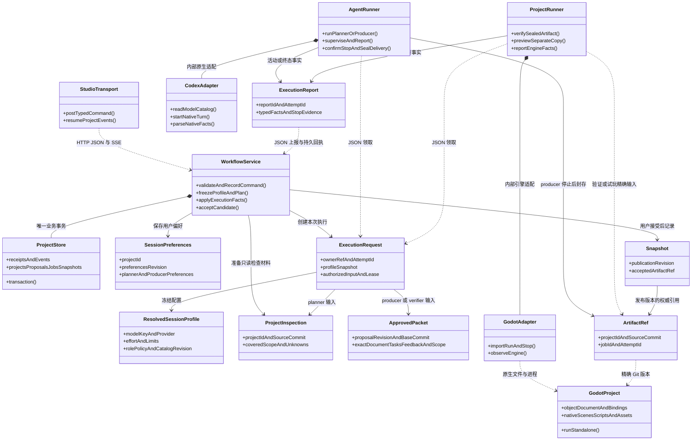
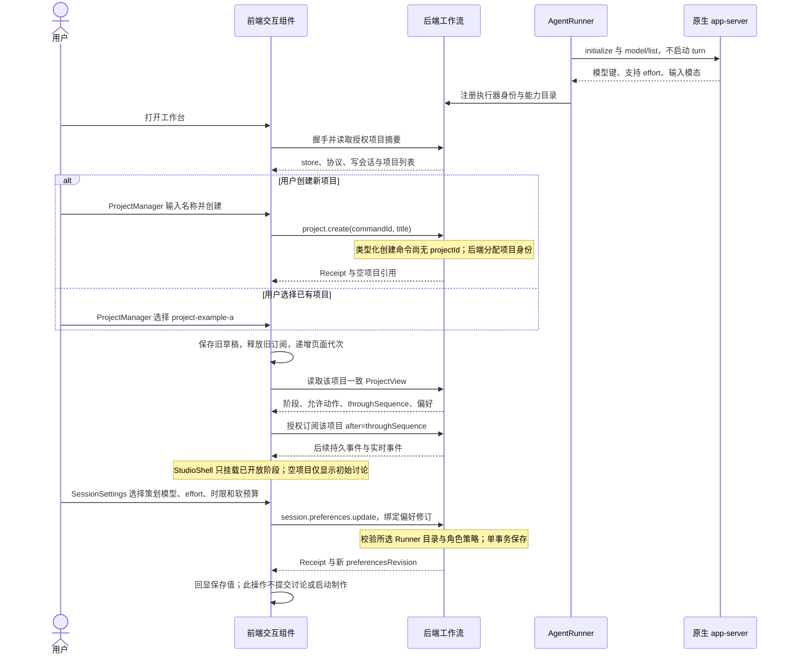
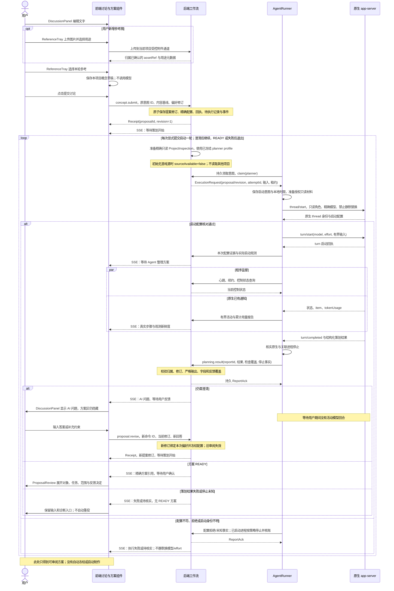
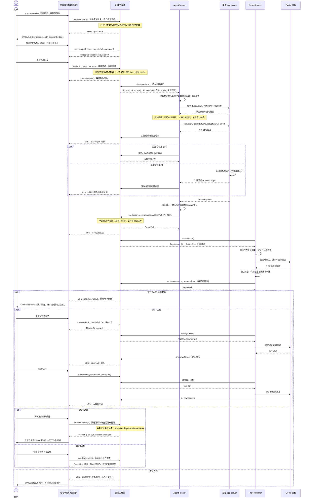
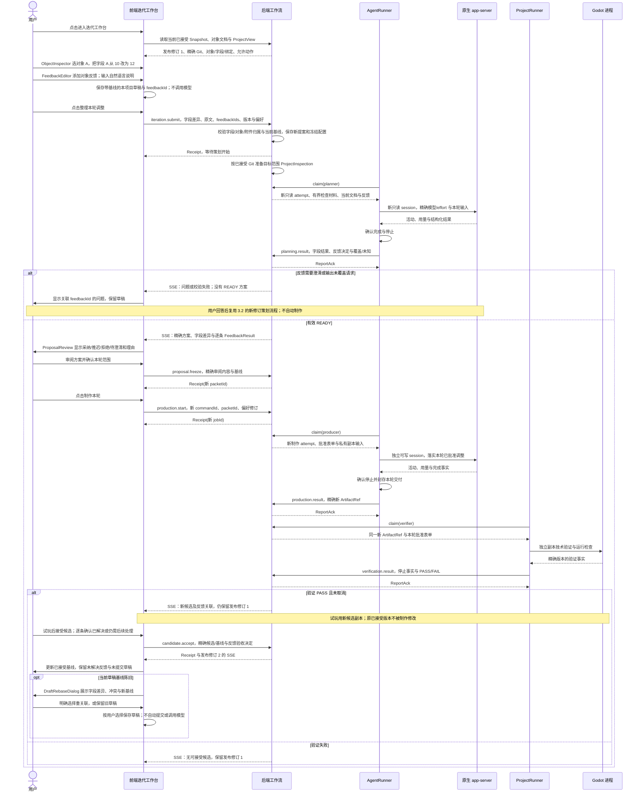
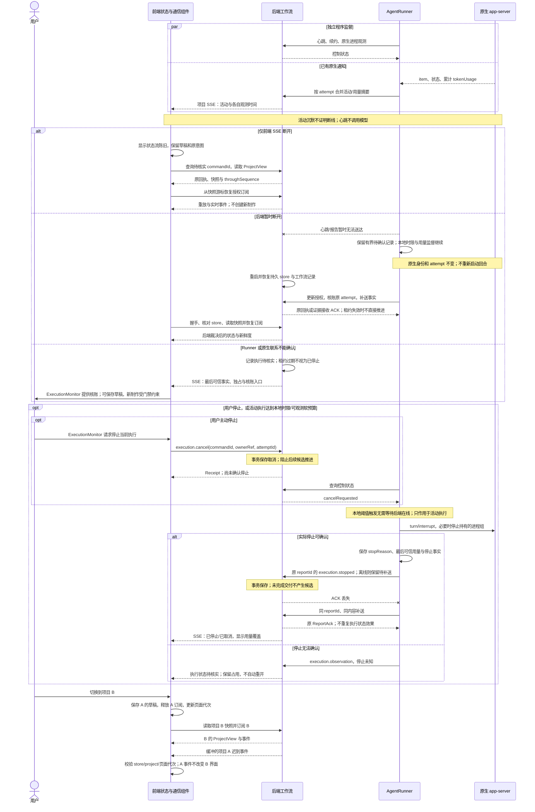

# 工作台用户交互：完整类图、时序与消息示例

日期：2026-10-12。代码基线：`6087e72`。补充[四部分架构](STUDIO-FOUR-PART-ASYNC-ARCHITECTURE.zh-CN.md)、[最终审查](STUDIO-FOUR-PART-FINAL-REVIEW.zh-CN.md)和[Session 参数与持续联系契约](STUDIO-SESSION-PROFILES-AND-LIVENESS.zh-CN.md)。

本图例是[最终修改方案](STUDIO-FINAL-MODIFICATION-PLAN.zh-CN.md)的交互附件；字段及实施顺序以主方案为准。GM 消费/确认仅在后端，inputCommit 与已接受 baseCommit 分开；profile 在接收执行意图时冻结，领取不重新选配置。

状态：拟实施设计。本文补足用户、前端交互组件、后端工作流、原生 Agent 和 Godot 项目之间的完整闭环；图中的类表示职责，可用现有 JavaScript 模块实现，不要求增加框架、服务或数据库。当前前端主要由 StudioApp 与 DraftStore 实现，下面的拆分尚未落地。

阅读路径：[前端类图](#frontend-classes) → [执行与项目类图](#execution-classes) → [项目与参数](#sequence-project) → [只读策划](#sequence-planning) → [制作与验收](#sequence-production) → [对象迭代](#sequence-iteration) → [失联与停止](#sequence-recovery)。

## 1. 前端组件与用户动作

<a id="frontend-classes"></a>

### 1.1 前端交互类图

```mermaid
classDiagram
    direction TB
    class StudioShell {
        +projectKey
        +mountProject()
        +renderAllowedStage()
    }
    class ProjectManager {
        +createOrOpenProject()
        +renameOrArchiveProject()
    }
    class DiscussionPanel {
        +editConceptDraft()
        +submitDiscussion()
        +showAIQuestionsAndUserAnswers()
    }
    class ReferenceTray {
        +uploadProjectReference()
        +selectReferencesForThisRound()
    }
    class ProposalReview {
        +showExactPlanAndDiff()
        +showFeedbackDecisions()
        +confirmReviewedRevision()
    }
    class IterationWorkbench {
        +restoreVersionedDraft()
        +submitObjectAdjustment()
    }
    class ObjectInspector {
        +selectStableObjectId()
        +editDeclaredField()
        +showSourceBindings()
    }
    class FeedbackEditor {
        +addTargetedFeedback()
        +reviewFeedbackDisposition()
    }
    class CandidateReview {
        +openOrStopPreview()
        +acceptOrRejectCandidate()
        +confirmExperienceFeedback()
    }
    class ExecutionMonitor {
        +showAttemptProfileAndEvidence()
        +requestCancelOrReconcile()
    }
    class DraftRebaseDialog {
        +showFieldConflictsAndNewBase()
        +confirmRebaseOrKeepOldDraft()
    }
    class SessionSettings {
        +filterEffortByModel()
        +saveRolePreferences()
        +showFrozenAttemptProfile()
    }
    class StatusBar {
        +showPhaseAndAttention()
        +showExecutionFreshnessAndUsage()
    }
    class ProjectController {
        +forwardTypedUserAction()
        +applyProjectView()
        +guardProjectAndPageGeneration()
    }
    class DraftStore {
        +saveVersionedDraft()
        +savePendingCommand()
        +restoreWithoutResubmitting()
    }
    class StudioTransport {
        +postTypedCommand()
        +queryOriginalReceipt()
        +resumeAuthorizedProjectEvents()
    }
    class ProjectView {
        +storeId
        +projectId
        +phaseAndAttention
        +allowedActions
        +throughSequence
    }
    class WorkflowService {
        +acceptCommand()
        +readProjectView()
        +replayProjectEvents()
    }

    StudioShell *-- ProjectManager
    StudioShell *-- DiscussionPanel
    StudioShell *-- ReferenceTray
    StudioShell *-- ProposalReview
    StudioShell *-- IterationWorkbench
    StudioShell *-- CandidateReview
    StudioShell *-- ExecutionMonitor
    StudioShell *-- DraftRebaseDialog
    StudioShell *-- SessionSettings
    StudioShell *-- StatusBar
    IterationWorkbench *-- ObjectInspector
    IterationWorkbench *-- FeedbackEditor
    StudioShell *-- ProjectController : 各面板的用户动作统一转交
    ProjectController *-- DraftStore
    ProjectController *-- StudioTransport
    ProjectController ..> ProjectView : 应用后端公开投影
    StatusBar ..> ProjectView : 展示业务状态与观测新鲜度
    StudioTransport ..> WorkflowService : HTTP JSON 与授权 SSE
```



各面板只产生用户动作并显示公开投影，由 ProjectController 统一关联项目、草稿与待核实命令。StudioTransport 处理通信；前端不自行裁定批准、原生成功或发布状态。图中没有前端直连 AgentRunner、原生 app-server、后端数据库或可变 Godot 工程的依赖。

### 1.2 组件如何对应现有界面

| 组件 | 用户操作与现有界面入口 | 输出/约束 |
| --- | --- | --- |
| ProjectManager / StudioShell | `#project-manager`、`#project-view`、项目路由 | 项目切换先保存本项目草稿、释放订阅；新页面不保留前项目的方案/作业/附件 |
| DiscussionPanel | `#concept-form`、`#answers-form`、`#questions` | 用户原文和 AI 问题分区；尚未形成方案时不展开 ProposalReview |
| ReferenceTray | `#images`、`#image-list` | 附件归属由后端确认；JSON 引用授权附件，不传任意本机路径 |
| ProposalReview | `#proposal-content`、`#freeze-area` | 显示精确方案、范围、差异与反馈决定；确认绑定该修订 |
| IterationWorkbench / ObjectInspector | `#workbench-panel`、`#object-catalog`、`#dynamic-fields` | 编辑稳定对象 ID 与声明字段；键入和保存草稿不启动 Agent |
| FeedbackEditor | `#feedback-editor`、`#feedback-list` | 为反馈保留稳定 feedbackId、对象、类别和原文；逐条显示处理决定 |
| CandidateReview | `#candidate-area`、`#candidate-preview` | 区分技术验证、试玩与用户接受；技术 PASS 不等于体验反馈已解决 |
| ExecutionMonitor | `#job-panel`、`#cancel-area`、`#reconcile-area` | 展示冻结执行配置、证据和停止事实；取消/核账仍经后端，不直接终止原生进程 |
| DraftRebaseDialog | `#rebase-dialog`、`#rebase-content` | 展示草稿与新基线的字段差异/冲突；用户选择重关联或保留旧草稿，不静默迁移 |
| SessionSettings | 拟新增策划/制作设置区 | 两角色偏好；按模型过滤 effort；运行配置另行只读显示 |
| StatusBar | `#workflow-status-copy`、`#job-panel`；观测明细拟补齐 | 显示下一位行动者、真实步骤、连接新鲜度、用量覆盖与停止状态 |
| ProjectController / StudioTransport | 从现有 StudioApp 内部职责逐步抽取 | 不另建工作流状态机；HTTP 写授权、SSE 游标和回执核查集中处理 |
| DraftStore | 现有 IndexedDB 草稿扩展 | 键至少包含 storeId/projectId、草稿种类、基线修订与 Git 引用；保存不等于提交 |

SessionSettings 是共享组件，按当前阶段显示适用角色。StatusBar 在项目页顶部持续可见。恢复 pending command 时只能查询或按原 ID/原内容重试，不把旧草稿自动变成新的制作请求。

## 2. 执行、协议记录与项目组件

<a id="execution-classes"></a>



跨进程虚线表示协议依赖，内部组合关系不要求独立服务。策划绑定 proposalId/revision，制作与验证绑定 jobId，各自有独立 attemptId。前端偏好、冻结执行配置、原生观测三者分开；后端批准和 Snapshot 不能由 Agent 文本或 Runner 直接改写。原生 stdio JSON-RPC 保持原格式，Godot 源码/资产走受控 Git/文件通道。

## 3. 完整时序与相邻示例

示例统一使用虚构的 store-example、project-example-a，全部模型、Git、原生身份和用量都是占位或说明性数据。它们说明工作台协议，不对应具体游戏案例，也没有发起实际执行。消息类型和字段是拟新增的严格类型化契约，不能直接提交给当前旧接口。命令走各自类型化路由，不增加任意 payload 的通用执行入口。

每个图例给出用户操作、关键消息和应出现的界面反馈。示例只展示选定消息，不是完整网络抓包；略去的事件不能成为客户端跳过 event.sequence 缺口的理由。回执只证明后端已持久接收，不证明原生执行已开始。

<a id="sequence-project"></a>

### 3.1 项目建立、切换、参数与订阅



示例：用户打开项目 A 的初始讨论页，设置策划使用目录中的模型、medium、420 秒和 12000 token 软预算。

```json
{
  "schemaVersion": "studio.message.v1",
  "kind": "command",
  "type": "session.preferences.update",
  "storeId": "store-example",
  "projectId": "project-example-a",
  "commandId": "preferences-planner-example",
  "expected": {"preferencesRevision": 1},
  "payload": {
    "role": "planner",
    "modelKey": "<该执行器目录中的实际模型键>",
    "effort": "medium",
    "limits": {"maxDurationSeconds": 420, "softTotalTokens": 12000}
  }
}
```

```json
{
  "schemaVersion": "studio.message.v1",
  "kind": "receipt",
  "storeId": "store-example",
  "projectId": "project-example-a",
  "commandId": "preferences-planner-example",
  "decision": "accepted",
  "effectRefs": {"preferencesRevision": 2}
}
```

界面显示“策划设置已保存；等待用户提交想法”。尚无初步方案、制作作业或活动模型回合。medium 在本例假设为所选模型支持的值；真实目录不支持时明确拒绝。

<a id="sequence-planning"></a>

### 3.2 初始讨论、只读检查、澄清与方案审阅



示例：用户只提交“希望先明确对象、交互和首轮验证目标”，planner 返回需要确认 MVP 对象范围的问题。

```json
{
  "schemaVersion": "studio.message.v1",
  "kind": "command",
  "type": "concept.submit",
  "storeId": "store-example",
  "projectId": "project-example-a",
  "commandId": "concept-example-01",
  "expected": {"publicationRevision": 0, "sourceCommit": null, "preferencesRevision": 2},
  "payload": {
    "text": "希望先明确对象、交互和首轮验证目标。",
    "assetRefs": [],
    "targetObjectIds": []
  }
}
```

```json
{
  "schemaVersion": "studio.message.v1",
  "kind": "event",
  "type": "planning.changed",
  "storeId": "store-example",
  "projectId": "project-example-a",
  "eventId": "planning-event-example-06",
  "sequence": 6,
  "ownerRef": {"kind": "proposal", "id": "proposal-example-initial", "revision": 1},
  "attemptId": "planner-attempt-example-01",
  "payload": {
    "status": "NEEDS_CLARIFICATION",
    "questions": [{"id": "question-example-mvp", "prompt": "哪些对象必须进入首个 Demo？", "type": "text", "required": true}],
    "planRef": null,
    "attention": "user_feedback"
  }
}
```

用户下一次回答使用新 commandId，但绑定旧提案的当前修订：

```json
{
  "schemaVersion": "studio.message.v1",
  "kind": "command",
  "type": "proposal.revise",
  "storeId": "store-example",
  "projectId": "project-example-a",
  "commandId": "answer-example-01",
  "expected": {
    "proposalRevision": 1,
    "publicationRevision": 0,
    "sourceCommit": null,
    "preferencesRevision": 2
  },
  "payload": {
    "proposalId": "proposal-example-initial",
    "answers": [{"questionId": "question-example-mvp", "text": "首轮仅包含对象 A 和对象 B。"}]
  }
}
```

后端递增为修订 2，创建新的只读 attempt。重送 concept-example-01 只返回原回执，不创建第二个提案。若用户回答后得到 READY，才展开 ProposalReview；“AI 问题已返回”不等于“初步方案已经完成”。参考图片/文档作为输入内容，不改变项目身份、角色权限或派发命令。

<a id="sequence-production"></a>

### 3.3 精确确认、可写制作、独立验证、试玩与接受



示例：用户确认初始方案修订 2，精确审阅引用包含完整文档、任务、反馈决定和范围：

```json
{
  "schemaVersion": "studio.message.v1",
  "kind": "command",
  "type": "proposal.freeze",
  "storeId": "store-example",
  "projectId": "project-example-a",
  "commandId": "freeze-example-01",
  "expected": {"proposalRevision": 2, "publicationRevision": 0, "sourceCommit": null},
  "payload": {
    "proposalId": "proposal-example-initial",
    "reviewedPlanRef": "plan-example-initial-r2"
  }
}
```

reviewedPlanRef 指向后端保存的不可变精确内容，不能指向“最新方案”或任意路径。后端核对真实用户写授权、审阅内容与版本后生成 packet-example-initial-r2；用户另行选择制作设置并点击开始。

```json
{
  "schemaVersion": "studio.message.v1",
  "kind": "command",
  "type": "production.start",
  "storeId": "store-example",
  "projectId": "project-example-a",
  "commandId": "production-example-01",
  "expected": {"publicationRevision": 0, "sourceCommit": null, "preferencesRevision": 3},
  "payload": {"packetId": "packet-example-initial-r2"}
}
```

```json
{
  "schemaVersion": "studio.message.v1",
  "kind": "event",
  "type": "candidate.ready",
  "storeId": "store-example",
  "projectId": "project-example-a",
  "eventId": "candidate-event-example-24",
  "sequence": 24,
  "ownerRef": {"kind": "job", "id": "job-example-01"},
  "attemptId": "verifier-attempt-example-01",
  "payload": {
    "candidateId": "candidate-example-01",
    "artifactRef": "artifact-example-01",
    "sourceCommit": "<source-commit-example-01>",
    "verification": "PASS",
    "attention": "user_acceptance",
    "published": false
  }
}
```

此刻顶部显示“等待用户验收”，已接受版本仍为 0。只有用户 candidate.accept 经后端确认后才成为发布修订 1，并显示“进入迭代工作台”。初始制作的 sourceCommit=null 表示尚无已接受游戏源；可信适配器仍须在该项目内准备、绑定并检查制作输入 Git 基线，不能借用另一项目工程或绕过规格确认。源锁、批准和停止门禁沿用原计划。

<a id="sequence-iteration"></a>

### 3.4 对象编辑、自然语言反馈、再策划与精细验收



示例：用户修改对象 A 的声明字段，并针对同一对象补充自然语言反馈。该例只描述工作台编辑与关联，不预设游戏玩法。

```json
{
  "schemaVersion": "studio.message.v1",
  "kind": "command",
  "type": "iteration.submit",
  "storeId": "store-example",
  "projectId": "project-example-a",
  "commandId": "iteration-example-01",
  "expected": {
    "publicationRevision": 1,
    "sourceCommit": "<source-commit-example-01>",
    "preferencesRevision": 3
  },
  "payload": {
    "text": "请保留其他对象，本轮只调整对象 A，并说明这条反馈如何处理。",
    "targetObjectIds": ["object-example-a"],
    "fields": [{"objectId": "object-example-a", "fieldId": "field-example-a", "value": 12}],
    "feedback": [{
      "feedbackId": "feedback-example-a",
      "objectId": "object-example-a",
      "category": "behavior",
      "message": "希望这个对象的操作反馈更明确。"
    }]
  }
}
```

随后有效策划结果中的一条 FeedbackResult 片段：

```json
{
  "feedbackId": "feedback-example-a",
  "proposalId": "proposal-example-iteration",
  "proposalRevision": 1,
  "disposition": "adopted",
  "reason": "本轮采纳，关联目标对象的反馈表现和验证条件。",
  "taskRefs": ["task-example-feedback-a"],
  "requirementRefs": ["requirement-example-feedback-a"],
  "candidateRef": null,
  "userAcceptance": "pending"
}
```

这是“计划已采纳”的事实，不是“已实现”或“用户认为已解决”。候选形成后关联精确 candidateRef，用户体验验收后才记录对应接受决定。推迟/拒绝的反馈必须有理由，待澄清阻止 READY。字段结果必须精确保留 value=12；只读检查未覆盖的部分明示未知。字段本身若已由现有代码正确读取，制作可以不改游戏源码，不能为了制造 diff 做无关修改。

例如，用户可以接受本轮候选，同时记录一条体验反馈仍需后续调整：

```json
{
  "schemaVersion": "studio.message.v1",
  "kind": "command",
  "type": "candidate.accept",
  "storeId": "store-example",
  "projectId": "project-example-a",
  "commandId": "accept-example-02",
  "expected": {"publicationRevision": 1, "sourceCommit": "<source-commit-example-01>"},
  "payload": {
    "candidateId": "candidate-example-02",
    "sourceCommit": "<source-commit-example-02>",
    "feedbackAcceptance": [{"feedbackId": "feedback-example-a", "decision": "needs_followup"}]
  }
}
```

候选接受和每条反馈的验收结论分别记录；本例更新到发布修订 2，但 feedback-example-a 仍进入后续迭代。后台必须校验反馈属于本项目、此次候选关联和允许的状态，不能由前端任意填写 ID 来解决其他反馈。没有明确提交体验验收决定的反馈，不因整体验收而被默认标记为已解决。

<a id="sequence-recovery"></a>

### 3.5 联系、新鲜度、断线恢复、预算停止与项目切换



示例是 3.4 本轮制作的一种替代结局：job-example-02 还在制作时，原生累计用量报告为 13100，本次软预算是 12000；Runner 请求停止并确认退出。因此该路径没有 candidate-example-02 或发布修订 2。超过数值用于说明延迟，不是可保证的超额范围。

```json
{
  "schemaVersion": "studio.message.v1",
  "kind": "report",
  "type": "execution.stopped",
  "storeId": "store-example",
  "projectId": "project-example-a",
  "ownerRef": {"kind": "job", "id": "job-example-02"},
  "attemptId": "producer-attempt-example-02",
  "reportId": "stop-report-example-01",
  "payload": {
    "stopReason": "soft_token_budget",
    "terminationConfirmed": true,
    "nativeRef": {"threadId": "thread-example-production-02", "turnId": "turn-example-production-02"},
    "usage": {
      "source": "thread/tokenUsage/updated",
      "coverage": "native_thread",
      "totalTokens": 13100
    },
    "artifactRef": null,
    "deliveryComplete": false
  }
}
```

```json
{
  "schemaVersion": "studio.message.v1",
  "kind": "report_ack",
  "storeId": "store-example",
  "projectId": "project-example-a",
  "reportId": "stop-report-example-01",
  "disposition": "recorded",
  "effectRefs": {"candidateId": null}
}
```

界面显示“本轮因软预算停止；没有可验收候选”。后端失联时该报告先留在 Runner，本地监督继续；补送 ACK 若仅确认“证据已保存”，需沿既有核账规则裁决，不能换 reportId 绕过租约或取消门禁。无法确认停止时不能显示“已停止”。用量缺失为 null/未知，不能假定为零；累计快照不能逐次相加，主线程统计不自动包含其他模型工具。

软预算没有原生硬 token 上限的保证。已完成后的可信用量补报仅更新记账，不重新启动执行，也不自动撤销已接受版本。用户取消与完成结果按后端事务顺序裁决：取消先提交则结果只留证据；结果先提交且已进入验证则取消当前验证；已发布版本不被取消执行撤销。

## 4. 图、示例和功能充分性核对

| 检查项 | 覆盖位置 | 必须保留的边界 |
| --- | --- | --- |
| 用户交互前端 | 1.1、1.2；所有时序均包含用户 | 组件是界面职责，动作统一经后端，不额外建业务服务 |
| 项目管理与首次进入 | 3.1 | 新项目空状态；归属检查与旧订阅释放；创建前尚无 projectId |
| 用户/AI 来源与逐步展开 | 3.2 | 问题与用户回答分区；READY 才显示方案，未自动批准 |
| 精确只读项目检查 | 3.2、3.4 | 绑定 Git 与覆盖范围；检查不执行工程，不读取另一项目 |
| 参数定义、保存与冻结 | 3.1、3.3 | 模型目录校验；两角色偏好；只影响后续 attempt |
| 制作、验证、试玩、接受 | 3.3 | 独立副本；停止后封存；精确验证；用户接受后发布 |
| 持续精细调整与反馈 | 3.4 | 稳定对象/字段/反馈身份；原文、处理决定、实现与体验验收分开 |
| 心跳、断线、预算、停止 | 3.5 | 程序观测；未知不伪装成功；不重复启动或循环调用模型 |
| 回执和补送顺序 | 3.1、3.2、3.5 | 授权/类型/归属后先查原命令/报告，再检查新基线/租约 |
| 跨项目与迟到消息 | 3.1、3.5 | store/project/页面代次、提案修订及执行身份共同防止串扰 |

每条 mutation/report 均有持久回执或 ACK；图中重复路径省略了部分相同 ACK，但不是允许省略实现确认。事件提交与业务状态、回执同事务；SSE 保活不是项目业务事件。工作流阶段与行动者仍由后端现有记录产生，前端只增加展示与通信职责。

已完成机械检查：本文 13 个 JSON 示例严格解析通过，无重复键和非标准常量；每张时序图后都有对应示例；本地链接/锚点、代码围栏、5 张时序图的参与者和分支、2 张类图的引用与括号一致。相关五份文档共核对 19 个 JSON 示例、9 张时序图、5 张类图与 20 个本地链接；这些是源码结构检查，没有验证 Mermaid 图形渲染。

本轮只补充设计、图与虚构消息示例，没有改动工作台运行代码或启动真实 Agent/Godot。图的结构检查与协议实现验收分开。
