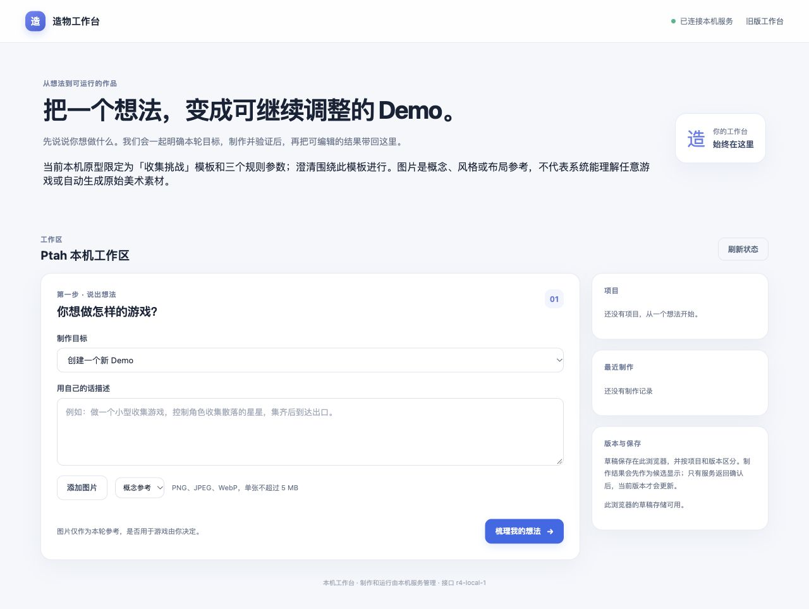
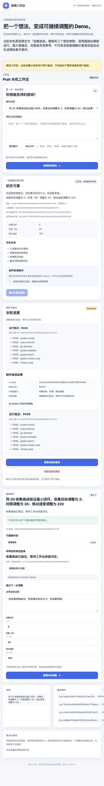
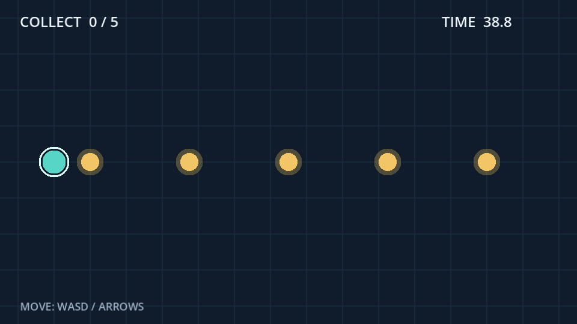

# Ptah 工作台用户说明书

本文面向使用本机 Studio 工作台提出游戏概念、确认制作范围、审阅 Demo 并继续迭代的用户。部署者安装和维护服务请参阅[部署与运维手册](DEPLOYMENT-MANUAL.zh-CN.md)；这里说明用户在页面中的操作以及每个决定的含义。

文档日期：2026-10-09。适用工作流：`r4-local-1`，实现基准：`13b3a03`。[返回说明书入口](README.zh-CN.md)。

## 阅读导航

| 需要完成的事 | 章节 |
| --- | --- |
| 了解当前可以制作什么 | [先了解工作台能做什么](#先了解工作台能做什么) |
| 从概念开始制作 | [新建 Demo](#新建-demo先准备工程再制作玩法) |
| 查看报告、体验和接受结果 | [审阅候选](#审阅候选运行预览与决定) |
| 修改当前版本 | [继续迭代已有项目](#继续迭代已有项目) |
| 恢复草稿和冻结表单 | [草稿、冻结表单与版本重关联](#草稿冻结表单与版本重关联) |
| 理解进度或处理故障 | [状态与下一步](#状态与下一步)、[取消与故障](#取消对账与常见故障) |

## 先了解工作台能做什么

当前版本是一个本机工作流原型，能制作并迭代一种受控的 2D「收集挑战」：使用方向键或 WASD 移动，收集全部目标获胜，倒计时结束失败，按 R 重试。可调整的规则只有收集目标数量、时限和移动速度。系统会围绕这些已声明能力提出固定的结构化问题。

这不是可自由设计任意游戏的通用 grill 访谈或通用游戏生成器。新的题材、关卡、额外机制和美术生产需要后续增加适配器。若想法超出当前范围，页面会让你明确选择暂停；系统会保留原始描述，不会偷偷把它改写成收集游戏。

工作台里的「版本」是后端已发布的项目快照：其中 Git 源版本、可编辑规则、语义清单和运行验证报告绑定在一起。可玩的制作结果先作为候选，由正式工作区用户接受后更新当前发布修订。新项目的工程准备基线有一个例外：用户确认初始化范围后，初始化验证成功会自动发布这个不可玩的基线，再返回单独的玩法提案。

界面图片说明：

上图展示正式工作台的初始页面，不代表已有游戏通过生产验收。

上图来自隔离的测试工作区。画面中的候选与测试决定只证明界面流程，不是生产批准或真实用户验收。

上图是候选游戏的运行截图，用于展示当前模板，不表示任意用户游戏都已完成。

## 开始使用

工作台地址通常是 `http://127.0.0.1:8765/studio/`。打开后应看到“造物工作台”和“已连接本机服务”。如果提示“服务能力尚未就绪”或页面无法连接，请先联系本机部署者；这时页面不会假装已经创建提案、制作或验证结果。部署步骤见[部署与运维手册](DEPLOYMENT-MANUAL.zh-CN.md)。

留意页面顶部的“测试工作区”横幅。出现横幅表示当前确认和发布仅用于测试，不构成生产授权或真实用户验收。测试候选按钮也会明确写成“接受此测试候选”。如你要对真实游戏作决定，先让部署者确认连接的是生产工作区；不要把测试页面中的接受当成游戏批准。

在右侧可查看“项目”和“最近制作”。“版本与保存”会说明草稿保存在此浏览器，并按项目和版本区分。它不是云同步，也不保证在其他浏览器或设备出现。

## 新建 Demo：先准备工程，再制作玩法

新项目有两个独立确认阶段。第一个阶段只准备工程并验证基础，不会产出可玩的游戏；准备快照返回后，页面再提供玩法表单，需再次核对确认才开始制作 Demo。

### 1. 提交文字概念或图片

在“制作目标”选择“创建一个新 Demo”。在“用自己的话描述”写下你想验证的核心体验，然后点“梳理我的想法”。这个输入框最多 5,000 字。建议只描述本轮要验证的主要动作、目标和结束条件。

例如：

> 做一个小型收集游戏，玩家控制角色收集散落的星星，收集完成后获胜。先验证移动、收集、限时和重试是否有趣。

也可以先在图片用途下拉框选择“概念参考”“风格参考”“布局参考”或“素材输入”，再点“添加图片”；本次选择的图片采用该用途。需要另一种用途时，切换下拉框后再添加。当前限制是每轮最多六张，每张不超过 5 MiB，格式仅限 PNG、JPEG、WebP。服务还会验证图像数据及尺寸。图片会作为参考输入传给制作 session；**上传图片不会自动生成或导入游戏美术素材**。若需求依赖实际美术生产，应暂停并等待对应适配器。

单张图片的像素总数不能超过 1,600 万。虽然服务在本机运行，制作时 Codex 会使用当前部署配置的模型提供方；使用远端模型时，概念、表单与参考图会送入该模型服务。部署者可以说明当前使用的提供方。

图片与概念一起提交后，该轮图片会绑定到提案。若提案被拒绝或你改为另一个概念，检查页面当前显示的图片列表，确认新提案绑定的是你想使用的图片。

### 2. 回答模板澄清

“初步方案”区域会显示提案摘要和“需要补充信息”状态。新项目会询问是否用“2D 收集挑战：移动、收集、胜负和重试”验证概念；同时确认三个规则值。有图片时还会问是否将图片仅作为参考。

每个问题提供固定选项，旁边也会显示“也可以用自己的话回答”的输入框。当前后端对范围问题只接受固定选项，对参数只接受明确数字。范围问题请使用下拉框，并将旁边的文字框留空；需要不同参数值时，在该题文字框只填写数字，例如 `5`、`60`、`220`。随意填写“愿意”或“更快一点”等句子会被拒绝，而且非空文字会覆盖下拉选择。

回答后点“提交回答”。每次回答会更新方案修订；若页面提示方案已更新，请刷新并重新核对当前修订。

新项目常见回答是：

| 问题主题 | 示例选择 |
| --- | --- |
| 是否采用收集挑战 | 采用收集挑战验证 |
| 图片如何使用 | 保留为参考 |
| 收集目标 | 接受建议值，或在文字框输入 1–8 的整数，例如 `5` |
| 时限 | 10–300 秒之间 |
| 移动速度 | 60–400 像素/秒之间 |

如果你的关键玩法不在选项里，选择“保留其他玩法，暂停制作”。提案会显示“服务状态：BLOCKED”，原始概念仍保留，本轮不会派发制作。

### 3. 核对并确认工程初始化

问题回答齐全后，状态变为“方案待确认”。在“制作前请核对”阅读“本轮目标”、模板范围、参数、Git 基线和验收条件。新工程第一次确认只授权准备工程，页面会说明“初始化通过后才制作玩法”。勾选“我已阅读并确认上面的方案和制作范围”，再点“确认方案并继续”。

确认后，本轮表单被冻结并发送给单独的初始化 session。刷新页面后可恢复原表单；如需续跑，按钮“恢复并继续此制作表单”沿用相同的表单编号，不会新建另一份确认。

### 4. 等待初始化验证，再确认玩法提案

在“制作与验证”查看初始化进度。初始化通过后，当前工作台会显示已验证的工程准备基线，并明确提醒“尚不包含可玩的 MVP”。此时页面会返回新的玩法提案，供你单独确认。

阅读玩法提案和冻结前表单，确认规则值、制作范围及验收条件，再勾选确认并继续。这次确认才授权玩法实现。该制作 session 的范围受限于模板，制作后由独立验证器运行 Godot 检查。

## 审阅候选、运行预览与决定

候选完成验证后，状态会变为“等待你审阅”。查看“制作候选结果”中的 Git 版本、映射状态、可编辑能力、变更摘要和“运行验证”证据。只有出现候选并通过服务检查，才会提供“在 Godot 中运行此候选”。该按钮请求本机 Godot 从候选版本启动预览；预览便于你亲自体验，不会接受或发布版本。

同一时间只允许一个本机预览。先关闭现有 Godot 预览窗口，再启动另一个；单次预览最多运行 15 分钟，到时会自动关闭，需要时可重新打开。游戏中用方向键或 WASD 移动；获胜或失败后按 R 重试。

检查候选是否符合本轮确认的范围，并实际体验移动、收集、获胜、失败与重试。随后在正式工作区选择：

- **接受并发布此版本**：记录你的决定，将候选 Git 源版本、规则清单和验证报告作为新的完整发布快照；之后“当前工作台”显示更新的版本号。
- **拒绝此候选**：记录拒绝，保留原发布快照。你可以在原版本基础上重新整理调整并提交新提案。

点击后浏览器还会要求确认一次。若项目版本在你审阅期间已变化，服务会拒绝过期决定并要求刷新后重新审阅。候选源文件若在验证后发生变化，也不能直接发布。

“接受并发布”表示你接受这个候选成为当前工作台版本；不表示游戏已导出、签名、上架，也不代表完整 GM 发行认证。Godot 自动验证通过是技术证据，不等于你的体验验收；反过来，模型 session 显示完成也不等于验证通过。

## 继续迭代已有项目

在“制作目标”选择已有项目。查看“当前工作台”的版本号和摘要，确认编辑的是正确项目和基线。只有项目明确声明支持的字段才会启用。

“提出下一步调整”提供“自然语言说明”以及可用的“收集目标”“时限（秒）”“移动速度”字段。自然语言框上限 3,000 字。每个参数均有项目能力声明的范围；当前收集挑战范围为目标 1–8、时限 10–300 秒、速度 60–400 像素/秒。

当前迭代区以**非空数值框的值作为最终参数**。提交时页面会在自然语言后附上这些值，因此如果文字写“移动速度调整为 300”，而速度框仍是 `220`，方案中的速度仍会是 `220`。请把对应数值框同步改为目标值，并在确认页核对。

一个可照做的例子：

1. 把“移动速度”数值框改为 `300`。
2. 保留“收集目标”和“时限（秒）”数值框的原值。
3. 在文字框写“仅调整移动手感，其余规则保持不变。”，或留空。
4. 点“整理本轮调整”，在返回提案中确认移动速度为 `300`。

也可把明确数字写在顶部“用自己的话描述”概念框中，选择已有项目后点“梳理我的想法”；该入口不会附加下面迭代区数值。例如写“移动速度调整为 300”。无论使用哪个入口，都以随后澄清和确认的数值为准。当前只解析部分带字段名和数字的表达，模糊的“更快一点”不会自动推导数值。

后续仍要回答结构化范围问题、核对提案、确认冻结表单、等待独立验证，最后审阅候选并决定接受或拒绝。自然语言输入不会扩大服务器声明的项目能力；本轮不支持的要求会保留并要求暂停。参数不可编辑时，说明该项目没有声明对应能力。

## 草稿、冻结表单与版本重关联

### 草稿保存

工作台会把迭代区文字和参数草稿保存在当前浏览器，并按项目 ID 与发布版本区分。草稿状态会显示保存修订号。草稿不等于已提交提案或已冻结制作表单；关闭浏览器、清理站点数据、浏览器存储不可用或改用另一台设备，可能无法恢复草稿。重要输入可先在自己的安全位置备份。

### 冻结表单恢复

冻结表单是服务端保存的本轮制作意图。刷新页面时，页面会恢复未完成提案、冻结表单及相关作业。恢复时使用同一表单 ID 和幂等派发意图；遇到网络错误时重新读取工作区，按页面的恢复按钮继续，不要通过重复创建项目来绕过状态。

### 新版本后的草稿重关联

当新发布版本出现，而当前项目仍有旧版本草稿时，工作台会打开“检查草稿重关联”。页面显示旧、新基线及自然语言和参数预览，并标记与新版本值不同、需要人工核对的参数。你可以点“保留旧草稿”，或在确认内容后点“预览后更新草稿基线”。

重关联只复制草稿到新版本的草稿基线并标记为待核对，不会提交制作、覆盖新版本或发布内容。确认前旧草稿和当前发布版本都不改变。完成重关联后，继续提交迭代前请再次核对草稿参数和文字。

新版本先显示新版本自己的参数，旧草稿需要你检查预览并明确确认后才应用。对话框尚未处理时，系统会阻止提交迭代。若旧草稿在预览后又发生变化，页面会更新预览并要求重新确认；本地存储不可用时只能在当前页面内重关联，刷新后可能丢失。

## 状态与下一步

| 页面状态 | 含义 | 建议操作 |
| --- | --- | --- |
| 需要补充信息 | 澄清问题尚未回答完 | 完成当前问题，再点“提交回答” |
| 方案待确认 | 服务已整理本轮方案 | 阅读方案和制作范围，确认后冻结 |
| 服务状态：BLOCKED | 提案选择了暂停或超出模板范围 | 保留原意；重新整理受支持范围或等待新适配器 |
| 排队中 / 准备制作 | 作业已登记，服务正在准备隔离工程 | 等待页面刷新进度 |
| 制作中 | 制作 session 正在执行 | 等待；确需停止时点“请求取消” |
| 运行验证 | 独立 Godot 验证正在运行 | 等待验证报告，不把 session 完成当作通过 |
| 整理结果 | 服务正在整理候选和证据 | 等待结果，不要重复提交表单 |
| 等待你审阅 | 候选已形成，等待用户体验和决定 | 阅读报告，可运行预览，然后接受或拒绝 |
| 已发布 | 候选已被接受并成为新快照，或初始化快照已完成 | 查看当前工作台版本；新项目初始化后仍需确认玩法提案 |
| 已拒绝 | 用户拒绝候选，原已发布版本仍有效 | 从当前版本重新提出调整 |
| 制作失败 | 制作或验证没有成功形成可接受候选 | 查看错误和验证证据；修正范围/输入后再提交新提案 |
| 暂时受阻 | 当前服务能力或确认条件不足，未能安全派发 | 按提示联系部署者或暂停超范围概念 |
| 状态待核实 | 服务重启或执行结果不确定，无法证明原进程已停止 | 点“向服务对账此作业”；不要重复派发 |
| 正在请求取消 / 正在停止 | 服务正在停止受管进程 | 等待“已取消”等明确结果；项目停止确认前仍被占用 |
| 已取消 | 作业已确认停止，没有发布结果 | 检查当前版本后再决定是否重新提案 |

“已发布”会出现在新项目初始化完成的阶段。请看当前工作台中的快照类型和提示：如果显示工程准备基线，它还不是可玩的 MVP。

## 取消、对账与常见故障

### 请求取消

对仍在排队、制作或验证的作业点“请求取消”。这只是发出停止请求；服务要确认整个受管执行进程组退出后，才会解除项目独占。候选待审阅时取消会撤销该候选，不发布它。等待状态更新，不要通过启动第二个作业来“重试”。

### 状态待核实

服务重启后，如果不能确认制作或验证已停止，作业会显示“状态待核实”。点“向服务对账此作业”只能查询服务保存的租约和进程组，不会自动重派或杀死其他进程。如果仍有进程、租约信息不完整或系统无法观察进程状态，项目会继续受阻。请保留项目并联系本机部署者处理；不要删除工作区数据、改写作业状态或手动清理不认识的进程。

### 页面无法连接或功能不可用

点“重新连接”或“刷新状态”。若页面提示能力未就绪，工作台会暂停制作入口；联系部署者检查本机服务与能力状态。未就绪时浏览器不会模拟成功结果。

### 图片被拒绝

确认每张图片是有效 PNG、JPEG 或 WebP，单张不超过 5 MiB，每个提案不超过六张。重新导出为受支持格式后再添加。选择“素材输入”只是声明图片用途，不保证系统会把图片导入游戏。

### 确认时提示基线变化

如果发布版本或方案修订在审阅期间发生变化，服务会阻止旧表单冻结或旧候选决定。刷新状态，检查最新版本、重新阅读方案，再确认。不要沿用过期截图中的范围或版本号。

### 验证失败或制作失败

展开“运行验证”证据，查看第一条失败诊断。失败候选不会成为当前发布快照。若改动目标仍在支持范围内，从当前版本重新输入调整；若失败原因不清楚，保留作业 ID 并联系部署者。

模型回合也可能已经结束，却没有实际修改授权文件。后端会拒绝这样的结果；页面没有候选和发布更新是预期保护。不要把模型回复“完成”当成文件改动证据。

## 正式批准、自动验证与测试数据

流程中有几个不同决定，需分别理解：

1. “确认方案并继续”是用户对本轮冻结制作范围的明确确认。
2. 独立 Godot 验证是服务对指定候选执行的自动技术检查。
3. “接受并发布此版本”是用户审阅和体验候选后对该版本的接受决定。

这三者不能互相替代。模型回合完成不代表 Godot 验证通过；自动测试中的合成接受也不代表真实用户已批准。测试工作区顶部有横幅，按钮带“测试”字样，记录属于测试数据。正式候选批准必须由用户在正式工作台实际操作。

## 明确的能力边界

- 当前只制作受控的 2D 收集挑战模板，不支持通过自由文字要求任意题材、关卡或额外玩法。
- 澄清是模板驱动的固定结构化问题，不是开放式、无限轮次的通用 grill 访谈。
- 当前仅有三个受控规则参数：收集目标、时限、移动速度。
- 图片有用途和数量/大小限制，可作为参考输入；不会因上传而自动成为游戏美术。
- 项目快照是本机工作台的发布版本，不是导出包、安装包、签名版本或已对外发布的游戏。
- 自动验证覆盖当前模板和约定闭环，不等同于完整 GM 发行认证，也不代替用户体验验收。

## 相关文档

- [部署与运维手册](DEPLOYMENT-MANUAL.zh-CN.md)：安装、启动、健康检查、存储、备份和故障升级。
- [后端工作台说明](../backend/README.zh-CN.md)：当前技术能力、状态恢复与本机运行范围。
- [工作流实施与验证记录](WORKFLOW-IMPLEMENTATION.zh-CN.md)：实施证据及其测试范围。
