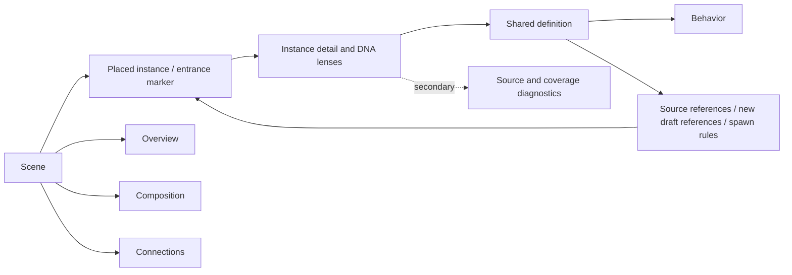
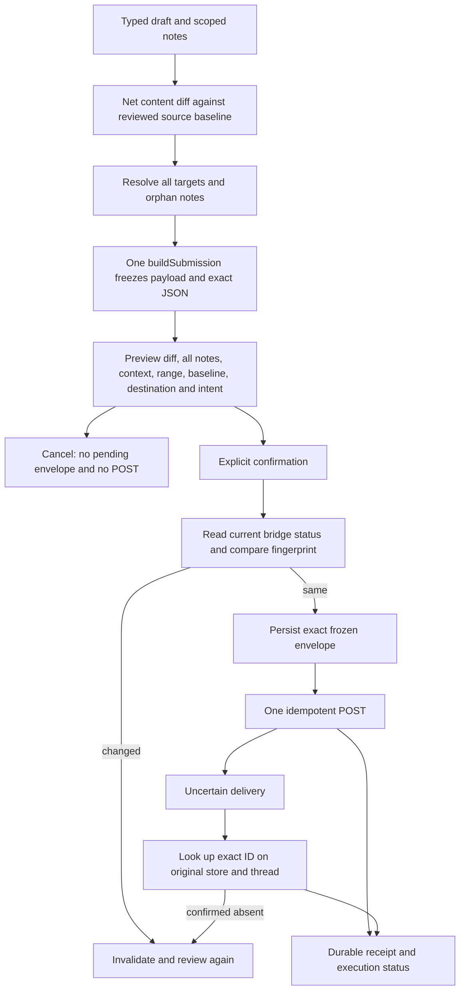
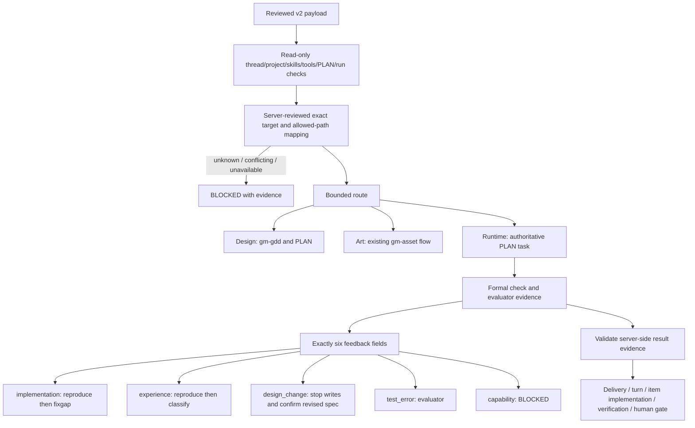

# Reviewed navigation and submission workflow

## A. Navigation and editing

There is one explicit current target shared by selection, breadcrumbs, inspector
and note scope. DNA is three views of the same target, not three data stores.
Browsing existing targets never places an object. New placement has a separate
entry, preview state and cancellation. Name/ID search and browser history use
stable target references. Existing note IDs are retained; room ID plus draft
object ID maps explicitly to catalog records. Colons inside an entrance ID are
not parsed as structural separators.

Definition usage separates immutable source placements, new browser-only draft
references, and runtime spawn rules. A source record removed from the draft stays
visible as removed; it is never silently reassigned to a different instance.

## A. Submission

Revision is an audit counter, not proof of a change. Edit/revert and edit/undo
can have zero net diff. Navigation and theme changes preserve a preview; content,
notes, version, scope, execution intent, source baseline or destination changes
require a new preview. Notes-only submissions are allowed; truly empty ones are
blocked. Deleted-target notes must be explicitly moved or removed. No automatic
resend, source re-extraction, result application or replacement of newer drafts.

V1 remains compatible. V2 is separately negotiated and adds explicit resolved
targets, diff, allowed execution scope, execution intent and PLAN/tag/mechanism
references. Full snapshot context never means permission to change all of it.

## B. GM adapter boundary

PLAN and GAP remain GM's authority. The adapter introduces no new planner,
project task database, or graph. Its target-map file is an adapter mapping, not a
replacement task model. Unknown mappings must be reviewed against the bound
project; IDs are not inferred from names, prose or sample data.

Human confirmation follows the real phase: specification before dependent
implementation; run acceptance after experience verification; feedback resolution
after a verified repair. Existing exact valid confirmations may be reused.
Neither Submit, an agent message, a fabricated actor field nor simulated TTY input
is a human confirmation. Only a real needed phase yields needs_human.

A completed turn is not proof of source edits, item completion or a game test.
Formal verification uses GM check run/report provenance; smoke, play, browser
simulation and source inspection are not substitutes. Results never overwrite
post-submission drafts or silently adopt a different source baseline.

## Validation scope

The private Site is deliberately a browser-local demo. It can exercise preview,
selection, notes and receipt recovery but does not call an agent, connect a local
bridge, run Godot or change project files. The local source package includes the
real loopback bridge and fail-closed GM contract; live capabilities and evidence
must be established on the explicitly bound local project/thread.
